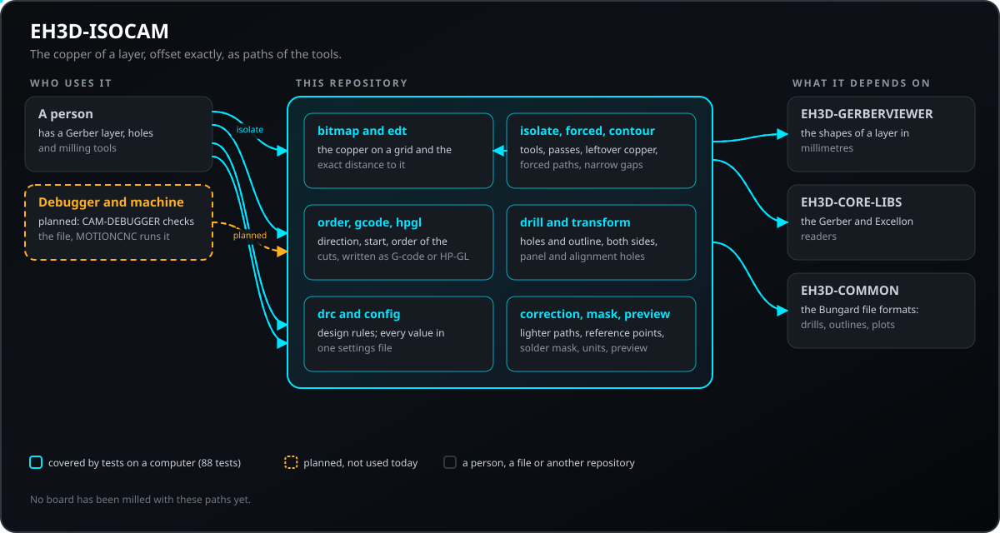
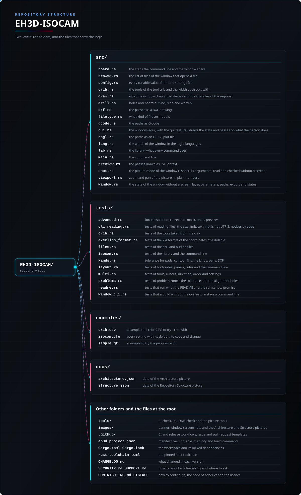

<p align="center">
  
</p>

#  EH3D-ISOCAM
<p align="center">🇺🇸 <b>English</b> | <a href="README_spa.md">🇪🇸 Español</a> | <a href="README_fra.md">🇫🇷 Français</a> | <a href="README_ita.md">🇮🇹 Italiano</a> | <a href="README_deu.md">🇩🇪 Deutsch</a> | <a href="README_zho.md">🇨🇳 中文</a> | <a href="README_jpn.md">🇯🇵 日本語</a> | <a href="README_por.md">🇵🇹 Português</a></p>

### Isolation milling of copper from a Gerber layer: exact offsets, several passes and gap checks

<p align="center">
  
  
  
  
  
</p>

---

**Honesty check - what actually runs today:** a Rust library and a command line program (`eh3d-isocam`) with 323 tests that run on a computer: traces the paths of one or several milling tools around the copper of a Gerber layer, clears the leftover copper, chooses the direction, the starting points and the order of the cuts, reads and writes drill files and board outlines, lays a board out for both sides and for a panel, checks the design rules and writes G-code or HP-GL. It has a window (built with `--features gui`) that opens a layer, a drill file, an outline, a mask layer and a table of reference points, turns the board over and repeats it on a panel, draws the copper, the holes, the outline and the paths and writes the same files as the command line, but the window has not been looked at on a screen yet; it has not been tried on a machine and it has not been checked against a collection of real files.

---

> **Safety and security status:** this program does not control any machine and is not a safety system. What it produces must be checked by a person before anything is run on a machine; nothing here has run on real hardware.


## 📋 At a glance

| | |
|---|---|
| Version | `0.0.8` |
| Maturity | Scaffolding |
| Tests | 323 |
| Stack | Rust |
| On real hardware | Not tried: nothing here has run on a machine |

**Jump to:** [Overview](#-overview) · [Architecture](#-architecture) · [Quick start](#-quick-start) · [Testing](#-testing) · [Structure](#-repository-structure) · [Related](#-related-projects)

## 🚦 Project status

Each line is one part of this repository and the light says how far it is today. It is written from what the repository can show (tests, builds, runs), not from what is planned.

🟢 Done and verified · 🟡 Works, with known limits · 🟠 Partly done or not verified yet · 🔴 Not done or not working

| Area | State | What it means here |
|---|---|---|
| Core | 🟡 | traces the paths of one or several milling tools around the copper of a Gerber layer, clears the leftover copper, chooses the direction, the starting points and the order of the cuts, reports the gaps that are too narrow for the tool and writes G-code or HP-GL; tested on a computer with normal and damaged input, not with a collection of real files. |
| Files and layout | 🟡 | reads and writes drill files and board outlines, lays a board out for both sides and for a panel, adds alignment holes and checks the design rules with the place of every finding; tested on a computer, not with files written by other programs and not on a machine. |
| Forced isolation, correction, mask | 🟡 | forced paths along the gaps the tool does not fit in, lighter paths, scale and correction from reference points, the solder mask openings, units and the preview of the passes; tested on a computer with generated layers and damaged input, never with real boards, never on a machine, and the correction has not been compared with real measurements of a camera. |
| Command line | 🟡 | `eh3d-isocam` runs the same functions as the library and prints the result; every error comes back as a message and a non-zero exit code. |
| Tests | 🟡 | 323 tests pass (`cargo test`), with normal cases, edge cases and damaged input. |
| Security | 🟡 | Plain safe Rust (`forbid(unsafe_code)`): nothing panics on the files it is given and a bad value is an error with its reason; no independent review. |
| Window | 🟠 | Written (egui, `--features gui`): open or drop a layer, zoom and pan, edit the main parameters, export; its logic is tested, but it has not been built or looked at on a screen yet. |
| Real hardware | 🔴 | Not tried: nothing here has been run on a machine. |
| Documentation | 🟡 | README in eight languages, the changelog and the two pictures drawn from `docs/`. |

## 🎯 Overview

* **The copper on a grid** (`bitmap`): pads (round, rectangular, obround), tracks and regions are drawn on cells of the size you choose; overlapping tracks and pads are one piece because a grid has no overlaps, so no special case is needed; a grid that would not fit in memory is refused.
* **The exact distance** (`eh3d-raster`): the distance from every cell to the nearest copper is worked out exactly (and tested against a brute force), and the path of a pass is the line where it equals the radius of the tool, traced as closed polylines and made lighter with a tolerance of half a cell; further passes go one stepover farther each.
* **What the tool cannot do** (`isolate`): where two separate pieces of copper are closer than the width of the tool, no path can go between them: `check` lists those places, and `isolate` does not write the G-code until they are looked at (or `--force`). The G-code (`src/gcode.rs`) lifts the tool between paths, goes down to the depth chosen and cuts the nearest path next.
* **HP-GL for the Bungard machines** (`src/hpgl.rs`): with an output file that ends in `.plt` the passes are written as an HP-GL plot file at 40 units to the millimetre, one pen for each pass, which is what the routing program of the Bungard machines reads.
* **Several tools and leftover copper** (`isolate`): a plan has up to four tools and the widest cuts first; where a wider tool has already cut along a path of a narrower one, that stretch is left out (the rest stays as open runs), and rings of a wider tool, each overlapping the one before, can clear the copper that is left beyond the passes; the G-code stops for a tool change when the width of the tool changes. With `around_pads_min_mm` above 0 the wider tools cut only the rings round pads at least that wide and the narrowest tool does the rest (tracks and small pads).
* **Direction, start and order** (`order`): the paths are traced with the copper on the right of the tool (climb milling with a spindle that turns clockwise); the settings can turn that round (conventional), force clockwise or counterclockwise, start each closed path at its nearest point, its lowest point or where it was traced, set the point the tool starts from and put the paths in the order they were traced, nearest first, or shortened further by turning stretches of the order round; `info` shows how many paths go each way and the travel through the air.
* **Holes and board outline** (`src/drill.rs`): drill files are read (Bungard files in mils with the reader of the Bungard formats, metric files with the reader of the suite) and written in whole mils; an outline is read from a Gerber outline layer, a DXF drawing or an HP-GL plot file, strokes drawn one by one are joined, and the path of the tool round the board and inside its cutouts is written as HP-GL or as a routing Excellon file. A drill file with tools numbered above 255 gets them renumbered to free numbers, with a notice, so two tools never become one. With `--excellon-format 2.4` (or `excellon_format = 2.4`) the coordinates of a drill file are read and written as two digits before the point and four after (`X012340` is 1.2340 in), with the zeros as the header says; a file that states its own format keeps it. The routing Excellon file of `route` is written in the same format.
* **Both sides, panels and alignment holes** (`transform`): the layer, the holes and the outline are turned over, turned by quarter turns and repeated on a panel together; alignment holes are put outside the board where the turned-over board finds them again (a third one on the line tells it from the same board turned half a turn).
* **Design rules** (`drc`): copper narrower than the rule, pieces of copper closer than the rule or than the tool is wide, and holes with less copper round them than the rule, each with its place in millimetres.
* **One settings file** (`src/config.rs`): every value that can be tuned is a setting with a default, read from a `key = value` file (`examples/isocam.cfg`) or given by the same name as an option of the command line.
* **Forced isolation** (`forced`): with `forced_isolation = yes` a path is also laid along the middle of every gap that the finest tool does not fit in, as long as the gap is not narrower than `forced_min_gap_mm`; each place is reported with its coordinates and its gap, and the gaps that are narrower are listed and left alone. It is off by default: then these places are only reported.
* **Problem zones, tolerance and alignment distance** (`problems`, `src/config.rs`): `check` also lists, as warnings that do not stop anything, the inner corners sharper than `problem_corner_angle_deg` (a round tool leaves copper in the tip of a notch; 60 degrees by default, 0 switches it off) and the tracks that run between two pads nearer to them than `problem_track_gap_factor` times the tool (1.5 by default, 0 switches it off); both criteria are settings, not fixed in the code. `conflict_tolerance_mm` (0 by default: no gap is accepted) accepts the gaps that are narrower than the tool by at most that much, in `check` and in `isolate`. The distance of the alignment holes from the board is `alignment_margin_mm` (5 mm by default; other programs of this kind put them 10 mm away, which is `alignment_margin_mm = 10`).
* **Bridges, nets, hole patterns and area clearing** (`src/drill.rs`, `isolate`, `transform`, `problems`, `legacy`): `route` can leave bridges that hold the board in the sheet (`tab_count` for each closed path, 0 by default; `tab_width_mm` of material left; `tab_min_length_mm` between bridges): the cut stops half a bridge and half a tool short of the middle of each bridge. `isolate --net X,Y` isolates only the net that holds a point, with the tool `net_tool_mm`. `rubout-area OUT --area X0,Y0,X1,Y1` writes parallel lines of the tool `rubout_lines_tool_mm` (direction `rubout_lines_direction`) that clear an area. The alignment holes can be 2, 3 or 6, outside the board or, with `alignment_pattern = special`, in a pattern about its middle (`alignment_special_a_mm` apart for the pair, `alignment_special_b_mm` for the four more). With a conflict tolerance, `check` and `isolate` warn about the tracks and rectangular pads thinner than twice the tolerance plus `tolerance_warning_margin_mm`. The guess of the format of an old-style Gerber layer now uses the units the file states and the size of the board, and a list of apertures may give both sides in one cell (`60x40`).
* **Tolerance for pads, filling by contours, kind of file, DXF and plotter pens** (`tolerance`, `fill`, `src/filetype.rs`, `src/dxf.rs`, `src/hpgl.rs`): `conflict_tolerance_scope = pads` (all by default, as before) keeps the conflict tolerance for the gaps that have a pad beside them, and the thin-copper warning then looks at pads only. `rubout-area OUT [LAYER.gtl] --contour FILE` (or `--area`) fills the closed paths of a file, even-odd so that an inner path is a hole, with back-and-forth lines of `rubout_lines_tool_mm`; with a layer the lines are cut to the copper, the whole tool on copper plus `rubout_fill_margin_mm`. A layer that is really an Excellon, HP-GL or DXF file (or a drill file that is a Gerber layer) is refused by name, and `kind FILE...` says what each file is. `isolate` and `rubout-area` write a DXF drawing for a `.dxf`. `drills IN OUT.plt` plots the holes with a pen for each drill (`hpgl_pen_map = 1:2, 3:1`; the tools it leaves out take the lowest free pens), and `hpgl_pen_speed_cm_s` (0 = the machine's own, the default) writes the pen speed into any plot. `hpgl_isocam_style` (on) writes a plot the way the original program did: a `PA` for each point and lines of about 75 columns ended with CR LF; off writes the compact form.
* **Two-sided boards and the plain drill file** (`src/hpgl.rs`, `src/drill.rs`, `src/filetype.rs`): `hpgl_shift_negative = no` keeps the coordinates of the board in a plot (negative ones included), so that a plot and a drill file share one origin; `isolate` with `plot_outline = yes` and `--outline FILE` puts the cut round the outline (the tool of `route_tool_mm`) first in the plot, on `hpgl_outline_pen`, with the isolation on `hpgl_isolation_pen`. `--mirror vertical` turns the holes over about the middle of the outline. `ncd_isocam_style = yes` writes a drill file as the Bungard programs do (`M48` and `%`, tools by number, a repeated coordinate left out, CR LF, `M00`) and `ncd_digits` fills the coordinates with zeros in front. A drill file with no `M48` line is known as Excellon. When the plots are shifted, `hpgl_margin_mm` fixes the common shift of the isolation plot and the hole plot of one board, so that they stay aligned. `spindle_wait_s` writes a wait (`G4`) after each spindle start in the G-code.
* **Lighter paths, scale and correction** (`optimize`, `fiducial`): spikes are taken out and points on a straight line (within `optimize_tolerance_mm`) become one move, on by default (0.01 mm and 0.02 mm, 0 switches them off); the work can be scaled about the centre of the board, and pairs of reference points relative to that centre (where a mark should be and where it was measured) give a similarity (two pairs) or an affine fit (three or more, least squares) that is applied to every path and hole; it is refused when the scale is far from 1 or a mark does not fit.
* **Solder mask** (`mask`): the openings are written as a Gerber layer, from the mask layer of the design or from the pads of the copper, each grown by `mask_margin_mm`; tracks stay covered.
* **Units and preview** (`eh3d-raster`, `src/preview.rs`): a length may carry `mm`, `mil` or `in`, the G-code can be written in inches, and `preview` draws the passes over the copper as an SVG drawing or as text.
* **Old-style Gerber layers** (`legacy`): a layer with no format statement (RS-274D, as many older programs write it) is read when its list of apertures is given (`--apertures`, one D code and its size per line) together with its format (`--gerber-format 2.3`, `--gerber-zeros`, `--gerber-units`); it is rewritten as extended Gerber and goes through the normal reader. Tested with hand-written layers, not with files from other programs.
* **Reading and notices by code (command line):** files are read with a size limit (`--max-bytes N` or `max_input_mb`, 64 MiB by default) and text that is not UTF-8 is read as Latin-1 with a warning (`input-not-utf8`); the notices of the Gerber reader are shown with their stable code and `--hide CODE[,CODE]` leaves out those codes. The note about the lighter paths and the one about the bridges of the cut are printed only when they changed something. `arc_tolerance_mm` sets how closely the arcs of a layer are followed.

## 🧩 Role in EH3D

EH3D-ISOCAM is one program of the EH3D Fabrication Suite. It works as a library and a command line and, built with `--features gui`, as a window in the look the other programs of the suite share. It reads and writes plain files, so it can be used on its own or between the other programs.

## 🏛️ Architecture

<p align="center">
  
</p>


How the parts of this repository fit together: who uses it, what it holds and what it depends on. The picture is drawn from `docs/architecture.json` and checked against the code.

## ✨ Features

* **A library and a command line:** every command of `eh3d-isocam` is a function of the library, so another program of the suite can call it without starting a process.
* **Tests with damaged input:** the tests also feed empty files, garbage, huge numbers and cut files, and none of them may panic.
* **No guessing:** a value that does not make sense is an error that says which value and why, never a result that only looks right.
* **No unsafe code:** `#![forbid(unsafe_code)]` in the library and the program.
* **Every tuned value is a setting:** nothing that a person may want to change is hidden in the code; a bad value is an error with its line.
* **Units you choose:** lengths in a settings file or on the command line may be written in millimetres, mils or inches; the G-code can be written in inches and the screen can show mils.
* **Safer files:** the G-code starts with the standard header (generator, units, source file with its SHA-256), an output that is also an input of the run is refused, a plot with a coordinate beyond 32767 units is refused, `--units mm|inch` gives the units of a drill file that does not say them (a file with tiny holes and no units is refused without it), and the outline of separate strokes is joined with an index, so fifty thousand segments take moments.
* **Output checked and documented:** the drill file says in a comment that its coordinates are whole mils without a decimal point and how far the rounding can be off, and the tests read the G-code of the passes and the one of the command line back with the reader of the suite, which finds no warning, no rapid move into the material and no cut with the spindle off.
* **Marks from a table:** `--fiducials-csv FILE` reads the pairs of marks (design x, design y, measured x, measured y; a header row and lines that start with `#` are left out), so the output of `eh3d-vision align --isocam-args` can be used as it is.

## 🔒 Security & Safety

| Threat | Defense |
|---|---|
| A damaged, truncated or empty file | no panic: the tests cut valid input at every position and feed garbage |
| A number that makes no sense (negative, not finite, absurdly large) | refused with an error that names the value; nothing is rounded into something plausible |
| Unsafe memory use | plain safe Rust with `forbid(unsafe_code)` |

**What is not defended:** a result that was produced cleanly is not a verified result. Nothing here knows the limits of a machine, and the program has had no independent review. Report a vulnerability privately (see [SECURITY.md](SECURITY.md)).

## 🔌 Interfaces

The library is `eh3d_isocam` (`use eh3d_isocam::...`); the command line is `eh3d-isocam`. Each command prints its result on the standard output and reports an error on the standard error with a non-zero exit code. There is no network access. The text of the help (`eh3d-isocam help`) is in English:

```text
eh3d-isocam isolate LAYER.gtl OUT.nc|OUT.plt|OUT.dxf  paths round the copper (G-code, HP-GL for a .plt, DXF for a .dxf)
eh3d-isocam check LAYER.gtl                      places where the tool does not fit between pieces of copper
eh3d-isocam info LAYER.gtl                       passes, paths each way round, travel through the air
eh3d-isocam preview LAYER.gtl [OUT.svg|OUT.txt]    the passes drawn over the copper, as SVG or text
eh3d-isocam drc LAYER.gtl [--drills F.ncd]       design rules, with the place of every finding
eh3d-isocam drills IN.ncd OUT.ncd|OUT.plt [--align]  read, turn over, panel and add alignment holes; .plt = a pen per drill
eh3d-isocam route OUTLINE OUT.plt|OUT.ncd        path of the tool round the board
eh3d-isocam rubout-area OUT.nc|OUT.plt|OUT.dxf [LAYER.gtl] --area X0,Y0,X1,Y1|--contour FILE  parallel lines of a tool that clear an area or fill closed paths, cut to the copper of LAYER
eh3d-isocam kind FILE...                        say what kind of file each one is (Gerber, old-style Gerber, Excellon, HP-GL, DXF)
eh3d-isocam mask COPPER.gtl OUT.gts [--mask-layer F] openings of the solder mask, from the mask layer or the pads
eh3d-isocam config                               every setting with its default, as a file
eh3d-isocam [gui] [LAYER.gtl]                    the window (a build with --features gui); with no arguments it opens
eh3d-isocam gui [LAYER.gtl] --shot OUT.png [--size WxH] [--theme forge|dark|light] [--wait N] [--lang CODE] [--replace]   a picture of the window
options: --config FILE  --outline FILE  --drills FILE  --force  and every setting by its name (--fine-tool-mm 0.15, --fine-tool-mm 8mil, --forced-isolation yes, --fiducial "0,0,0.1,0.05")
old-style Gerber (no format statement): --apertures FILE  --gerber-format 2.3  --gerber-zeros leading|trailing  --gerber-units inch|mm  --aperture-units mil|mm|inch
drill and routing files: --excellon-format auto|2.4   (2.4 = two digits before the point, four after)
```

```text
EH3D-ISOCAM/
├── src/
│   ├── board.rs                                 the steps the command line and the window share
│   ├── browse.rs                                the list of files of the window that opens a file
│   ├── config.rs                                every tunable value, from one settings file
│   ├── draw.rs                                  what the window draws: the shapes and the triangles of the regions
│   ├── drill.rs                                 holes and board outline, read and written
│   ├── dxf.rs                                   the passes as a DXF drawing
│   ├── filetype.rs                              what kind of file an input is
│   ├── gcode.rs                                 the paths as G-code
│   ├── gui.rs                                   the window (egui, with the gui feature): draws the state and passes on what the person does
│   ├── hpgl.rs                                  the paths as an HP-GL plot file
│   ├── lang.rs                                  the words of the window in the eight languages
│   ├── lib.rs                                   the library: what every command uses
│   ├── main.rs                                  the command line
│   ├── preview.rs                               the passes drawn as SVG or text
│   ├── shot.rs                                  the picture mode of the window (--shot): its arguments, read and checked without a screen
│   ├── viewport.rs                              zoom and pan of the picture, in plain numbers
│   └── window.rs                                the state of the window without a screen: layer, parameters, paths, export and status
├── tests/
│   ├── advanced.rs                              forced isolation, correction, mask, units, preview
│   ├── cli_reading.rs                           tests of reading files: the size limit, text that is not UTF-8, notices by code
│   ├── excellon_format.rs                       tests of the 2.4 format of the coordinates of a drill file
│   ├── files.rs                                 tests of the drill and outline files
│   ├── isocam.rs                                tests of the library and the command line
│   ├── kinds.rs                                 tolerance for pads, contour fills, file kinds, pens, DXF
│   ├── layout.rs                                tests of both sides, panels, rules and the command line
│   ├── multi.rs                                 tests of tools, rubout, direction, order and settings
│   ├── problems.rs                              tests of problem zones, the tolerance and the alignment holes
│   ├── readme.rs                                tests that run what the README and the run scripts promise
│   └── window_cli.rs                            tests that a build without the gui feature stays a command line
├── examples/
│   ├── isocam.cfg                               every setting with its default, to copy and change
│   └── sample.gtl                               a sample to try the program with
├── docs/
│   ├── architecture.json                        data of the Architecture picture
│   └── structure.json                           data of the Repository Structure picture
├── tools/                                       CI check, README check and the picture tools
├── images/                                      banner and the Architecture and Repository Structure pictures
├── .github/                                     CI and release workflows, issue and pull-request templates
├── eh3d.project.json                            manifest: version, role, maturity and build command
├── Cargo.toml Cargo.lock                        the workspace and its locked dependencies
├── rust-toolchain.toml                          the pinned Rust toolchain
├── CHANGELOG.md                                 what changed in each version
├── SECURITY.md SUPPORT.md                       how to report a vulnerability and where to ask
└── CONTRIBUTING.md CODE_OF_CONDUCT.md LICENSE   how to contribute, the code of conduct and the licence
```

## ⚙️ Configuration

Every value that can be tuned is a setting with a default: the diameters, passes and stepover of the fine and the coarse tool, the removal of the leftover copper, the depth, feed and speed, the direction, the starting point, the start of each path and the ordering, the tool that cuts out the board, the alignment holes, the mirror, turn and panel, and the design rules. `eh3d-isocam config` prints them all as a file (`examples/isocam.cfg` is that file); `--config FILE` reads one, and any setting can be given on the command line as an option with the same name (`--fine-tool-mm 0.15`), which wins over the file. A value that makes no sense is an error that says the line. The fixed limits live in the code as named constants and are covered by tests. The forced isolation, the lighter paths, the scale and the reference points, the margin of the solder mask, the units and the width of the text preview are settings too. The format of the coordinates of a drill file (`excellon_format`: `auto` or `2.4`) is a setting too.

## 🚀 Quick start

You need a stable Rust toolchain (1.88 or newer).

```bash
cargo build --release
cargo test
cargo run --release -- isolate examples/sample.gtl examples/sample.nc --passes 2
cargo run --release --features gui   # the window
cargo run --release --features gui -- --shot screen.png examples/sample.gtl   # a picture of the window
```

To take a picture of the window without opening it by hand, run it with `--shot FILE.png` (also `--size WxH`, `--theme forge|dark|light`, `--wait N`, `--lang CODE`, `--open FILE`, `--replace`): it opens at that size, saves the PNG, keeps no settings and closes by itself (exit code 0 when the file was written, 1 when it was not, 2 for wrong arguments).

## 🧪 Testing

The suite has 323 tests (`cargo test`, run on Windows and Linux in the CI). They check the normal cases, the edge cases and damaged input: empty files, garbage and cut files never panic. The CI also runs `cargo fmt --check`, `cargo clippy` with warnings as errors and `python -I tools/ci_validate.py`.

## 🏗️ Build & Release

The version lives in `Cargo.toml` and in `eh3d.project.json`; each version has its entry in [CHANGELOG.md](CHANGELOG.md). `build.bat` / `build.sh` build the program, `test.bat` / `test.sh` run the tests and `run.bat` / `run.sh` run it with a sample. Releases are published on GitHub.

### Downloads

Each release has the program with its window for Windows (64 and 32 bits), Linux (64 bits) and macOS (Apple silicon and Intel), as `<name>-<version>-<system>.zip` (Windows) or `.tar.gz` with the program, the licence, the readme, the icon and the examples. The files are built by GitHub Actions, listed in `SHA256SUMS` and signed with the EH3D key. To check a download, compare its hash with the `.sha256` file next to it (`sha256sum -c`) and check its signature with the `.sig` file next to it (`ssh-keygen -Y verify`).

## 📂 Repository Structure

<p align="center">
  
</p>

<details>
<summary>Text version of the tree</summary>

```text
EH3D-ISOCAM/
├── src/
│   ├── board.rs                                 the steps the command line and the window share
│   ├── browse.rs                                the list of files of the window that opens a file
│   ├── config.rs                                every tunable value, from one settings file
│   ├── draw.rs                                  what the window draws: the shapes and the triangles of the regions
│   ├── drill.rs                                 holes and board outline, read and written
│   ├── dxf.rs                                   the passes as a DXF drawing
│   ├── filetype.rs                              what kind of file an input is
│   ├── gcode.rs                                 the paths as G-code
│   ├── gui.rs                                   the window (egui, with the gui feature): draws the state and passes on what the person does
│   ├── hpgl.rs                                  the paths as an HP-GL plot file
│   ├── lang.rs                                  the words of the window in the eight languages
│   ├── lib.rs                                   the library: what every command uses
│   ├── main.rs                                  the command line
│   ├── preview.rs                               the passes drawn as SVG or text
│   ├── shot.rs                                  the picture mode of the window (--shot): its arguments, read and checked without a screen
│   ├── viewport.rs                              zoom and pan of the picture, in plain numbers
│   └── window.rs                                the state of the window without a screen: layer, parameters, paths, export and status
├── tests/
│   ├── advanced.rs                              forced isolation, correction, mask, units, preview
│   ├── cli_reading.rs                           tests of reading files: the size limit, text that is not UTF-8, notices by code
│   ├── excellon_format.rs                       tests of the 2.4 format of the coordinates of a drill file
│   ├── files.rs                                 tests of the drill and outline files
│   ├── isocam.rs                                tests of the library and the command line
│   ├── kinds.rs                                 tolerance for pads, contour fills, file kinds, pens, DXF
│   ├── layout.rs                                tests of both sides, panels, rules and the command line
│   ├── multi.rs                                 tests of tools, rubout, direction, order and settings
│   ├── problems.rs                              tests of problem zones, the tolerance and the alignment holes
│   ├── readme.rs                                tests that run what the README and the run scripts promise
│   └── window_cli.rs                            tests that a build without the gui feature stays a command line
├── examples/
│   ├── isocam.cfg                               every setting with its default, to copy and change
│   └── sample.gtl                               a sample to try the program with
├── docs/
│   ├── architecture.json                        data of the Architecture picture
│   └── structure.json                           data of the Repository Structure picture
├── tools/                                       CI check, README check and the picture tools
├── images/                                      banner and the Architecture and Repository Structure pictures
├── .github/                                     CI and release workflows, issue and pull-request templates
├── eh3d.project.json                            manifest: version, role, maturity and build command
├── Cargo.toml Cargo.lock                        the workspace and its locked dependencies
├── rust-toolchain.toml                          the pinned Rust toolchain
├── CHANGELOG.md                                 what changed in each version
├── SECURITY.md SUPPORT.md                       how to report a vulnerability and where to ask
└── CONTRIBUTING.md CODE_OF_CONDUCT.md LICENSE   how to contribute, the code of conduct and the licence
```

</details>

## 🗺️ Roadmap & Known limits

**Known limits today**

* The window has not been looked at on a screen; it uses the default settings besides the parameters it shows, and it does not cover the commands `check`, `drc`, `info`, `preview` and `rubout-area`: those stay on the command line.
* It has not been tried on a machine nor with a collection of real files, and it has had no independent review.
* The paths are exact to half a cell, not to the curve itself; there is no Voronoi strategy, arcs are not fitted, by decision (a curve is many short moves), a forced path lets a tool wider than the gap touch the copper on both sides, the correction from reference points moves the paths but keeps the size of the tool offset, the scale is about the centre of the board, there is no silkscreen layer, and no board has been milled with these paths.
* The solder mask follows the pads as drawn (flashed circles, rectangles and obrounds); tracks are left covered, and a negative margin does not shrink a region.
* The removal of the leftover copper is rings of one wider tool at a distance from the copper: places narrower than that tool keep their copper, and it does not follow the edge of the board.
* The stretches left out for a narrower tool are decided on a grid with two cells of margin; it prefers cutting a stretch twice to leaving it uncut.
* Drill files are written in whole mils (the convention of the Bungard programs): a diameter `T1C0.8` with no unit is read as millimetres from 0.2 up and as inches below it; files with slots or routed paths have those left out, with a note. The files written have only been read back by the readers of this suite, not by other programs or machines.
* The design rules do not round off the corners of a square pad and do not check the copper against the board edge or the solder mask; the check of the rings takes the pad as drawn in the Gerber layer.

**Next**

* Look at the window on a screen and bring the checks of the command line into it (`check`, `drc`, the preview).
* The Voronoi strategy; compare the correction from reference points with measurements of a camera.
* Silkscreen layers.
* Compare the paths with boards that were really milled and try it with real files and with the other programs of the suite.

## 🌍 Languages

README and texts exist in English, Spanish, French, Italian, German, Chinese, Japanese and European Portuguese.

## 🔗 Related Projects

* [EH3D-CORE-LIBS](https://github.com/JuanenRac/EH3D-CORE-LIBS): the readers of Gerber, Excellon and G-code
* [EH3D-COMMON](https://github.com/JuanenRac/EH3D-COMMON): the file formats of the Bungard machines: drill, plot and outline files
* [EH3D-GERBERVIEWER](https://github.com/JuanenRac/EH3D-GERBERVIEWER): the viewer of Gerber layers
* [EH3D-TOOL-MANAGER](https://github.com/JuanenRac/EH3D-TOOL-MANAGER): the tool crib shared by the CAM programs
* [EH3D-CAM-DEBUGGER](https://github.com/JuanenRac/EH3D-CAM-DEBUGGER): the checking of G-code before it reaches a machine
* [EH3D-AUTOLEVEL](https://github.com/JuanenRac/EH3D-AUTOLEVEL): the height map and the correction of G-code
* [EH3D-VISION-STUDIO](https://github.com/JuanenRac/EH3D-VISION-STUDIO): cameras, fiducials and inspection

## 📚 Documentation

* [Changelog](CHANGELOG.md)
* [Architecture and structure data](docs/architecture.json): the data the two pictures are drawn from.

## 🤝 Contributing & Community

* Before a pull request run `cargo fmt --check`, `cargo clippy --all-targets -- -D warnings`, `cargo test` and `python -I tools/ci_validate.py`: all must pass. See [CONTRIBUTING.md](CONTRIBUTING.md) and the [code of conduct](CODE_OF_CONDUCT.md).
* The README exists in eight languages: a change to the text is made in all eight files, and the two pictures are drawn from `docs/architecture.json` and `docs/structure.json` by `tools/make_architecture.py` and `tools/make_structure.py`.
* Report a vulnerability privately: [SECURITY.md](SECURITY.md). Questions, ideas and reports: electrohobby3d@gmail.com ([SUPPORT.md](SUPPORT.md)).

## 👤 AUTHOR

**JuanenRac (Electro Hobby 3D)** · electrohobby3d@gmail.com

## 📜 LICENSE

Software: GPL-3.0-or-later. See [LICENSE](LICENSE). Hardware designs of the suite use CERN OHL-S.
