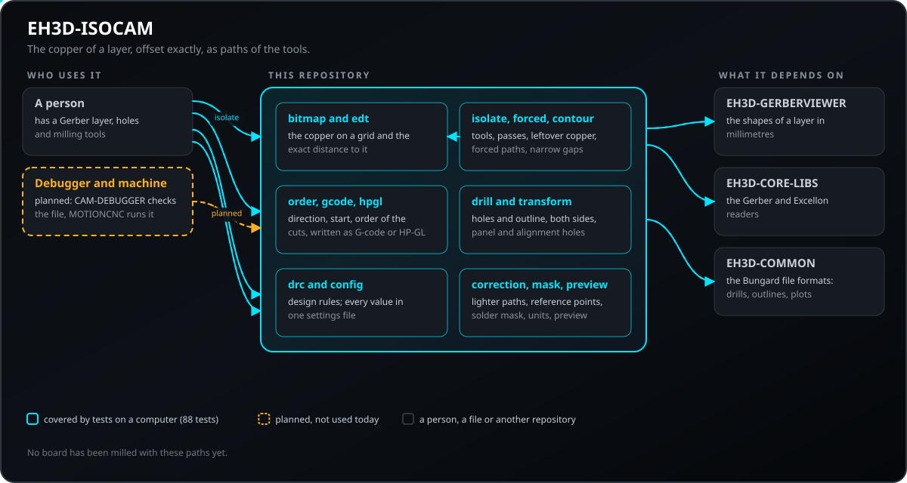
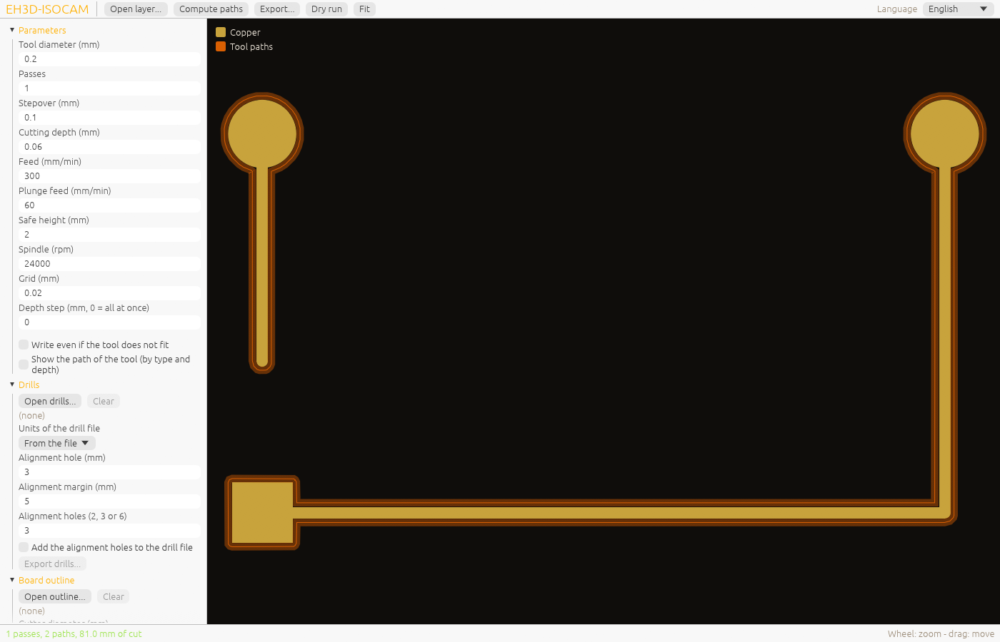
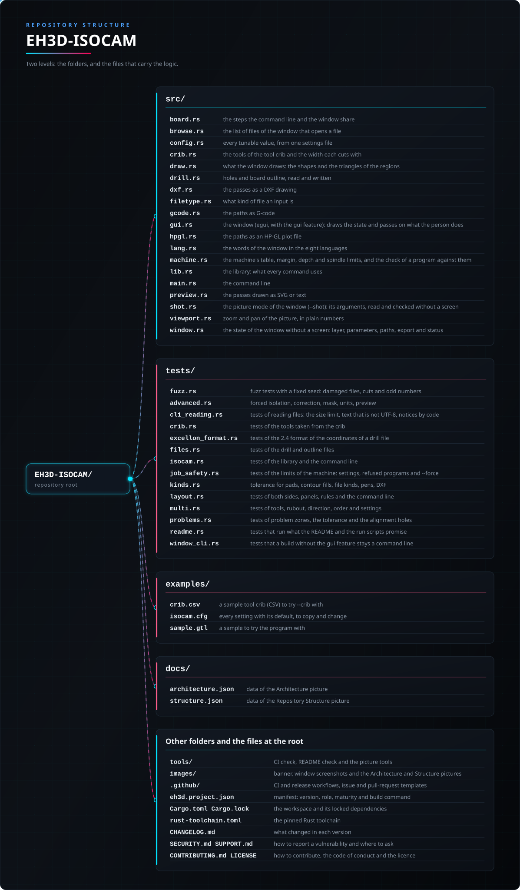

<p align="center">
  
</p>

#  EH3D-ISOCAM
<p align="center"><a href="README.md">🇺🇸 English</a> | <a href="README_spa.md">🇪🇸 Español</a> | <a href="README_fra.md">🇫🇷 Français</a> | <a href="README_ita.md">🇮🇹 Italiano</a> | 🇩🇪 <b>Deutsch</b> | <a href="README_zho.md">🇨🇳 中文</a> | <a href="README_jpn.md">🇯🇵 日本語</a> | <a href="README_por.md">🇵🇹 Português</a></p>

### Isolationsfräsen von Kupfer aus einer Gerber-Lage: exakte Offsets, mehrere Durchgänge und Lückenprüfung

<p align="center">
  
  
  
  
  
</p>

---

**Ehrlichkeitscheck - was heute wirklich läuft:** eine Rust-Bibliothek und ein Kommandozeilenprogramm (`eh3d-isocam`) mit 606 Tests, die auf einem Computer laufen: zeichnet die Bahnen eines oder mehrerer Fräswerkzeuge um das Kupfer einer Gerber-Lage, räumt das Restkupfer ab, wählt Richtung, Startpunkte und Reihenfolge der Schnitte, liest und schreibt Bohrdateien und Platinenkonturen, richtet eine Platine für beide Seiten und für einen Nutzen aus, prüft die Entwurfsregeln und schreibt G-Code oder HP-GL. Es hat ein Fenster (Build mit `--features gui`), das eine Ebene, eine Bohrdatei, einen Umriss, eine Maskenebene und eine Tabelle von Referenzpunkten öffnet, die Platine wendet und auf einem Nutzen wiederholt, das Kupfer, die Bohrungen, den Umriss und die Bahnen zeichnet und dieselben Dateien schreibt wie die Kommandozeile, das aber noch auf keinem Bildschirm angesehen wurde; es wurde auf keiner Maschine erprobt und nicht an einer Sammlung echter Dateien geprüft.

---

> **Sicherheitsstatus:** Dieses Programm steuert keine Maschine und ist kein Sicherheitssystem. Was es erzeugt, muss ein Mensch prüfen, bevor etwas an einer Maschine läuft; nichts davon lief auf echter Hardware.


## 📋 Auf einen Blick

| | |
|---|---|
| Version | `0.2.1` |
| Reifegrad | Gerüst |
| Tests | 606 |
| Technologie-Stack | Rust |
| Auf echter Hardware | Nicht erprobt: nichts davon lief an einer Maschine |

**Springe zu:** [Überblick](#-überblick) · [Architektur](#-architektur) · [Schnellstart](#-schnellstart) · [Tests](#-tests) · [Struktur](#-struktur-des-repositorys) · [Verwandte](#-verwandte-projekte)

## 🚦 Projektstatus

Jede Zeile ist ein Teil dieses Repositorys, und die Ampel sagt, wie weit er heute ist. Sie beruht auf dem, was das Repository zeigen kann (Tests, Builds, Läufe), nicht auf dem, was geplant ist.

🟢 Fertig und überprüft · 🟡 Funktioniert, mit bekannten Grenzen · 🟠 Teilweise fertig oder noch nicht überprüft · 🔴 Nicht gemacht oder funktioniert nicht

| Bereich | Stand | Was das hier bedeutet |
|---|---|---|
| Kern | 🟡 | zeichnet die Bahnen eines oder mehrerer Fräswerkzeuge um das Kupfer einer Gerber-Lage, räumt das Restkupfer ab, wählt Richtung, Startpunkte und Reihenfolge der Schnitte, meldet die für das Werkzeug zu engen Lücken und schreibt G-Code oder HP-GL; auf einem Computer mit normalen und beschädigten Eingaben getestet, nicht mit einer Sammlung echter Dateien. |
| Dateien und Anordnung | 🟡 | liest und schreibt Bohrdateien und Platinenkonturen, richtet eine Platine für beide Seiten und für einen Nutzen aus, setzt Passlöcher und prüft die Entwurfsregeln mit dem Ort jedes Befunds; auf einem Computer getestet, nicht mit Dateien anderer Programme und nicht auf einer Maschine. |
| Erzwungene Isolation, Korrektur, Maske | 🟡 | erzwungene Pfade durch Lücken, in die das Werkzeug nicht passt, leichtere Bahnen, Skalierung und Korrektur mit Referenzpunkten, die Öffnungen der Lötstoppmaske, Einheiten und die Vorschau der Durchgänge; auf einem Computer mit erzeugten Lagen und beschädigten Eingaben getestet, nie mit echten Platinen und nie auf einer Maschine, und die Korrektur wurde nicht mit echten Kameramessungen verglichen. |
| Kommandozeile | 🟡 | `eh3d-isocam` führt dieselben Funktionen wie die Bibliothek aus und gibt das Ergebnis aus; jeder Fehler kommt als Meldung mit einem Exit-Code ungleich null zurück. |
| Tests | 🟡 | 606 Tests bestehen (`cargo test`), mit Normalfällen, Grenzfällen und beschädigten Eingaben. Dazu gehört eine Simulation mit festem Seed für eine Bungard-Maschine mit dem Verfahrweg ihres Tisches, mit eingespeisten Fehlern und Wiederherstellung. |
| Sicherheit | 🟡 | Reines sicheres Rust (`forbid(unsafe_code)`): nichts gerät bei den übergebenen Dateien in Panik und ein schlechter Wert ist ein Fehler mit Begründung; keine unabhängige Prüfung. |
| Fenster | 🟠 | Geschrieben (egui, `--features gui`): Ebene öffnen oder hineinziehen, Zoom und Verschieben, die wichtigsten Parameter ändern, exportieren; die Logik ist getestet und das Programm einer Version zeichnet es in ein Bild (`--shot`), aber noch niemand hat es auf einem Bildschirm benutzt. |
| Echte Hardware | 🔴 | Nicht erprobt: nichts davon wurde an einer Maschine ausgeführt. |
| Dokumentation | 🟡 | README in acht Sprachen, das Changelog und die zwei aus `docs/` gezeichneten Bilder. |

## 🎯 Überblick

* **Das Kupfer auf einem Raster** (`bitmap`): Pads (rund, rechteckig, oval), Leiterbahnen und Flächen werden auf Zellen der gewählten Größe gezeichnet; überlappende Bahnen und Pads sind ein Stück, weil ein Raster keine Überlappungen kennt, es braucht also keinen Sonderfall; ein Raster, das nicht in den Speicher passt, wird abgelehnt.
* **Der exakte Abstand** (`eh3d-raster`): Der Abstand jeder Zelle zum nächsten Kupfer wird exakt berechnet (und gegen Brute Force getestet), und die Bahn eines Durchgangs ist die Linie, auf der er dem Werkzeugradius entspricht, als geschlossene Polylinien verfolgt und mit einer Toleranz von einer halben Zelle ausgedünnt; weitere Durchgänge liegen je eine Zustellung weiter außen.
* **Was das Werkzeug nicht kann** (`isolate`): Wo zwei getrennte Kupferstücke näher beieinander liegen als das Werkzeug breit ist, passt keine Bahn dazwischen: `check` listet diese Stellen, und `isolate` schreibt den G-Code erst, wenn man sie angesehen hat (oder `--force`). Der G-Code (`src/gcode.rs`) hebt das Werkzeug zwischen den Bahnen an, fährt auf die gewählte Tiefe und schneidet als Nächstes die nächstgelegene Bahn.
* **HP-GL für die Bungard-Maschinen** (`src/hpgl.rs`): Bei einer Ausgabedatei mit der Endung `.plt` werden die Durchgänge als HP-GL-Plotdatei mit 40 Einheiten je Millimeter geschrieben, ein Stift je Durchgang; das liest das Fräsprogramm der Bungard-Maschinen.
* **Mehrere Werkzeuge und Restkupfer** (`isolate`): ein Plan hat bis zu vier Werkzeuge, das breiteste schneidet zuerst; wo ein breiteres Werkzeug schon entlang einer Bahn eines schmaleren geschnitten hat, entfällt dieses Stück (der Rest bleibt als offene Abschnitte), und Ringe eines breiteren Werkzeugs, die sich jeweils mit dem vorigen überlappen, können das Kupfer jenseits der Durchgänge abräumen; der G-Code hält zum Werkzeugwechsel an, wenn sich die Werkzeugbreite ändert. Ist `around_pads_min_mm` größer als 0, schneiden die breiteren Werkzeuge nur die Ringe um Pads mit mindestens dieser Breite, und das feinste Werkzeug übernimmt den Rest (Leiterbahnen und kleine Pads).
* **Richtung, Start und Reihenfolge** (`order`): die Bahnen werden mit dem Kupfer rechts vom Werkzeug gezeichnet (Gleichlauffräsen bei rechtsdrehender Spindel); die Einstellungen können das umkehren (Gegenlauf), im oder gegen den Uhrzeigersinn erzwingen, jede geschlossene Bahn an ihrem nächsten Punkt, ihrem tiefsten Punkt oder dort beginnen lassen, wo sie gezeichnet wurde, den Startpunkt des Werkzeugs festlegen und die Bahnen in der gezeichneten Reihenfolge, die nächste zuerst oder durch Umkehren von Abschnitten der Reihenfolge noch kürzer ordnen; `info` zeigt, wie viele Bahnen in welche Richtung laufen, und den Leerweg.
* **Bohrungen und Platinenkontur** (`src/drill.rs`): Bohrdateien werden gelesen (Bungard-Dateien in Mil mit dem Leser der Bungard-Formate, metrische mit dem Leser der Suite) und in ganzen Mil geschrieben; eine Kontur wird aus einer Gerber-Konturlage, einer DXF-Zeichnung oder einer HP-GL-Plotdatei gelesen, einzeln gezeichnete Striche werden verbunden, und die Bahn des Werkzeugs um die Platine und in ihren Ausschnitten wird als HP-GL oder als Excellon-Fräsdatei geschrieben. Eine Bohrdatei mit Werkzeugnummern über 255 bekommt freie Nummern, mit einem Hinweis, sodass zwei Werkzeuge nie zu einem werden. Mit `--excellon-format 2.4` (oder `excellon_format = 2.4`) werden die Koordinaten einer Bohrdatei mit zwei Ziffern vor und vier nach dem Punkt gelesen und geschrieben (`X012340` ist 1,2340 in), mit den Nullen, wie es der Kopf angibt; eine Datei, die ihr eigenes Format angibt, behält es. Die Routing-Excellon-Datei von `route` wird im selben Format geschrieben.
* **Beide Seiten, Nutzen und Passlöcher** (`transform`): Lage, Bohrungen und Kontur werden zusammen gewendet, um Vierteldrehungen gedreht und auf einem Nutzen wiederholt; Passlöcher liegen außerhalb der Platine dort, wo die gewendete Platine sie wiederfindet (ein drittes auf der Achse unterscheidet sie von derselben, um eine halbe Drehung gedrehten Platine).
* **Entwurfsregeln** (`drc`): Kupfer schmaler als die Regel, Kupferstücke näher als die Regel oder als das Werkzeug breit ist, und Bohrungen mit weniger Kupfer ringsum als die Regel, jeweils mit ihrem Ort in Millimetern.
* **Eine Einstellungsdatei** (`src/config.rs`): jeder einstellbare Wert ist eine Einstellung mit Standardwert, gelesen aus einer `Schlüssel = Wert`-Datei (`examples/isocam.cfg`) oder unter demselben Namen als Option der Kommandozeile angegeben.
* **Erzwungene Isolation** (`forced`): mit `forced_isolation = yes` wird zusätzlich ein Pfad durch die Mitte jeder Lücke gelegt, in die das feinste Werkzeug nicht passt, solange die Lücke nicht schmaler als `forced_min_gap_mm` ist; jede Stelle wird mit Koordinaten und Lückenbreite gemeldet, schmalere Lücken werden aufgelistet und bleiben unberührt. Standardmäßig ist sie aus: Dann werden diese Stellen nur gemeldet.
* **Problemzonen, Toleranz und Passlochabstand** (`problems`, `src/config.rs`): `check` listet außerdem als Warnungen, die nichts anhalten, die Innenecken auf, die spitzer sind als `problem_corner_angle_deg` (ein rundes Werkzeug lässt in der Spitze einer Kerbe Kupfer stehen; standardmäßig 60 Grad, 0 schaltet es ab), und die Leiterbahnen, die zwischen zwei Pads verlaufen, die ihr näher sind als `problem_track_gap_factor` mal das Werkzeug (standardmäßig 1,5, 0 schaltet es ab); beide Kriterien sind Einstellungen und nicht im Code festgelegt. `conflict_tolerance_mm` (standardmäßig 0: keine Lücke wird akzeptiert) akzeptiert die Lücken, die höchstens um diesen Betrag schmaler sind als das Werkzeug, in `check` und in `isolate`. Der Abstand der Passlöcher zur Platine ist `alignment_margin_mm` (standardmäßig 5 mm; andere Programme dieser Art setzen sie 10 mm entfernt, also `alignment_margin_mm = 10`).
* **Stege, Netze, Lochmuster und Flächenräumung** (`src/drill.rs`, `isolate`, `transform`, `problems`, `legacy`): `route` kann Stege stehen lassen, die die Platine im Nutzen halten (`tab_count` je geschlossenem Pfad, standardmäßig 0; `tab_width_mm` verbleibendes Material; `tab_min_length_mm` zwischen den Stegen): der Schnitt endet eine halbe Stegbreite und einen halben Werkzeugdurchmesser vor der Mitte jedes Stegs. `isolate --net X,Y` isoliert nur das Netz, das einen Punkt enthält, mit dem Werkzeug `net_tool_mm`. `rubout-area OUT --area X0,Y0,X1,Y1` schreibt parallele Linien des Werkzeugs `rubout_lines_tool_mm` (Richtung `rubout_lines_direction`), die eine Fläche räumen. Die Passlöcher können 2, 3 oder 6 sein, außerhalb der Platine oder mit `alignment_pattern = special` in einem Muster um ihre Mitte (`alignment_special_a_mm` Abstand beim Paar, `alignment_special_b_mm` für die vier weiteren). Mit einer Konflikttoleranz warnen `check` und `isolate` vor Leiterbahnen und rechteckigen Pads, die dünner sind als die doppelte Toleranz plus `tolerance_warning_margin_mm`. Die Schätzung des Formats einer alten Gerber-Ebene nutzt jetzt die Einheiten, die die Datei nennt, und die Größe der Platine, und eine Aperturliste darf beide Seiten in einer Zelle angeben (`60x40`).
* **Toleranz nur für Pads, Füllen nach Konturen, Dateiart, DXF und Plotterstifte** (`tolerance`, `fill`, `src/filetype.rs`, `src/dxf.rs`, `src/hpgl.rs`): `conflict_tolerance_scope = pads` (Standard `all`, wie bisher) behält die Konfliktoleranz für Spalte mit einem Pad daneben, und die Warnung vor dünnem Kupfer prüft dann nur Pads. `rubout-area OUT [LAGE.gtl] --contour DATEI` (oder `--area`) füllt die geschlossenen Pfade einer Datei, gerade-ungerade, sodass ein innerer Pfad ein Loch ist, mit hin- und hergehenden Linien von `rubout_lines_tool_mm`; mit einer Lage werden die Linien aufs Kupfer beschnitten: das ganze Werkzeug auf Kupfer plus `rubout_fill_margin_mm`. Eine Lage, die in Wirklichkeit eine Excellon-, HP-GL- oder DXF-Datei ist (oder eine Bohrdatei, die eine Gerber-Lage ist), wird mit Namen abgelehnt, und `kind DATEI...` sagt, was jede Datei ist. `isolate` und `rubout-area` schreiben bei `.dxf` eine DXF-Zeichnung. `drills EIN AUS.plt` plottet die Bohrungen mit einem Stift je Bohrer (`hpgl_pen_map = 1:2, 3:1`; nicht genannte Bohrer erhalten die niedrigsten freien Stifte), und `hpgl_pen_speed_cm_s` (0 = die der Maschine, Standard) schreibt die Stiftgeschwindigkeit in jeden Plot. `hpgl_isocam_style` (an) schreibt den Plot wie das Originalprogramm: ein `PA` je Punkt und Zeilen von etwa 75 Spalten, mit CR LF beendet; aus schreibt die kompakte Form.
* **Zweiseitige Platinen und die schlichte Bohrdatei** (`src/hpgl.rs`, `src/drill.rs`, `src/filetype.rs`): `hpgl_shift_negative = no` behält die Koordinaten der Platine im Plot bei (auch negative), sodass Plot und Bohrdatei denselben Ursprung haben; `isolate` mit `plot_outline = yes` und `--outline DATEI` setzt den Schnitt um die Kontur (mit dem Werkzeug von `route_tool_mm`) an den Anfang des Plots, auf den Stift `hpgl_outline_pen`, die Isolation auf den Stift `hpgl_isolation_pen`. `--mirror vertical` dreht die Bohrungen um die Mitte der Kontur um. `ncd_isocam_style = yes` schreibt eine Bohrdatei wie die Bungard-Programme (`M48` und `%`, Werkzeuge nur mit Nummer, wiederholte Koordinate weggelassen, CR LF, `M00`), und `ncd_digits` füllt die Koordinaten vorn mit Nullen auf. Eine Bohrdatei ohne `M48`-Zeile wird als Excellon erkannt. Werden die Plots verschoben, legt `hpgl_margin_mm` die gemeinsame Verschiebung von Isolations- und Bohrplot einer Platine fest, damit sie deckungsgleich bleiben. `spindle_wait_s` schreibt nach jedem Spindelstart im G-Code eine Wartezeit (`G4`).
* **Leichtere Bahnen, Skalierung und Korrektur** (`optimize`, `fiducial`): Spitzen werden entfernt und Punkte auf einer Geraden (innerhalb von `optimize_tolerance_mm`) werden zu einer Bewegung, standardmäßig aktiv (0,01 mm und 0,02 mm; mit 0 abgeschaltet); die Arbeit lässt sich um die Mitte der Platine skalieren, und Paare von Referenzpunkten relativ zu dieser Mitte (wo eine Marke sein sollte und wo sie gemessen wurde) ergeben eine Ähnlichkeit (zwei Paare) oder eine affine Anpassung (drei oder mehr, kleinste Quadrate), die auf jede Bahn und jede Bohrung angewendet wird; abgelehnt wird sie, wenn der Maßstab weit von 1 abweicht oder eine Marke nicht passt.
* **Lötstoppmaske** (`mask`): die Öffnungen werden als Gerber-Lage geschrieben, aus der Maskenlage des Entwurfs oder aus den Pads des Kupfers, jede um `mask_margin_mm` vergrößert; Leiterbahnen bleiben bedeckt.
* **Einheiten und Vorschau** (`eh3d-raster`, `src/preview.rs`): eine Länge kann `mm`, `mil` oder `in` tragen, der G-Code kann in Zoll geschrieben werden, und `preview` zeichnet die Durchgänge über das Kupfer als SVG-Zeichnung oder als Text.
* **Alte Gerber-Ebenen** (`legacy`): eine Ebene ohne Formatangabe (RS-274D, wie viele ältere Programme sie schreiben) wird gelesen, wenn ihre Aperturliste (`--apertures`, ein D-Code und seine Größe pro Zeile) zusammen mit ihrem Format (`--gerber-format 2.3`, `--gerber-zeros`, `--gerber-units`) angegeben wird; sie wird als erweitertes Gerber neu geschrieben und läuft durch den normalen Leser. Getestet mit von Hand geschriebenen Ebenen, nicht mit Dateien anderer Programme.
* **Lesen und Meldungen nach Code (Kommandozeile):** Dateien werden mit einem Größenlimit gelesen (`--max-bytes N` oder `max_input_mb`, standardmäßig 64 MiB), und Text ohne UTF-8 wird mit einer Warnung (`input-not-utf8`) als Latin-1 gelesen; die Meldungen des Gerber-Lesers erscheinen mit ihrem stabilen Code, und `--hide CODE[,CODE]` lässt diese Codes weg. Der Hinweis zu den leichteren Pfaden und der zu den Stegen des Schnitts erscheinen nur, wenn sie etwas geändert haben. `arc_tolerance_mm` legt fest, wie genau die Bögen einer Ebene nachgezeichnet werden. `min_tool_mm` (standardmäßig 0,02) legt das dünnste Werkzeug fest, das eine Werkzeugeinstellung haben darf; ein dünneres wird mit dem Namen der Einstellung abgelehnt; `rapid_mm_min` (standardmäßig 0, keine Schätzung) ist die Geschwindigkeit der Eilgänge, mit der `info` eine Schätzung der Auftragszeit ergänzt (Schneiden, Eintauchen, Fahren; die Wartezeit der Spindel und Werkzeugwechsel von Hand zählen nicht). `hpgl_units_per_mm` (standardmäßig 40, von 10 bis 1000) legt die Einheiten einer Plotdatei je Millimeter fest; die Bereichsprüfung von 32767 Einheiten folgt ihm (327 mm bei 100).
* **Werkzeuge aus dem Werkzeuglager** (`src/crib.rs`): `--crib DATEI` (oder `crib_file`) liest die CSV-Tabelle, die `eh3d-tools` exportiert, und `--crib-fine N`, `--crib-coarse N` und `--crib-route N` nehmen daraus die Werkzeuge mit diesen Nummern: die Breite, mit der ein Fingerfräser, ein V-Fräser oder ein Gravierstichel bei `depth_mm` schneidet, wird zu `fine_tool_mm` oder `coarse_tool_mm` (ein V-Fräser schneidet `2 * Tiefe * tan(Winkel / 2) + crib_vbit_flat_mm` breit, höchstens seinen Durchmesser, auf ein Zehntausendstel Millimeter abgerundet) und der Durchmesser eines Fingerfräsers wird zu `route_tool_mm`; jeder Austausch wird auf der Fehlerausgabe gemeldet, ein Bohrer, ein Laser oder eine Düse wird abgelehnt, und ein für `min_tool_mm` zu dünnes Werkzeug wird mit dem Namen der Einstellung abgelehnt. Die Tabelle wird nur gelesen, wenn ein Werkzeug gewählt wird.
* **Grenzen der Maschine** (`src/machine.rs`): `machine_profile` (`ccd-mtc`: 495 x 325 mm, `ccd2-mtc`: 325 x 270 mm) oder `machine_x_mm` und `machine_y_mm` geben den Tisch an, `machine_margin_mm` den Abstand zu seinen Rändern, `machine_max_depth_mm` und `machine_max_rpm` den tiefsten Schnitt und die schnellste Spindel. Der G-Code wird vor dem Speichern Bewegung für Bewegung durchlaufen und mit seiner Zeile abgelehnt, wenn eine Bewegung den Tisch verlässt, zu tief geht oder die Spindel zu schnell dreht (`--force` schreibt ihn trotzdem und nennt den Grund); eine Tiefe oder Drehzahl des Auftrags über den Grenzen wird beim Lesen der Einstellungen abgelehnt. Alles ist standardmäßig aus.
* **Was nicht beurteilt werden kann, wird angehalten:** Ein Programm mit einem unlesbaren Teil, einem `$`-Befehl, einem Code, der den Nullpunkt verschiebt (`G92`, `G28`, `G53`, `G10`), oder Sätzen nach seinem Ende besteht die Grenzen nicht; eine zu schnell gestartete Spindel wird auch ohne Bewegung bei dieser Drehzahl gefunden, und der Trockenlauf sagt, wenn das Programm bei laufender Spindel anhält (`M0`, `M1`).
* **Ein Trockenlauf eines Programms** (`src/simulate.rs`): `eh3d-isocam simulate PROGRAMM.nc` durchläuft jedes G-Code-Programm Bewegung für Bewegung und gibt seine Länge, den Fahrbereich, den tiefsten Schnitt und die Zeit aus (Schneiden mit dem Vorschub, Eintauchen mit dem Eintauchvorschub, Eilgänge mit `rapid_mm_min`, `G4`-Wartezeiten) und listet mit ihren Zeilen einen Eilgang ins Material, einen Schnitt bei stehender Spindel oder ohne Vorschub, ein Programm, das nicht endet, und die Maschinengrenzen, die es verletzt; jeder Befund ergibt den Exit-Code 1. Der Bericht erscheint in den acht Sprachen.
* **Tiefenstufen und eine Höhenkarte** (`src/heightmap.rs`): `depth_step_mm` schneidet jeden Pfad in jeder Tiefe erneut (ein geschlossener Pfad läuft noch einmal herum, ein offener Lauf wird auf dem Rückweg geschnitten, ohne Anheben), und `--height-map DATEI` (`heightmap_file`) liest die Karte von EH3D-AUTOLEVEL, sodass das Z jedes Schnitts die Tiefe unter dem Tisch an dieser Stelle ist, mit in Stücke von höchstens `heightmap_max_segment_mm` zerlegten Bewegungen; eine Karte mit fehlendem Punkt oder ein Tisch, der zu weit von eben abweicht (`heightmap_max_range_mm`), wird abgelehnt. Beides ist standardmäßig aus.
* **Die Tiefe für eine Leiterbahnbreite** (`src/crib.rs`): `--crib-fine-width-mm W` berechnet die Tiefe, bei der der V-Fräser oder Gravierstichel des Lagers eine Bahn der Breite `W` schneidet, und verwendet sie als `depth_mm`; eine Breite, die das Werkzeug nicht schneiden kann, oder ein Schaftfräser wird abgelehnt.
* **Ein kurzer Weg für den Bohrer** (`src/drill.rs`): `drill_order = nearest|optimized` (`--drill-order`) ordnet die Löcher jedes Werkzeugs auf einem kurzen Weg ab dem Startpunkt des Werkzeugs, wobei die Werkzeuge ihre Reihenfolge behalten, und `drills` meldet, um wie viel kürzer der Weg als in der Reihenfolge der Datei ist; `file` (Standard) behält die Reihenfolge der Datei bei.
* **Die Zeit des Auftrags** (`src/simulate.rs`): ist `rapid_mm_min` gesetzt, gibt `isolate` zusätzlich die geschätzte Zeit des geschriebenen G-Codes aus (derselbe Durchlauf des Programms wie bei `simulate`, ohne die Wartezeiten der Spindel); ohne Eilgang-Geschwindigkeit wird nichts weiter ausgegeben, und ein Plot oder eine DXF-Zeichnung hat keine Zeit.
* **Das Bohrformat im Fenster** (`src/window.rs`): Auch das Fenster fragt danach: eine abgelehnte Bohrdatei öffnet eine Frage mit den Formaten (keines ist markiert, nur ein Klick wählt) und die Liste im Bohrabschnitt ändert es; das Fenster behält die Wahl nur, solange es offen ist.
* **Der Trockenlauf im Fenster** (`src/window.rs`): die Schaltfläche „Trockenlauf“ durchläuft den G-Code, als der die Bahnen geschrieben würden (es wird nichts geschrieben), und zeigt seine Zeit, den Bereich, in dem er sich bewegt, den tiefsten Schnitt und seine Befunde in der Sprache des Fensters; die Gruppe „Maschine“ enthält die Eilganggeschwindigkeit und die Grenzen der Maschine (`machine_profile`, den Tisch, den Abstand, den tiefsten Schnitt und die schnellste Spindel), und eine verletzte Grenze ist ein Befund.
* **Der Werkzeugweg im Bild** (`src/toolpath.rs`): das Feld „Werkzeugweg zeigen“ durchläuft den G-Code, als der die Bahnen geschrieben würden, und zeichnet statt der Bänder der Durchgänge, was die Maschine tun würde: Eilgänge grau, Eintauchbewegungen rot und jede Schnittstrecke in einer Farbe von Blau (knapp unter der Oberfläche) bis Bernstein (der tiefste Schnitt), Bögen als Bögen; Zoom, Verschieben und „Einpassen“ des Bildes wirken darauf, und die Einstellung `depth_step_mm` ist jetzt ein Parameter des Fensters.
* **Stege abseits der Ecken** (`src/drill.rs`): `tab_corner_clearance_mm` (standardmäßig 0, was die Stege wie bisher gleichmäßig entlang jeder Bahn verteilt) verschiebt einen Steg, der auf eine Ecke des Schnitts fiele, entlang der Bahn in Schritten eines Viertels des Abstands zur nächsten Stelle, an der die Bahn innerhalb der Lücke und des Abstands zu beiden Seiten höchstens 20 Grad abbiegt; ein Steg, der keine solche Stelle findet, bleibt, wo er war, und wird gezählt und gemeldet (`route` warnt, das Fenster fügt einen Hinweis hinzu). Die Zahl der Stege (`tab_count`), ihre Breite (`tab_width_mm`) und das kürzeste Stück zwischen zweien (`tab_min_length_mm`) sind Parameter des Fensters.
* **Ein Programm wird nie halb geschrieben:** jede Datei, die das Programm schreibt (G-Code, HP-GL, Bohrdateien, Zeichnungen, von der Kommandozeile und aus dem Fenster), geht in eine neue Datei neben der echten und wird über sie umbenannt, sodass ein Abbruch oder eine volle Platte die alte Datei ganz lässt; eine schreibgeschützte Datei wird nicht ersetzt.
* **Die Form des Schnitts um die Platine** (`src/corners.rs`): `outline_corner_radius_mm` (standardmäßig 0, die Ecken bleiben wie gezeichnet scharf) rundet jede Ecke der geschlossenen Pfade der Kontur mit einem Bogen dieses Radius, bevor das Werkzeug sie umfährt; eine Ecke, deren Seiten für den Radius zu kurz sind (ein Bogen nimmt höchstens die Hälfte jeder Seite ein), erhält den größten passenden Radius und wird gezählt und gemeldet. `outline_min_cutout_mm` (standardmäßig 0) lässt die Aussparungen der Kontur (geschlossene Pfade innerhalb der Platine) aus, deren Umgebungsrechteck keine Seite länger als dieser Wert hat. Beides gilt für `route` und für den Schnitt von `plot_outline` und sind Parameter des Fensters, das in seinen Hinweisen sagt, wie viele Ecken einen kleineren Radius erhielten und wie viele Aussparungen ausgelassen wurden.
* **Der Schnitt gegen den Tisch der Maschine geprüft:** Beschreiben die Einstellungen einen Tisch (`machine_profile` oder `machine_x_mm` und `machine_y_mm`, mit `machine_margin_mm`), weisen `route` und das Fenster einen Schnitt zurück, der ihn verlässt, mit dem Pfad und dem Ort, zu dem er führt; `--force` schreibt ihn mit einer Warnung auf der Kommandozeile. Ohne beschriebenen Tisch wird nichts geprüft, wie bisher. Die Bohrungen einer Bohrdatei oder eines Bohrplots und ein Plot der Isolation werden gegen denselben Tisch geprüft und ebenso zurückgewiesen.
* **Räumen einer Fläche mit Ringen** (`src/clearing.rs`): mit `rubout_style = rings` füllt `rubout-area` ein Rechteck (`--area`) oder die geschlossenen Bahnen einer Datei (`--contour`, Gerade-Ungerade-Füllung, also ist eine Bahn in einer anderen ein Loch) mit geschlossenen Ringen, die dem Rand nach innen folgen, statt mit hin und her laufenden Linien; der erste Ring liegt ein halbes Werkzeug vom Rand, die nächsten je einen Schritt von `tool * (1 - rubout_overlap)` weiter innen, und ein Ring in der Mitte kommt hinzu, wenn ein Streifen übrig bliebe. `rubout_ring_order` (`outside-in`, der Normalfall, oder `inside-out`) bleibt im G-Code erhalten, was `ordering` auch sagt. Bevor etwas geschrieben wird, werden die Bahnen gegen den Tisch der Maschine geprüft, und eine Bahn, die ihn verlässt, wird mit ihrer Nummer und ihrem Durchgang abgelehnt (`--force` schreibt sie trotzdem); die Prüfung gilt auch für die Linien.
* **An die Pfade angepasste Bögen** (`src/arcs.rs`): `arc_fit_tolerance_mm` (standardmäßig 0, was alle Stücke wie bisher gerade lässt; 0.001 bis 0.5 mm) ersetzt jede Folge kurzer Bewegungen, die auf einem Kreis liegt, durch ein einziges `G2` oder `G3`, höchstens so weit vom ursprünglichen Polygon entfernt (der am weitesten vom Kreis entfernte Punkt und die Pfeilhöhe des längsten Stücks bleiben zusammen darin). `isolate` nennt, wie viele Bewegungen gespart wurden und wie lang der Schnitt mit Bögen und als gerade Stücke ist; der Interpreter der Suite läuft das Programm ab, sodass die Grenzen der Maschine sehen, wohin sich ein Bogen wölbt. Nur G-Code, nicht zusammen mit einer Höhenkarte, und ein Parameter des Fensters.
* **Der Bestückungsdruck graviert** (`src/silk.rs`): `eh3d-isocam silk EBENE.gto AUS.nc` verbindet Striche, die sich an den Enden berühren, schneidet eine Fläche entlang ihres Rands und graviert beides mit `silk_depth_mm` und einem Werkzeug von `silk_tool_mm`; es warnt, dass die Linie so breit wie das Werkzeug ist und in die Platine geschnitten wird, nennt Striche anderer Breite (`silk_width_tolerance_mm`) und zählt die gestempelten Pads, die es auslässt. Es schreibt G-Code oder eine DXF-Zeichnung, nie einen Plot.
* **Der Bericht vor dem Auftrag** (`src/report.rs`): `eh3d-isocam report EBENE.gtl` nennt die Durchgänge, die Pfade, die Länge des Schnitts, die Werkzeuge in der Reihenfolge ihres Einsatzes, die Bögen, die Zeit und die Befunde des Probelaufs, hält jedes Werkzeug gegen die CSV-Tabelle des Werkzeugmagazins (`crib_file`: ein Fräser nach seinem Durchmesser, ein V-Fräser oder Gravierstichel nach der Breite, die er in der Tiefe des Auftrags schneidet) und fügt die Prüfungen der Ebene hinzu (Stellen ohne Platz für das Werkzeug, Problemzonen, Entwurfsregeln). Er endet mit 2, dem Exitcode einer nicht bestandenen Prüfung, wenn es etwas anzusehen gibt. Das Fenster erstellt denselben Bericht und dieselben Prüfungen ohne Bildschirm (`Window::report_text`, `Window::checks_text`); die Schaltflächen dafür sind noch nicht geschrieben.
* **Wo die Arbeit auf dem Tisch liegt** (`src/config.rs`): `offset_x_mm` und `offset_y_mm` (standardmäßig 0, von -10000 bis 10000) verschieben jede Ausgabe um denselben Betrag, nach dem Maßstab und den Referenzpunkten: die Bahnen des Kupfers, die Löcher einer Bohrdatei und den Schnitt um die Platine, sodass ein Auftrag an beliebiger Stelle des Maschinentischs liegen kann; die Grenzen der Maschine (`machine_profile`) weisen weiterhin ein Programm zurück, das der Versatz vom Tisch schiebt.

## 🧩 Rolle in EH3D

EH3D-ISOCAM ist ein Programm der EH3D Fabrication Suite. Es arbeitet als Bibliothek und Kommandozeile und, mit `--features gui` gebaut, als Fenster im gemeinsamen Aussehen der Suite. Es liest und schreibt einfache Dateien und lässt sich allein oder zwischen den anderen Programmen nutzen.

## 🏛️ Architektur

<p align="center">
  
</p>


Wie die Teile dieses Repositorys zusammenpassen: wer es nutzt, was es enthält und wovon es abhängt. Das Bild wird aus `docs/architecture.json` gezeichnet und gegen den Code geprüft.

## 🖼️ Screenshots

<p align="center">
  
</p>

<p align="center"><em>Das Fenster mit der Beispielebene aus `examples/`, nach dem Berechnen der Pfade: das Kupfer in Gold, die Werkzeugpfade darum in Orange, links die Parameter und die Bohrungen. Das Bild hat der Bildmodus (`--shot`) des veröffentlichten Programms mit den Standardparametern geschrieben; noch niemand hat das Fenster auf einem Bildschirm benutzt.</em></p>

## ✨ Funktionen

* **Bibliothek und Kommandozeile:** Jeder Befehl von `eh3d-isocam` ist eine Funktion der Bibliothek, sodass ein anderes Programm der Suite ihn ohne Prozessstart aufrufen kann.
* **Tests mit beschädigten Eingaben:** Die Tests füttern auch leere Dateien, Datenmüll, riesige Zahlen und abgeschnittene Dateien; keiner darf in Panik geraten.
* **Kein Raten:** Ein unsinniger Wert ist ein Fehler, der sagt welcher und warum, nie ein Ergebnis, das nur richtig aussieht.
* **Kein unsafe-Code:** `#![forbid(unsafe_code)]` in Bibliothek und Programm.
* **Jeder abgestimmte Wert ist eine Einstellung:** nichts, was jemand ändern möchte, steckt fest im Code; ein schlechter Wert ist ein Fehler mit Zeilenangabe.
* **Einheiten nach Wahl:** Längen in einer Einstellungsdatei oder auf der Kommandozeile können in Millimetern, Mil oder Zoll geschrieben werden; der G-Code kann in Zoll geschrieben werden und der Bildschirm kann Mil anzeigen.
* **Sicherere Dateien:** der G-Code beginnt mit dem Standardkopf (Erzeuger, Einheiten, Quelldatei mit ihrem SHA-256), eine Ausgabe, die zugleich Eingabe des Laufs ist, wird abgelehnt, ein Plot mit einer Koordinate über 32767 Einheiten wird abgelehnt, `--units mm|inch` gibt die Einheiten einer Bohrdatei an, die sie nicht nennt (eine Datei mit winzigen Löchern und ohne Einheiten wird ohne die Angabe abgelehnt), und die Kontur aus einzelnen Strichen wird mit einem Index verbunden, sodass fünfzigtausend Segmente nur Augenblicke brauchen.
* **Ausgabe geprüft und dokumentiert:** Die Bohrdatei sagt in einem Kommentar, dass ihre Koordinaten ganze Mil (0,001 Zoll) ohne Dezimalpunkt sind und wie weit die Rundung danebenliegen kann; die Tests lesen den G-Code der Durchgänge und den der Befehlszeile mit dem Leser der Suite wieder ein und finden keine Warnung, keine Eilbewegung ins Material und keinen Schnitt bei stehender Spindel.
* **Marken aus einer Tabelle:** `--fiducials-csv DATEI` liest die Markenpaare (Entwurf x, Entwurf y, gemessen x, gemessen y; eine Kopfzeile und Zeilen, die mit `#` beginnen, werden übergangen), sodass die Ausgabe von `eh3d-vision align --isocam-args` unverändert verwendet werden kann.

## 🔒 Sicherheit und Schutz

| Bedrohung | Schutz |
|---|---|
| Eine beschädigte, abgeschnittene oder leere Datei | keine Panik: die Tests schneiden gültige Eingaben an jeder Stelle ab und füttern Datenmüll |
| Eine unsinnige Zahl (negativ, nicht endlich, absurd groß) | wird mit einem Fehler abgelehnt, der den Wert nennt; nichts wird zu etwas Plausiblem gerundet |
| Unsichere Speichernutzung | reines sicheres Rust mit `forbid(unsafe_code)` |

**Was nicht abgesichert ist:** Ein fehlerfrei erzeugtes Ergebnis ist kein geprüftes Ergebnis. Solange kein Maschinenprofil und keine Grenzen gesetzt sind, kennt nichts hier die Grenzen einer Maschine, und das Programm hatte keine unabhängige Prüfung. Eine Schwachstelle bitte privat melden (siehe [SECURITY.md](SECURITY.md)).

## 🔌 Schnittstellen

Die Bibliothek ist `eh3d_isocam` (`use eh3d_isocam::...`); die Kommandozeile ist `eh3d-isocam`. Jeder Befehl gibt sein Ergebnis auf der Standardausgabe aus und meldet einen Fehler auf der Fehlerausgabe mit einem Exit-Code ungleich null. Es gibt keinen Netzwerkzugriff. Der Hilfetext (`eh3d-isocam help`) ist englisch:

Der Exitcode folgt der Konvention der Suite: 0, wenn der Lauf gut ging, 1, wenn die Arbeit scheiterte (zum Beispiel eine Datei, die nicht gelesen werden kann), und 64, wenn die Befehlszeile falsch benutzt wurde (ein unbekannter Befehl oder eine unbekannte Option oder etwas, das ein Befehl braucht und fehlt).

```text
eh3d-isocam isolate LAYER.gtl OUT.nc|OUT.plt|OUT.dxf  paths round the copper (G-code, HP-GL for a .plt, DXF for a .dxf)
eh3d-isocam check LAYER.gtl                      places where the tool does not fit between pieces of copper
eh3d-isocam info LAYER.gtl                       passes, paths each way round, travel through the air
eh3d-isocam preview LAYER.gtl [OUT.svg|OUT.txt]    the passes drawn over the copper, as SVG or text
eh3d-isocam drc LAYER.gtl [--drills F.ncd]       design rules, with the place of every finding
eh3d-isocam drills IN.ncd OUT.ncd|OUT.plt [--align]  read, turn over, panel and add alignment holes; .plt = a pen per drill
eh3d-isocam route OUTLINE OUT.plt|OUT.ncd        path of the tool round the board
eh3d-isocam rubout-area OUT.nc|OUT.plt|OUT.dxf [LAYER.gtl] --area X0,Y0,X1,Y1|--contour FILE  parallel lines of a tool that clear an area or fill closed paths, cut to the copper of LAYER
eh3d-isocam kind FILE...                        say what kind of file each one is (Gerber, old-style Gerber, Excellon, HP-GL, DXF)
eh3d-isocam mask COPPER.gtl OUT.gts [--mask-layer F] openings of the solder mask, from the mask layer or the pads
eh3d-isocam config                               every setting with its default, as a file
eh3d-isocam [gui] [LAYER.gtl]                    the window (a build with --features gui); with no arguments it opens
eh3d-isocam gui [LAYER.gtl] --shot OUT.png [--size WxH] [--theme forge|dark|light] [--wait N] [--lang CODE] [--replace]   a picture of the window
options: --config FILE  --outline FILE  --drills FILE  --force  and every setting by its name (--fine-tool-mm 0.15, --fine-tool-mm 8mil, --forced-isolation yes, --fiducial "0,0,0.1,0.05")
old-style Gerber (no format statement): --apertures FILE  --gerber-format 2.3  --gerber-zeros leading|trailing  --gerber-units inch|mm  --aperture-units mil|mm|inch
drill and routing files: --excellon-format auto|2.4   (2.4 = two digits before the point, four after)
drill files: --drill-format mils|inch-2.4-tz|inch-2.4-lz|metric-3.3-tz|metric-3.3-lz   (Bohrdateien ohne angegebenes Zahlenformat werden ohne Wahl abgelehnt)
tools from the crib: --crib FILE  --crib-fine N  --crib-coarse N  --crib-route N  --crib-fine-width-mm W   (N = the number of the tool in the table of eh3d-tools; 0 = keep the setting; W = the width the V-bit is to cut, the depth follows)
machine limits: --machine-profile none|ccd-mtc|ccd2-mtc  --machine-x-mm N  --machine-y-mm N  --machine-margin-mm N  --machine-max-depth-mm N  --machine-max-rpm N   (0 = not checked)
dry run of a program: eh3d-isocam simulate PROGRAM.nc [--rapid-mm-min N]   (time, box, deepest cut, findings with their lines; exit code 1 on any finding)
depth and surface: --depth-step-mm N  --height-map FILE  --heightmap-ref-x-mm N  --heightmap-ref-y-mm N  --heightmap-max-segment-mm N  --heightmap-max-range-mm N   (the map is the text file of EH3D-AUTOLEVEL)
drill order: --drill-order file|nearest|optimized   (the holes of each tool in a short path from --start-x-mm and --start-y-mm; file keeps the order of the file)
clearing an area: --rubout-style lines|rings  --rubout-ring-order outside-in|inside-out  --rubout-overlap N  --rubout-lines-tool-mm N   (rings follow the edge inwards, never cut to a layer; the paths are checked against the machine table first)
work on the table: --offset-x-mm N  --offset-y-mm N   (every output is moved by this much, after the scale and the reference points; the machine limits still apply)
```

```text
EH3D-ISOCAM/
├── src/
│   ├── board.rs                                 die Schritte, die Kommandozeile und Fenster teilen
│   ├── browse.rs                                die Dateiliste des Fensters zum Öffnen einer Datei
│   ├── clearing.rs                              das Räumen einer Fläche mit Ringen, in der gewünschten Reihenfolge und innerhalb der Fläche
│   ├── config.rs                                alle einstellbaren Werte aus einer Einstellungsdatei
│   ├── corners.rs                               die Ecken der Kontur abgerundet und ihre kleinen Aussparungen ausgelassen
│   ├── crib.rs                                  die Werkzeuge des Lagers und die Schnittbreite jedes einzelnen
│   ├── draw.rs                                  was das Fenster zeichnet: die Formen und die Dreiecke der Flächen
│   ├── drill.rs                                 Bohrungen und Platinenkontur lesen und schreiben
│   ├── dxf.rs                                   die Durchgänge als DXF-Zeichnung
│   ├── eh3dfile.rs                              das .eh3d-Projekt: Kupfer des Auftrags hinein, Programme in den eigenen Zweig
│   ├── filetype.rs                              welche Art Datei eine Eingabe ist
│   ├── gcode.rs                                 die Bahnen als G-Code
│   ├── gui.rs                                   das Fenster (egui, mit dem Feature gui): zeichnet den Zustand und gibt weiter, was die Person tut
│   ├── heightmap.rs                             die Höhenkarte des Tisches, gelesen aus der Datei von EH3D-AUTOLEVEL
│   ├── hpgl.rs                                  die Bahnen als HP-GL-Plotdatei
│   ├── lang.rs                                  die Wörter des Fensters in den acht Sprachen
│   ├── machine.rs                               Tisch, Rand sowie Tiefen- und Spindelgrenzen der Maschine und die Prüfung eines Programms dagegen
│   ├── lib.rs                                   die Bibliothek: was jeder Befehl nutzt
│   ├── main.rs                                  die Kommandozeile
│   ├── preview.rs                               die Durchgänge als SVG oder Text
│   ├── shot.rs                                  der Bildmodus des Fensters (--shot): seine Argumente, ohne Bildschirm gelesen und geprüft
│   ├── simulate.rs                              der Trockenlauf eines G-Code-Programms: Zeit, Fahrbereich, tiefster Schnitt und Befunde in acht Sprachen
│   ├── toolpath.rs                              der Werkzeugweg eines Programms für das Bild: Eilgang, Eintauchen und Schnitt nach Tiefe
│   ├── viewport.rs                              Zoom und Verschiebung des Bildes, in einfachen Zahlen
│   └── window.rs                                der Zustand des Fensters ohne Bildschirm: Ebene, Parameter, Bahnen, Export und Status
├── tests/
│   ├── fuzz.rs                                  Tests mit festem Startwert: beschädigte Dateien, Abschnitte und seltsame Zahlen
│   ├── advanced.rs                              erzwungene Isolation, Korrektur, Maske, Einheiten, Vorschau
│   ├── cli_reading.rs                           Tests zum Lesen von Dateien: Größenlimit, Text ohne UTF-8, Meldungen nach Code
│   ├── crib.rs                                  Tests der aus dem Lager genommenen Werkzeuge
│   ├── depth_and_levelling.rs                   Tests der Tiefenstufen und des Schneidens nach einer Höhenkarte
│   ├── excellon_format.rs                       Tests des Formats 2.4 der Koordinaten einer Bohrdatei
│   ├── files.rs                                 Tests der Bohr- und Konturdateien
│   ├── isocam.rs                                Tests von Bibliothek und Kommandozeile
│   ├── job_safety.rs                            Tests der Maschinengrenzen und des Trockenlaufs
│   ├── kinds.rs                                 Toleranz für Pads, Konturfüllung, Dateiarten, Stifte, DXF
│   ├── layout.rs                                Tests zu beiden Seiten, Nutzen, Regeln und der Kommandozeile
│   ├── multi.rs                                 Tests zu Werkzeugen, Restkupfer, Richtung, Reihenfolge und Einstellungen
│   ├── problems.rs                              Tests der Problemzonen, der Toleranz und der Passlöcher
│   ├── readme.rs                                Tests, die ausführen, was README und run-Skripte versprechen
│   └── window_cli.rs                            Tests, dass ein Build ohne das Feature gui eine reine Kommandozeile bleibt
├── examples/
│   ├── crib.csv                                 ein Beispiel-Lager (CSV) zum Ausprobieren von --crib
│   ├── isocam.cfg                               alle Einstellungen mit ihrem Standardwert, zum Kopieren und Ändern
│   └── sample.gtl                               ein Beispiel zum Ausprobieren
├── docs/
│   ├── architecture.json                        Daten des Architektur-Bildes
│   └── structure.json                           Daten des Struktur-Bildes
├── tools/                                       CI-Prüfung, README-Prüfung und die Bildwerkzeuge
├── images/                                      Banner, Fenster-Screenshots und die Bilder von Architektur und Struktur
├── .github/                                     CI- und Release-Workflows, Vorlagen für Issues und Pull Requests
├── eh3d.project.json                            Manifest: Version, Rolle, Reifegrad und Build-Befehl
├── Cargo.toml Cargo.lock                        der Workspace und seine festgelegten Abhängigkeiten
├── rust-toolchain.toml                          die festgelegte Rust-Toolchain
├── CHANGELOG.md                                 was sich in jeder Version geändert hat
├── SECURITY.md SUPPORT.md                       Schwachstellen melden und Fragen stellen
└── CONTRIBUTING.md CODE_OF_CONDUCT.md LICENSE   Mitwirken, Verhaltenskodex und Lizenz
```

**Das Projekt der Suite.** Eine `.eh3d`-Datei hat einen Zweig je Programm. `project info DATEI.eh3d` zeigt die Ebenen des Auftrags (Zweig `manufacturing/`, ein `.eh3dproj`-Paket) und die im Projekt gespeicherten Programme; `project isolate DATEI.eh3d [--layer NAME] [--plt]` isoliert jede Kupferebene des Auftrags (oder die genannte) mit denselben Optionen und Ablehnungen wie `isolate` und speichert das Programm nur im Zweig `isocam/`, mit einer Kopie der Ebene und dem Inhalt des Zweigs, aus dem sie stammt. Ändert sich der Auftrag danach, meldet `project info`, dass die Programme veraltet sind, und endet mit 2. Im Fenster öffnet eine hineingezogene `.eh3d`-Datei die Kupferebenen ihres Auftrags (aus einer Liste gewählt), und das Programm wird ins Projekt gespeichert. Würde das Speichern eine Signatur des Projekts oder seines Zweigs entfernen, fragt das Fenster vorher und schreibt ohne Zustimmung nichts. Das Fenster überschreibt kein Projekt, das ein anderes Programm gespeichert hat, seit es dort geöffnet oder gespeichert wurde, auch nicht, wenn es während einer offenen Frage gespeichert wurde: Es sagt es und bietet an, das Projekt neu zu lesen (mit derselben Ebene, wenn der Auftrag sie noch hat), eine Kopie unter anderem Namen mit dem Programm darin zu speichern oder zu schließen. Auch der Befehl `project isolate` prüft das: Speichert ein anderes Programm das Projekt, während die Programme entstehen, wird nichts darüber geschrieben.

## ⚙️ Konfiguration

Jeder einstellbare Wert ist eine Einstellung mit Standardwert: Durchmesser, Durchgänge und Zustellung des feinen und des groben Werkzeugs, das Abräumen des Restkupfers, Tiefe, Vorschub und Drehzahl, die Richtung, der Startpunkt, der Beginn jeder Bahn und die Reihenfolge, das Werkzeug, das die Platine ausschneidet, die Passlöcher, Spiegelung, Drehung und Nutzen sowie die Entwurfsregeln. `eh3d-isocam config` gibt sie alle als Datei aus (`examples/isocam.cfg` ist diese Datei); `--config DATEI` liest eine, und jede Einstellung kann in der Kommandozeile als Option mit demselben Namen angegeben werden (`--fine-tool-mm 0.15`), die der Datei vorgeht. Ein unsinniger Wert ist ein Fehler, der die Zeile nennt. Die festen Grenzen stehen als benannte Konstanten im Code und sind durch Tests abgedeckt. Auch die erzwungene Isolation, die leichteren Bahnen, die Skalierung und die Referenzpunkte, der Rand der Lötstoppmaske, die Einheiten und die Breite der Textvorschau sind Einstellungen. Auch das Format der Koordinaten einer Bohrdatei (`excellon_format`: `auto` oder `2.4`) ist eine Einstellung.

**Servermodus.** `--to-server` legt die Datei, die `isolate`, `drills`, `route`, `mask` oder `rubout-area` schreiben (G-Code, HP-GL, DXF oder eine Bohrdatei), und den Bericht von `simulate` als Artefakt auf dem EH3D-Server ab, mit dem Befehl und den wichtigsten Werten, mit denen sie erzeugt wurde, damit die anderen Programme der Suite sie dort finden. Die Verbindung ist der eine Client der Suite (`eh3d-serverclient` aus EH3D-COMMON); ihre Schlüssel stehen in der Einstellungsdatei: `server_address` (`host:port`; leer bedeutet aus), `server_token` (nur schreibbar, wird nie angezeigt), `server_machine`, `server_timeout_s` (1 bis 120, Standard 15), `server_retries` (0 bis 5, Standard 2), `server_mdns` (Standard `off`) und `server_max_answer_mib` (1 bis 256, Standard 8). Die Ablehnungen des Servers werden anhand ihres Codes in der Sprache des Systems erklärt. `eh3d-isocam server status --config FILE` zeigt die Einstellungen (das Token als `***`) und die Antwort des Servers. Ohne Adresse wird nichts gesendet, und die lokale Arbeit hängt nie vom Server ab.

## 🚀 Schnellstart

Sie brauchen eine stabile Rust-Toolchain (1.89 oder neuer).

```bash
cargo build --release
cargo test
cargo run --release -- isolate examples/sample.gtl examples/sample.nc --passes 2
cargo run --release --features gui   # the window
cargo run --release --features gui -- --shot screen.png examples/sample.gtl   # a picture of the window
```

Um ein Bild des Fensters aufzunehmen, ohne es von Hand zu öffnen, starten Sie es mit `--shot DATEI.png` (auch `--size WxH`, `--theme forge|dark|light`, `--wait N`, `--lang CODE`, `--open FILE`, `--replace`): Es öffnet sich in dieser Größe, speichert das PNG, behält keine Einstellungen und schließt sich selbst (Exit-Code 0, wenn die Datei geschrieben wurde, 1, wenn nicht, 2 bei falschen Argumenten).

## 🧪 Tests

Die Suite hat 606 Tests (`cargo test`, in der CI unter Windows und Linux). Sie prüfen Normalfälle, Grenzfälle und beschädigte Eingaben: leere Dateien, Datenmüll und abgeschnittene Dateien lösen nie eine Panik aus. Die CI führt außerdem `cargo fmt --check`, `cargo clippy` mit Warnungen als Fehlern und `python -I tools/ci_validate.py` aus.

## 🏗️ Build und Veröffentlichung

Die Version steht in `Cargo.toml` und in `eh3d.project.json`; jede Version hat ihren Eintrag in [CHANGELOG.md](CHANGELOG.md). `build.bat` / `build.sh` bauen das Programm, `test.bat` / `test.sh` führen die Tests aus und `run.bat` / `run.sh` starten es mit einem Beispiel. Releases erscheinen auf GitHub.

### Downloads

Jede Version enthält das Programm mit seinem Fenster für Windows (64 und 32 Bit), Linux (64 Bit) und macOS (Apple Silicon und Intel) als `<Name>-<Version>-<System>.zip` (Windows) oder `.tar.gz` mit dem Programm, der Lizenz, der Readme, dem Symbol und den Beispielen. Die Dateien werden von GitHub Actions gebaut, stehen in `SHA256SUMS` und sind mit dem EH3D-Schlüssel signiert. Um einen Download zu prüfen, vergleiche seinen Hash mit der danebenliegenden `.sha256`-Datei (`sha256sum -c`) und prüfe die Signatur mit der danebenliegenden `.sig`-Datei (`ssh-keygen -Y verify`).

## 📂 Struktur des Repositorys

<p align="center">
  
</p>

<details>
<summary>Textversion des Baums</summary>

```text
EH3D-ISOCAM/
├── src/
│   ├── arcs.rs                                  Bögen, an kurze Bewegungsfolgen mit Toleranz angepasst
│   ├── board.rs                                 die Schritte, die Kommandozeile und Fenster teilen
│   ├── browse.rs                                die Dateiliste des Fensters zum Öffnen einer Datei
│   ├── clearing.rs                              das Räumen einer Fläche mit Ringen, in der gewünschten Reihenfolge und innerhalb der Fläche
│   ├── config.rs                                alle einstellbaren Werte aus einer Einstellungsdatei
│   ├── corners.rs                               die Ecken der Kontur abgerundet und ihre kleinen Aussparungen ausgelassen
│   ├── crib.rs                                  die Werkzeuge des Lagers und die Schnittbreite jedes einzelnen
│   ├── draw.rs                                  was das Fenster zeichnet: die Formen und die Dreiecke der Flächen
│   ├── drill.rs                                 Bohrungen und Platinenkontur lesen und schreiben
│   ├── dxf.rs                                   die Durchgänge als DXF-Zeichnung
│   ├── eh3dfile.rs                              das .eh3d-Projekt: Kupfer des Auftrags hinein, Programme in den eigenen Zweig
│   ├── filetype.rs                              welche Art Datei eine Eingabe ist
│   ├── gcode.rs                                 die Bahnen als G-Code
│   ├── gui.rs                                   das Fenster (egui, mit dem Feature gui): zeichnet den Zustand und gibt weiter, was die Person tut
│   ├── heightmap.rs                             die Höhenkarte des Tisches, gelesen aus der Datei von EH3D-AUTOLEVEL
│   ├── hpgl.rs                                  die Bahnen als HP-GL-Plotdatei
│   ├── lang.rs                                  die Wörter des Fensters in den acht Sprachen
│   ├── machine.rs                               Tisch, Rand sowie Tiefen- und Spindelgrenzen der Maschine und die Prüfung eines Programms dagegen
│   ├── lib.rs                                   die Bibliothek: was jeder Befehl nutzt
│   ├── main.rs                                  die Kommandozeile
│   ├── preview.rs                               die Durchgänge als SVG oder Text
│   ├── report.rs                                der Bericht vor dem Auftrag, Werkzeuge gegen das Magazin und die Prüfungen
│   ├── shot.rs                                  der Bildmodus des Fensters (--shot): seine Argumente, ohne Bildschirm gelesen und geprüft
│   ├── silk.rs                                  der Bestückungsdruck graviert: Striche verbunden, Flächen am Rand geschnitten
│   ├── simulate.rs                              der Trockenlauf eines G-Code-Programms: Zeit, Fahrbereich, tiefster Schnitt und Befunde in acht Sprachen
│   ├── toolpath.rs                              der Werkzeugweg eines Programms für das Bild: Eilgang, Eintauchen und Schnitt nach Tiefe
│   ├── viewport.rs                              Zoom und Verschiebung des Bildes, in einfachen Zahlen
│   └── window.rs                                der Zustand des Fensters ohne Bildschirm: Ebene, Parameter, Bahnen, Export und Status
├── tests/
│   ├── fuzz.rs                                  Tests mit festem Startwert: beschädigte Dateien, Abschnitte und seltsame Zahlen
│   ├── advanced.rs                              erzwungene Isolation, Korrektur, Maske, Einheiten, Vorschau
│   ├── cli_reading.rs                           Tests zum Lesen von Dateien: Größenlimit, Text ohne UTF-8, Meldungen nach Code
│   ├── crib.rs                                  Tests der aus dem Lager genommenen Werkzeuge
│   ├── curve_paths.rs                           Tests der an die Pfade angepassten Bögen
│   ├── depth_and_levelling.rs                   Tests der Tiefenstufen und des Schneidens nach einer Höhenkarte
│   ├── excellon_format.rs                       Tests des Formats 2.4 der Koordinaten einer Bohrdatei
│   ├── files.rs                                 Tests der Bohr- und Konturdateien
│   ├── isocam.rs                                Tests von Bibliothek und Kommandozeile
│   ├── job_report.rs                            Tests des Berichts vor dem Auftrag und der Magazinprüfung
│   ├── job_safety.rs                            Tests der Maschinengrenzen und des Trockenlaufs
│   ├── kinds.rs                                 Toleranz für Pads, Konturfüllung, Dateiarten, Stifte, DXF
│   ├── layout.rs                                Tests zu beiden Seiten, Nutzen, Regeln und der Kommandozeile
│   ├── multi.rs                                 Tests zu Werkzeugen, Restkupfer, Richtung, Reihenfolge und Einstellungen
│   ├── problems.rs                              Tests der Problemzonen, der Toleranz und der Passlöcher
│   ├── silkscreen.rs                            Tests des gravierten Bestückungsdrucks
│   ├── readme.rs                                Tests, die ausführen, was README und run-Skripte versprechen
│   ├── window_checks.rs                         Tests der Prüfungen und des Berichts im Fenster
│   ├── window_cli.rs                            Tests, dass ein Build ohne das Feature gui eine reine Kommandozeile bleibt
│   ├── reqs.rs                                  Tests des Anforderungsregisters
│   └── project.rs                               Tests des Projekts: Zweige, Veraltetes, Befehlszeile und Fenster
├── examples/
│   ├── crib.csv                                 ein Beispiel-Lager (CSV) zum Ausprobieren von --crib
│   ├── isocam.cfg                               alle Einstellungen mit ihrem Standardwert, zum Kopieren und Ändern
│   └── sample.gtl                               ein Beispiel zum Ausprobieren
├── docs/
│   ├── architecture.json                        Daten des Architektur-Bildes
│   ├── NOT_YET.md                               gute Ideen außerhalb dieser Version, mit Grund und Zeitpunkt
│   ├── REQUIREMENTS.md                          das Register der Anforderungen: Stand, Nachweis und Test jeder einzelnen
│   ├── SCOPE.md                                 wofür es da ist, was es nicht tut und was es nie entscheidet
│   ├── STATUS.md                                was es gibt, was fehlt und was offen ist
│   └── structure.json                           Daten des Struktur-Bildes
├── tools/                                       CI-Prüfung, README-Prüfung und die Bildwerkzeuge
├── images/                                      Banner, Fenster-Screenshots und die Bilder von Architektur und Struktur
├── .github/                                     CI- und Release-Workflows, Vorlagen für Issues und Pull Requests
├── eh3d.project.json                            Manifest: Version, Rolle, Reifegrad und Build-Befehl
├── Cargo.toml Cargo.lock                        der Workspace und seine festgelegten Abhängigkeiten
├── rust-toolchain.toml                          die festgelegte Rust-Toolchain
├── CHANGELOG.md                                 was sich in jeder Version geändert hat
├── AGENTS.md                                    die Regeln für alle, die das Repository ändern
├── SECURITY.md SUPPORT.md                       Schwachstellen melden und Fragen stellen
└── CONTRIBUTING.md CODE_OF_CONDUCT.md LICENSE   Mitwirken, Verhaltenskodex und Lizenz
```

</details>

## 🗺️ Roadmap und bekannte Grenzen

**Bekannte Grenzen heute**

* Das Fenster wurde auf keinem Bildschirm angesehen; es verwendet außer den gezeigten Parametern die Standardeinstellungen und deckt die Befehle `check`, `drc`, `info`, `preview` und `rubout-area` nicht ab: die bleiben in der Kommandozeile.
* Es wurde weder auf einer Maschine noch mit einer Sammlung echter Dateien erprobt und hatte keine unabhängige Prüfung.
* Die Bahnen sind auf eine halbe Zelle genau, nicht auf die Kurve selbst; es gibt keine Voronoi-Strategie, Bögen werden bewusst nicht angepasst (eine Kurve sind viele kurze Bewegungen), ein erzwungener Pfad lässt ein Werkzeug, das breiter als die Lücke ist, das Kupfer auf beiden Seiten berühren, die Korrektur mit Referenzpunkten verschiebt die Bahnen, behält aber die Größe des Werkzeugabstands, die Skalierung geht von der Mitte der Platine aus, es gibt keine Bestückungsdruck-Lage, und mit diesen Bahnen wurde keine Platine gefräst.
* Die Lötstoppmaske folgt den Pads wie gezeichnet (Kreise, Rechtecke und Langlöcher); Leiterbahnen bleiben bedeckt, und ein negativer Rand verkleinert keine Fläche.
* Das Abräumen des Restkupfers sind Ringe eines breiteren Werkzeugs im Abstand vom Kupfer: Stellen, die schmaler als dieses Werkzeug sind, behalten ihr Kupfer, und es folgt nicht dem Rand der Platine.
* Die für ein schmaleres Werkzeug ausgelassenen Stücke werden auf einem Raster mit zwei Zellen Spielraum entschieden; lieber wird ein Stück doppelt geschnitten als ungeschnitten gelassen.
* Bohrdateien werden in ganzen Mil geschrieben (Konvention der Bungard-Programme): ein Durchmesser `T1C0.8` ohne Einheit wird ab 0,2 als Millimeter und darunter als Zoll gelesen; Dateien mit Langlöchern oder gefrästen Bahnen lassen diese mit einem Hinweis weg. Die geschriebenen Dateien wurden nur von den Lesern dieser Suite zurückgelesen, nicht von anderen Programmen oder Maschinen.
* Die Entwurfsregeln runden die Ecken eines eckigen Pads nicht ab und prüfen das Kupfer weder gegen den Platinenrand noch gegen die Lötstoppmaske; die Prüfung der Ringe nimmt das Pad, wie es in der Gerber-Lage gezeichnet ist.
* Die Werkzeuge des Lagers werden aus seiner CSV-Tabelle gelesen, nicht aus seiner JSON-Datei, und das Fenster nutzt das Lager nicht; die Breite eines V-Fräsers wird aus Winkel, Tiefe und einer von Hand gesetzten Spitzenbreite berechnet, nicht gemessen.

**Als Nächstes**

* Das Fenster auf einem Bildschirm ansehen und die Prüfungen der Kommandozeile darin abdecken (`check`, `drc`, die Vorschau).
* Die Voronoi-Strategie; die Korrektur mit Referenzpunkten mit Kameramessungen vergleichen.
* Bestückungsdruck-Lagen.
* Die Bahnen mit wirklich gefrästen Platinen vergleichen und mit echten Dateien und den anderen Programmen der Suite erproben.

## 🌍 Sprachen

README und Texte gibt es auf Englisch, Spanisch, Französisch, Italienisch, Deutsch, Chinesisch, Japanisch und europäischem Portugiesisch.

## 🔗 Verwandte Projekte

* [EH3D-CORE-LIBS](https://github.com/JuanenRac/EH3D-CORE-LIBS): die Leser für Gerber, Excellon und G-Code
* [EH3D-COMMON](https://github.com/JuanenRac/EH3D-COMMON): die Dateiformate der Bungard-Maschinen: Bohr-, Plot- und Konturdateien
* [EH3D-GERBERVIEWER](https://github.com/JuanenRac/EH3D-GERBERVIEWER): der Betrachter für Gerber-Lagen
* [EH3D-TOOL-MANAGER](https://github.com/JuanenRac/EH3D-TOOL-MANAGER): das Werkzeuglager der CAM-Programme
* [EH3D-CAM-DEBUGGER](https://github.com/JuanenRac/EH3D-CAM-DEBUGGER): die Prüfung von G-Code, bevor er eine Maschine erreicht
* [EH3D-AUTOLEVEL](https://github.com/JuanenRac/EH3D-AUTOLEVEL): die Höhenkarte und die Korrektur von G-Code
* [EH3D-VISION-STUDIO](https://github.com/JuanenRac/EH3D-VISION-STUDIO): Kameras, Passmarken und Inspektion

## 📚 Dokumentation

* [Changelog](CHANGELOG.md)
* [Umfang](docs/SCOPE.md): wofür das Programm da ist, was es nicht tut und was es nie entscheidet.
* [Anforderungen](docs/REQUIREMENTS.md): das Register der Fähigkeiten, der Stand jeder einzelnen und der Test, der sie zeigt.
* [Stand](docs/STATUS.md): was es gibt, was fehlt und was noch offen ist.
* [Noch nicht](docs/NOT_YET.md): gute Ideen, die in dieser Version fehlen.
* [Regeln für Änderungen am Repository](AGENTS.md): die Regeln für alle, die das Repository ändern.
* [Architektur- und Strukturdaten](docs/architecture.json): die Daten, aus denen die beiden Bilder gezeichnet werden.

## 🤝 Mitwirken und Community

* Vor einem Pull Request `cargo fmt --check`, `cargo clippy --all-targets -- -D warnings`, `cargo test` und `python -I tools/ci_validate.py` ausführen: alles muss bestehen. Siehe [CONTRIBUTING.md](CONTRIBUTING.md) und den [Verhaltenskodex](CODE_OF_CONDUCT.md).
* Die README gibt es in acht Sprachen: Eine Textänderung erfolgt in allen acht Dateien, und die zwei Bilder werden aus `docs/architecture.json` und `docs/structure.json` mit `tools/make_architecture.py` und `tools/make_structure.py` gezeichnet.
* Eine Schwachstelle privat melden: [SECURITY.md](SECURITY.md). Fragen, Ideen und Berichte: electrohobby3d@gmail.com ([SUPPORT.md](SUPPORT.md)).

## 👤 AUTOR

**JuanenRac (Electro Hobby 3D)** · electrohobby3d@gmail.com

## 📜 LIZENZ

Software: GPL-3.0-or-later. Siehe [LICENSE](LICENSE). Die Hardware-Entwürfe der Suite verwenden die CERN OHL-S.
