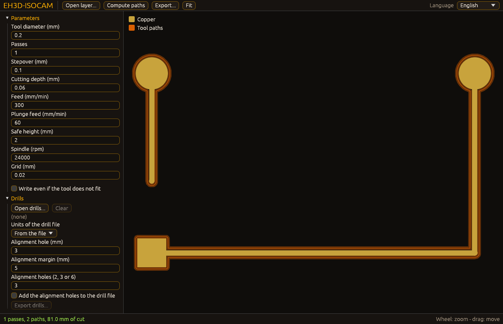

<p align="center">
  
</p>

#  EH3D-ISOCAM
<p align="center"><a href="README.md">🇺🇸 English</a> | <a href="README_spa.md">🇪🇸 Español</a> | 🇫🇷 <b>Français</b> | <a href="README_ita.md">🇮🇹 Italiano</a> | <a href="README_deu.md">🇩🇪 Deutsch</a> | <a href="README_zho.md">🇨🇳 中文</a> | <a href="README_jpn.md">🇯🇵 日本語</a> | <a href="README_por.md">🇵🇹 Português</a></p>

### Fraisage d'isolation du cuivre depuis une couche Gerber : décalages exacts, plusieurs passes et contrôle des espaces

<p align="center">
  
  
  
  
  
</p>

---

**Vérification d'honnêteté - ce qui fonctionne aujourd'hui :** une bibliothèque Rust et un programme en ligne de commande (`eh3d-isocam`) avec 361 tests qui s'exécutent sur un ordinateur : trace les trajets d'une ou de plusieurs fraises autour du cuivre d'une couche Gerber, retire le cuivre restant, choisit le sens, les points de départ et l'ordre des coupes, lit et écrit des fichiers de perçage et des contours de carte, dispose la carte pour les deux faces et pour un panneau, vérifie les règles de conception et écrit du G-code ou du HP-GL. Il a une fenêtre (compilée avec `--features gui`) qui ouvre une couche, un fichier de perçage, un contour, une couche de masque et une table de points de référence, retourne la carte et la répète sur un panneau, dessine le cuivre, les perçages, le contour et les trajets et écrit les mêmes fichiers que la ligne de commande, mais qui n'a pas encore été vue sur un écran ; il n'a pas été essayé sur une machine et n'a pas été vérifié sur une collection de fichiers réels.

---

> **État de sécurité :** ce programme ne commande aucune machine et n'est pas un système de sécurité. Ce qu'il produit doit être vérifié par une personne avant tout essai sur une machine ; rien ici n'a fonctionné sur du matériel réel.


## 📋 En un coup d'œil

| | |
|---|---|
| Version | `0.0.9` |
| Maturité | Échafaudage |
| Tests | 361 |
| Pile technique | Rust |
| Sur du matériel réel | Non essayé : rien ici n'a fonctionné sur une machine |

**Aller à  :** [Présentation](#-présentation) · [Architecture](#-architecture) · [Démarrage rapide](#-démarrage-rapide) · [Tests](#-tests) · [Structure](#-structure-du-dépôt) · [Liés](#-projets-liés)

## 🚦 État du projet

Chaque ligne est une partie de ce dépôt et le feu dit où elle en est aujourd'hui. Elle est écrite d'après ce que le dépôt peut montrer (tests, compilations, exécutions), pas d'après ce qui est prévu.

🟢 Fait et vérifié · 🟡 Fonctionne, avec des limites connues · 🟠 À moitié fait ou pas encore vérifié · 🔴 Pas fait ou ne fonctionne pas

| Domaine | État | Ce que cela veut dire ici |
|---|---|---|
| Cœur | 🟡 | trace les trajets d'une ou de plusieurs fraises autour du cuivre d'une couche Gerber, retire le cuivre restant, choisit le sens, les points de départ et l'ordre des coupes, signale les écarts trop étroits pour l'outil et écrit du G-code ou du HP-GL ; testé sur un ordinateur avec des entrées normales et abîmées, pas avec une collection de fichiers réels. |
| Fichiers et disposition | 🟡 | lit et écrit des fichiers de perçage et des contours de carte, dispose la carte pour les deux faces et pour un panneau, ajoute des trous d'alignement et vérifie les règles de conception avec l'endroit de chaque constat ; testé sur un ordinateur, pas avec des fichiers écrits par d'autres programmes ni sur une machine. |
| Isolation forcée, correction, masque | 🟡 | trajets forcés dans les espaces où l'outil ne passe pas, trajets allégés, échelle et correction par points de référence, ouvertures du masque de soudure, unités et aperçu des passes ; testé sur un ordinateur avec des couches générées et des entrées abîmées, jamais avec de vraies cartes ni sur une machine, et la correction n'a pas été comparée à de vraies mesures d'une caméra. |
| Ligne de commande | 🟡 | `eh3d-isocam` exécute les mêmes fonctions que la bibliothèque et affiche le résultat ; chaque erreur revient sous forme de message et de code de sortie non nul. |
| Tests | 🟡 | 361 tests passent (`cargo test`), avec des cas normaux, des cas limites et des entrées abîmées. |
| Sécurité | 🟡 | Rust sûr et simple (`forbid(unsafe_code)`) : rien ne panique sur les fichiers reçus et une mauvaise valeur est une erreur avec sa raison ; pas de revue indépendante. |
| Fenêtre | 🟠 | Écrite (egui, `--features gui`) : ouvrir ou déposer une couche, zoom et déplacement, modifier les principaux paramètres, exporter ; sa logique est testée et le programme d'une version la dessine dans une image (`--shot`), mais personne ne l'a encore utilisée sur un écran. |
| Matériel réel | 🔴 | Non essayé : rien ici n'a été exécuté sur une machine. |
| Documentation | 🟡 | README en huit langues, le journal des modifications et les deux images dessinées depuis `docs/`. |

## 🎯 Présentation

* **Le cuivre sur une grille** (`bitmap`) : pastilles (rondes, rectangulaires, oblongues), pistes et régions sont dessinées sur des cellules de la taille choisie ; les pistes et pastilles qui se chevauchent forment une seule pièce car une grille n'a pas de chevauchements, donc aucun cas particulier ; une grille qui ne tiendrait pas en mémoire est refusée.
* **La distance exacte** (`eh3d-raster`) : la distance de chaque cellule au cuivre le plus proche est calculée exactement (et testée contre la force brute), et le trajet d'une passe est la ligne où elle vaut le rayon de l'outil, tracée en polylignes fermées et allégée avec une tolérance d'une demi-cellule ; les passes suivantes vont chacune un pas latéral plus loin.
* **Ce que l'outil ne peut pas faire** (`isolate`) : là où deux pièces de cuivre séparées sont plus proches que la largeur de l'outil, aucun trajet ne peut passer entre elles : `check` liste ces endroits et `isolate` n'écrit pas le G-code tant qu'on ne les a pas regardés (ou `--force`). Le G-code (`src/gcode.rs`) lève l'outil entre les trajets, descend à la profondeur choisie et coupe ensuite le trajet le plus proche.
* **HP-GL pour les machines Bungard** (`src/hpgl.rs`) : avec un fichier de sortie qui se termine par `.plt`, les passes sont écrites en fichier de tracé HP-GL à 40 unités au millimètre, un stylo par passe, ce que lit le programme de fraisage des machines Bungard.
* **Plusieurs outils et cuivre restant** (`isolate`) : un plan compte jusqu'à quatre outils, le plus large coupe d'abord ; là où un outil plus large a déjà coupé le long d'un trajet d'un outil plus fin, ce tronçon est omis (le reste devient des tronçons ouverts), et des anneaux d'un outil plus large, chacun chevauchant le précédent, peuvent dégager le cuivre resté au-delà des passes ; le G-code s'arrête pour changer d'outil quand la largeur de l'outil change. Avec `around_pads_min_mm` supérieur à 0, les outils plus larges ne coupent que les anneaux autour des pastilles d'au moins cette largeur et l'outil le plus fin fait le reste (pistes et petites pastilles).
* **Sens, départ et ordre** (`order`) : les trajets sont tracés avec le cuivre à droite de l'outil (fraisage en avalant avec une broche qui tourne dans le sens horaire) ; les réglages peuvent l'inverser (en opposition), imposer horaire ou antihoraire, faire commencer chaque trajet fermé à son point le plus proche, à son point le plus bas ou là où il a été tracé, fixer le point d'où part l'outil et ranger les trajets dans l'ordre du tracé, le plus proche d'abord ou raccourcis encore en retournant des tronçons de l'ordre ; `info` montre combien de trajets vont dans chaque sens et le déplacement à vide.
* **Perçages et contour de la carte** (`src/drill.rs`) : les fichiers de perçage sont lus (ceux de Bungard en millièmes de pouce avec le lecteur des formats Bungard, les métriques avec le lecteur de la suite) et écrits en millièmes entiers ; un contour est lu depuis une couche Gerber de contour, un dessin DXF ou un fichier de tracé HP-GL, les traits dessinés un à un sont reliés, et le trajet de l'outil autour de la carte et dans ses découpes est écrit en HP-GL ou en fichier Excellon de détourage. Un fichier de perçage avec des outils numérotés au-delà de 255 les renumérote avec des numéros libres, avec un avis, pour que deux outils ne deviennent jamais un seul. Avec `--excellon-format 2.4` (ou `excellon_format = 2.4`), les coordonnées d'un fichier de perçage sont lues et écrites avec deux chiffres avant la virgule et quatre après (`X012340` vaut 1,2340 in), avec les zéros comme l'indique l'en-tête ; un fichier qui déclare son propre format le conserve. Le fichier Excellon de détourage de `route` est écrit dans le même format.
* **Deux faces, panneaux et trous d'alignement** (`transform`) : la couche, les perçages et le contour sont retournés, tournés par quarts de tour et répétés sur un panneau ensemble ; les trous d'alignement sont placés hors de la carte là où la carte retournée les retrouve (un troisième sur l'axe la distingue de la même carte tournée d'un demi-tour).
* **Règles de conception** (`drc`) : cuivre plus étroit que la règle, pièces de cuivre plus proches que la règle ou que la largeur de l'outil, et perçages avec moins de cuivre autour que la règle, chacun avec sa position en millimètres.
* **Un fichier de réglages** (`src/config.rs`) : chaque valeur réglable est un réglage avec une valeur par défaut, lu dans un fichier `clé = valeur` (`examples/isocam.cfg`) ou donné sous le même nom comme option de la ligne de commande.
* **Isolation forcée** (`forced`) : avec `forced_isolation = yes`, un trajet est aussi tracé au milieu de chaque espace où l'outil le plus fin ne passe pas, tant que l'espace n'est pas plus étroit que `forced_min_gap_mm` ; chaque endroit est signalé avec ses coordonnées et son espace, et les espaces plus étroits sont listés et laissés tels quels. Elle est désactivée par défaut : ces endroits sont alors seulement signalés.
* **Zones à problème, tolérance et distance d'alignement** (`problems`, `src/config.rs`) : `check` liste aussi, comme avertissements qui n'arrêtent rien, les coins intérieurs plus aigus que `problem_corner_angle_deg` (un outil rond laisse du cuivre dans la pointe d'une encoche ; 60 degrés par défaut, 0 le désactive) et les pistes qui passent entre deux pastilles plus proches d'elles que `problem_track_gap_factor` fois l'outil (1,5 par défaut, 0 le désactive) ; les deux critères sont des réglages, pas des valeurs fixées dans le code. `conflict_tolerance_mm` (0 par défaut : aucun espace n'est accepté) accepte les espaces plus étroits que l'outil d'au plus ce montant, dans `check` et dans `isolate`. La distance des trous d'alignement à la carte est `alignment_margin_mm` (5 mm par défaut ; d'autres programmes de ce genre les placent à 10 mm, soit `alignment_margin_mm = 10`).
* **Ponts, réseaux, motifs de trous et dégagement de zones** (`src/drill.rs`, `isolate`, `transform`, `problems`, `legacy`) : `route` peut laisser des ponts qui retiennent la carte dans la plaque (`tab_count` par chemin fermé, 0 par défaut ; `tab_width_mm` de matière restante ; `tab_min_length_mm` entre les ponts) : la coupe s'arrête une demi-largeur de pont et un demi-diamètre d'outil avant le milieu de chaque pont. `isolate --net X,Y` n'isole que le réseau qui contient un point, avec l'outil `net_tool_mm`. `rubout-area OUT --area X0,Y0,X1,Y1` écrit des lignes parallèles de l'outil `rubout_lines_tool_mm` (direction `rubout_lines_direction`) qui dégagent une zone. Les trous d'alignement peuvent être 2, 3 ou 6, hors de la carte ou, avec `alignment_pattern = special`, selon un motif autour de son centre (`alignment_special_a_mm` d'écart pour la paire, `alignment_special_b_mm` pour les quatre autres). Avec une tolérance de conflit, `check` et `isolate` signalent les pistes et pastilles rectangulaires plus fines que le double de la tolérance plus `tolerance_warning_margin_mm`. L'estimation du format d'une couche Gerber ancienne utilise maintenant les unités indiquées par le fichier et la taille de la carte, et une liste d'ouvertures peut donner les deux côtés dans une cellule (`60x40`).
* **Tolérance pour les pastilles seules, remplissage par contours, type de fichier, DXF et plumes du traceur** (`tolerance`, `fill`, `src/filetype.rs`, `src/dxf.rs`, `src/hpgl.rs`) : `conflict_tolerance_scope = pads` (`all` par défaut, comme avant) réserve la tolérance de conflit aux espaces qui ont une pastille à côté, et l'avertissement de cuivre fin ne regarde alors que les pastilles. `rubout-area OUT [COUCHE.gtl] --contour FICHIER` (ou `--area`) remplit les chemins fermés d'un fichier, pair-impair pour qu'un chemin intérieur soit un trou, avec des lignes en va-et-vient de `rubout_lines_tool_mm` ; avec une couche, les lignes sont coupées au cuivre : tout l'outil sur le cuivre plus `rubout_fill_margin_mm`. Une couche qui est en fait un fichier Excellon, HP-GL ou DXF (ou un fichier de perçage qui est une couche Gerber) est refusée par son nom, et `kind FICHIER...` dit ce qu'est chaque fichier. `isolate` et `rubout-area` écrivent un dessin DXF pour un nom en `.dxf`. `drills ENTRÉE SORTIE.plt` trace les trous avec une plume par foret (`hpgl_pen_map = 1:2, 3:1` ; les forets absents prennent les plumes libres les plus basses), et `hpgl_pen_speed_cm_s` (0 = celle de la machine, par défaut) écrit la vitesse de plume dans tout tracé. `hpgl_isocam_style` (activé) écrit le tracé comme le programme d'origine : un `PA` par point et des lignes d'environ 75 colonnes terminées par CR LF ; désactivé, il écrit la forme compacte.
* **Cartes double face et fichier de perçage simple** (`src/hpgl.rs`, `src/drill.rs`, `src/filetype.rs`) : `hpgl_shift_negative = no` conserve dans le tracé les coordonnées de la carte (négatives comprises), de sorte que le tracé et le fichier de perçage partagent la même origine ; `isolate` avec `plot_outline = yes` et `--outline FICHIER` place d'abord dans le tracé la coupe autour du contour (avec l'outil de `route_tool_mm`), sur la plume `hpgl_outline_pen`, l'isolation étant sur la plume `hpgl_isolation_pen`. `--mirror vertical` retourne les trous autour du milieu du contour. `ncd_isocam_style = yes` écrit un fichier de perçage comme les programmes Bungard (`M48` et `%`, outils par leur seul numéro, coordonnée répétée omise, CR LF, `M00`) et `ncd_digits` complète les coordonnées par des zéros devant. Un fichier de perçage sans ligne `M48` est reconnu comme Excellon. Quand les tracés sont décalés, `hpgl_margin_mm` fixe le décalage commun du tracé d'isolation et du tracé de perçage d'une carte, pour qu'ils restent alignés. `spindle_wait_s` écrit une attente (`G4`) après chaque démarrage de la broche dans le G-code.
* **Trajets allégés, échelle et correction** (`optimize`, `fiducial`) : les pointes sont retirées et les points alignés (dans `optimize_tolerance_mm`) deviennent un seul mouvement, activé par défaut (0,01 mm et 0,02 mm ; 0 le désactive) ; le travail peut être mis à l'échelle autour du centre de la carte, et des paires de points de référence relatives à ce centre (où une marque devrait être et où elle a été mesurée) donnent une similitude (deux paires) ou un ajustement affine (trois ou plus, moindres carrés) appliqué à chaque trajet et à chaque trou ; il est refusé quand l'échelle s'écarte beaucoup de 1 ou qu'une marque ne colle pas.
* **Masque de soudure** (`mask`) : les ouvertures sont écrites comme une couche Gerber, à partir de la couche de masque du dessin ou des pastilles du cuivre, chacune agrandie de `mask_margin_mm` ; les pistes restent couvertes.
* **Unités et aperçu** (`eh3d-raster`, `src/preview.rs`) : une longueur peut porter `mm`, `mil` ou `in`, le G-code peut être écrit en pouces, et `preview` dessine les passes sur le cuivre en dessin SVG ou en texte.
* **Couches Gerber anciennes** (`legacy`) : une couche sans instruction de format (RS-274D, comme l'écrivent beaucoup d'anciens programmes) est lue quand on donne sa liste d'ouvertures (`--apertures`, un code D et sa taille par ligne) avec son format (`--gerber-format 2.3`, `--gerber-zeros`, `--gerber-units`) ; elle est réécrite en Gerber étendu et passe par le lecteur normal. Testé avec des couches écrites à la main, pas avec des fichiers d'autres programmes.
* **Lecture et avis par code (ligne de commande) :** les fichiers sont lus avec une limite de taille (`--max-bytes N` ou `max_input_mb`, 64 MiB par défaut) et le texte non UTF-8 est lu comme du Latin-1 avec un avertissement (`input-not-utf8`) ; les avis du lecteur Gerber sont affichés avec leur code stable et `--hide CODE[,CODE]` omet ces codes. La note sur les tracés allégés et celle sur les ponts de la découpe ne sont affichées que lorsqu'elles ont changé quelque chose. `arc_tolerance_mm` fixe la précision avec laquelle les arcs d'une couche sont suivis. `min_tool_mm` (0,02 par défaut) fixe l'outil le plus fin que peut avoir un réglage d'outil, et un outil plus fin est refusé avec le nom du réglage ; `rapid_mm_min` (0 par défaut, pas d'estimation) est la vitesse des déplacements rapides, avec laquelle `info` ajoute une estimation de la durée du travail (coupe, descente, déplacements ; l'attente de la broche et les changements d'outil à la main ne sont pas comptés). `hpgl_units_per_mm` (40 par défaut, de 10 à 1000) fixe les unités d'un fichier de tracé par millimètre ; la vérification de la plage de 32767 unités le suit (327 mm avec 100).
* **Outils du magasin** (`src/crib.rs`) : `--crib FICHIER` (ou `crib_file`) lit le tableau CSV qu'exporte `eh3d-tools`, et `--crib-fine N`, `--crib-coarse N` et `--crib-route N` y prennent les outils portant ces numéros : la largeur avec laquelle une fraise, une fraise en V ou un graveur coupe à `depth_mm` devient `fine_tool_mm` ou `coarse_tool_mm` (une fraise en V coupe `2 * profondeur * tan(angle / 2) + crib_vbit_flat_mm` de large, au plus son diamètre, arrondie par défaut au dix-millième de millimètre) et le diamètre d'une fraise devient `route_tool_mm` ; chaque remplacement est signalé sur la sortie d'erreur, un foret, un laser ou une buse est refusé, et un outil trop fin pour `min_tool_mm` est refusé avec le nom du réglage. Le tableau n'est lu que lorsqu'un outil est choisi.

## 🧩 Rôle dans EH3D

EH3D-ISOCAM est un programme de l'EH3D Fabrication Suite. Il fonctionne comme bibliothèque et ligne de commande et, compilé avec `--features gui`, comme fenêtre avec l'aspect commun aux autres programmes de la suite. Il lit et écrit des fichiers simples et peut donc s'utiliser seul ou entre les autres programmes.

## 🏛️ Architecture

<p align="center">
  
</p>


Comment les parties de ce dépôt s'articulent : qui l'utilise, ce qu'il contient et de quoi il dépend. L'image est dessinée depuis `docs/architecture.json` et vérifiée avec le code.

## 🖼️ Captures d'écran

<p align="center">
  
</p>

<p align="center"><em>La fenêtre avec la couche d'exemple de `examples/`, après le calcul des trajectoires : le cuivre en doré, les trajectoires de l'outil autour en orange, les paramètres et les perçages à gauche. L'image a été écrite par le mode image (`--shot`) du programme publié, avec les paramètres par défaut ; personne n'a encore utilisé la fenêtre sur un écran.</em></p>

## ✨ Fonctionnalités

* **Une bibliothèque et une ligne de commande :** chaque commande de `eh3d-isocam` est une fonction de la bibliothèque ; un autre programme de la suite peut l'appeler sans lancer de processus.
* **Tests avec entrées abîmées :** les tests fournissent aussi des fichiers vides, du bruit, des nombres énormes et des fichiers coupés, et aucun ne doit paniquer.
* **Sans deviner :** une valeur absurde est une erreur qui dit laquelle et pourquoi, jamais un résultat qui n'en a que l'air.
* **Pas de code unsafe :** `#![forbid(unsafe_code)]` dans la bibliothèque et le programme.
* **Chaque valeur réglée est un réglage :** rien de ce qu'une personne voudrait changer n'est caché dans le code ; une mauvaise valeur est une erreur avec sa ligne.
* **Unités au choix :** les longueurs d'un fichier de réglages ou de la ligne de commande peuvent être écrites en millimètres, en mils ou en pouces ; le G-code peut être écrit en pouces et l'écran peut afficher des mils.
* **Des fichiers plus sûrs :** le G-code commence par l'en-tête standard (générateur, unités, fichier source avec son SHA-256), une sortie qui est aussi une entrée de l'exécution est refusée, un tracé avec une coordonnée au-delà de 32767 unités est refusé, `--units mm|inch` donne les unités d'un fichier de perçage qui ne les dit pas (un fichier aux trous minuscules et sans unités est refusé sans cela), et le contour fait de traits séparés est joint avec un index, si bien que cinquante mille segments prennent un instant.
* **Sortie vérifiée et documentée :** le fichier de perçage indique dans un commentaire que ses coordonnées sont en millièmes de pouce entiers sans point décimal et de combien l'arrondi peut se tromper ; les tests relisent le G-code des passes et celui de la ligne de commande avec le lecteur de la suite, qui ne trouve ni avertissement, ni déplacement rapide dans la matière, ni coupe avec la broche arrêtée.
* **Des repères depuis un tableau :** `--fiducials-csv FICHIER` lit les paires de repères (x de conception, y de conception, x mesuré, y mesuré ; une ligne d'en-tête et les lignes qui commencent par `#` sont ignorées), si bien que la sortie de `eh3d-vision align --isocam-args` s'utilise telle quelle.

## 🔒 Sécurité et protection

| Menace | Défense |
|---|---|
| Un fichier abîmé, coupé ou vide | pas de panique : les tests coupent une entrée valide à chaque position et fournissent du bruit |
| Un nombre absurde (négatif, non fini, démesuré) | refusé avec une erreur qui nomme la valeur ; rien n'est arrondi en quelque chose de plausible |
| Usage non sûr de la mémoire | Rust sûr et simple avec `forbid(unsafe_code)` |

**Ce qui n'est pas défendu :** un résultat produit sans erreur n'est pas un résultat vérifié. Rien ici ne connaît les limites d'une machine et le programme n'a pas eu de revue indépendante. Signalez une vulnérabilité en privé (voir [SECURITY.md](SECURITY.md)).

## 🔌 Interfaces

La bibliothèque est `eh3d_isocam` (`use eh3d_isocam::...`) ; la ligne de commande est `eh3d-isocam`. Chaque commande affiche son résultat sur la sortie standard et signale une erreur sur la sortie d'erreur avec un code de sortie non nul. Il n'y a aucun accès au réseau. Le texte de l'aide (`eh3d-isocam help`) est en anglais :

Le code de sortie suit la convention de la suite : 0 si l'exécution s'est bien passée, 1 si le travail a échoué (par exemple un fichier illisible) et 64 si la ligne de commande a été mal utilisée (une commande ou une option inconnue, ou quelque chose dont une commande a besoin et qui manque).

```text
eh3d-isocam isolate LAYER.gtl OUT.nc|OUT.plt|OUT.dxf  paths round the copper (G-code, HP-GL for a .plt, DXF for a .dxf)
eh3d-isocam check LAYER.gtl                      places where the tool does not fit between pieces of copper
eh3d-isocam info LAYER.gtl                       passes, paths each way round, travel through the air
eh3d-isocam preview LAYER.gtl [OUT.svg|OUT.txt]    the passes drawn over the copper, as SVG or text
eh3d-isocam drc LAYER.gtl [--drills F.ncd]       design rules, with the place of every finding
eh3d-isocam drills IN.ncd OUT.ncd|OUT.plt [--align]  read, turn over, panel and add alignment holes; .plt = a pen per drill
eh3d-isocam route OUTLINE OUT.plt|OUT.ncd        path of the tool round the board
eh3d-isocam rubout-area OUT.nc|OUT.plt|OUT.dxf [LAYER.gtl] --area X0,Y0,X1,Y1|--contour FILE  parallel lines of a tool that clear an area or fill closed paths, cut to the copper of LAYER
eh3d-isocam kind FILE...                        say what kind of file each one is (Gerber, old-style Gerber, Excellon, HP-GL, DXF)
eh3d-isocam mask COPPER.gtl OUT.gts [--mask-layer F] openings of the solder mask, from the mask layer or the pads
eh3d-isocam config                               every setting with its default, as a file
eh3d-isocam [gui] [LAYER.gtl]                    the window (a build with --features gui); with no arguments it opens
eh3d-isocam gui [LAYER.gtl] --shot OUT.png [--size WxH] [--theme forge|dark|light] [--wait N] [--lang CODE] [--replace]   a picture of the window
options: --config FILE  --outline FILE  --drills FILE  --force  and every setting by its name (--fine-tool-mm 0.15, --fine-tool-mm 8mil, --forced-isolation yes, --fiducial "0,0,0.1,0.05")
old-style Gerber (no format statement): --apertures FILE  --gerber-format 2.3  --gerber-zeros leading|trailing  --gerber-units inch|mm  --aperture-units mil|mm|inch
drill and routing files: --excellon-format auto|2.4   (2.4 = two digits before the point, four after)
tools from the crib: --crib FILE  --crib-fine N  --crib-coarse N  --crib-route N   (N = the number of the tool in the table of eh3d-tools; 0 = keep the setting)
```

```text
EH3D-ISOCAM/
├── src/
│   ├── board.rs                                 les étapes que la ligne de commande et la fenêtre partagent
│   ├── browse.rs                                la liste des fichiers de la fenêtre d'ouverture d'un fichier
│   ├── config.rs                                toutes les valeurs réglables, depuis un fichier de réglages
│   ├── crib.rs                                  les outils du magasin et la largeur de coupe de chacun
│   ├── draw.rs                                  ce que dessine la fenêtre : les formes et les triangles des régions
│   ├── drill.rs                                 perçages et contour de la carte, lus et écrits
│   ├── dxf.rs                                   les passes en dessin DXF
│   ├── filetype.rs                              de quel type est un fichier d'entrée
│   ├── gcode.rs                                 les trajets en G-code
│   ├── gui.rs                                   la fenêtre (egui, avec la fonctionnalité gui) : dessine l'état et transmet ce que fait la personne
│   ├── hpgl.rs                                  les trajets en fichier de tracé HP-GL
│   ├── lang.rs                                  les mots de la fenêtre dans les huit langues
│   ├── lib.rs                                   la bibliothèque : ce que chaque commande utilise
│   ├── main.rs                                  la ligne de commande
│   ├── preview.rs                               les passes dessinées en SVG ou en texte
│   ├── shot.rs                                  le mode capture de la fenêtre (--shot) : ses arguments, lus et vérifiés sans écran
│   ├── viewport.rs                              zoom et déplacement de l'image, en simples nombres
│   └── window.rs                                l'état de la fenêtre sans écran : couche, paramètres, trajets, export et état
├── tests/
│   ├── fuzz.rs                                  tests à graine fixe : fichiers abîmés, coupures et nombres étranges
│   ├── advanced.rs                              isolation forcée, correction, masque, unités, aperçu
│   ├── cli_reading.rs                           tests de lecture des fichiers : la limite de taille, le texte non UTF-8, les avis par code
│   ├── crib.rs                                  tests des outils pris dans le magasin
│   ├── excellon_format.rs                       tests du format 2.4 des coordonnées d'un fichier de perçage
│   ├── files.rs                                 tests des fichiers de perçage et de contour
│   ├── isocam.rs                                tests de la bibliothèque et de la ligne de commande
│   ├── kinds.rs                                 tolérance pastilles, remplissages, types de fichier, plumes, DXF
│   ├── layout.rs                                tests du double face, des panneaux, des règles et de la ligne de commande
│   ├── multi.rs                                 tests des outils, du cuivre restant, du sens, de l'ordre et des réglages
│   ├── problems.rs                              tests des zones à problème, de la tolérance et des trous d'alignement
│   ├── readme.rs                                tests qui exécutent ce que promettent le README et les scripts run
│   └── window_cli.rs                            tests qu'une compilation sans la fonctionnalité gui reste une ligne de commande
├── examples/
│   ├── crib.csv                                 un magasin d'exemple (CSV) pour essayer --crib
│   ├── isocam.cfg                               tous les réglages avec leur valeur par défaut, à copier et modifier
│   └── sample.gtl                               un exemple pour essayer le programme
├── docs/
│   ├── architecture.json                        données de l'image d'Architecture
│   └── structure.json                           données de l'image de Structure
├── tools/                                       contrôle de la CI et du README et outils d'images
├── images/                                      bannière, captures de la fenêtre et images d'Architecture et de Structure
├── .github/                                     workflows de CI et de publication, modèles d'issues et de pull requests
├── eh3d.project.json                            manifeste : version, rôle, maturité et commande de compilation
├── Cargo.toml Cargo.lock                        le workspace et ses dépendances verrouillées
├── rust-toolchain.toml                          la toolchain Rust épinglée
├── CHANGELOG.md                                 ce qui a changé dans chaque version
├── SECURITY.md SUPPORT.md                       signaler une vulnérabilité et poser des questions
└── CONTRIBUTING.md CODE_OF_CONDUCT.md LICENSE   contribuer, code de conduite et licence
```

## ⚙️ Configuration

Chaque valeur réglable est un réglage avec une valeur par défaut : diamètres, passes et décalage de l'outil fin et du gros outil, le retrait du cuivre restant, la profondeur, l'avance et la vitesse, le sens, le point de départ, le début de chaque trajet et l'ordre, l'outil qui découpe la carte, les trous d'alignement, le miroir, la rotation et le panneau, et les règles de conception. `eh3d-isocam config` les affiche tous sous forme de fichier (`examples/isocam.cfg` est ce fichier) ; `--config FICHIER` en lit un, et tout réglage peut être donné sur la ligne de commande comme option du même nom (`--fine-tool-mm 0.15`), qui l'emporte sur le fichier. Une valeur absurde est une erreur qui indique la ligne. Les limites fixes vivent dans le code comme constantes nommées et sont couvertes par des tests. L'isolation forcée, les trajets allégés, l'échelle et les points de référence, la marge du masque de soudure, les unités et la largeur de l'aperçu en texte sont aussi des réglages. Le format des coordonnées d'un fichier de perçage (`excellon_format` : `auto` ou `2.4`) est aussi un réglage.

## 🚀 Démarrage rapide

Il faut une chaîne d'outils Rust stable (1.88 ou plus récente).

```bash
cargo build --release
cargo test
cargo run --release -- isolate examples/sample.gtl examples/sample.nc --passes 2
cargo run --release --features gui   # the window
cargo run --release --features gui -- --shot screen.png examples/sample.gtl   # a picture of the window
```

Pour prendre une capture de la fenêtre sans l'ouvrir à la main, lancez-la avec `--shot FICHIER.png` (aussi `--size WxH`, `--theme forge|dark|light`, `--wait N`, `--lang CODE`, `--open FILE`, `--replace`) : elle s'ouvre à cette taille, enregistre le PNG, ne garde aucun réglage et se ferme toute seule (code de sortie 0 si le fichier a été écrit, 1 sinon, 2 si les arguments sont erronés).

## 🧪 Tests

La suite compte 361 tests (`cargo test`, exécutés sous Windows et Linux dans le CI). Ils vérifient les cas normaux, les cas limites et les entrées abîmées : fichiers vides, bruit et fichiers coupés ne font jamais paniquer. Le CI exécute aussi `cargo fmt --check`, `cargo clippy` avec les avertissements comme erreurs et `python -I tools/ci_validate.py`.

## 🏗️ Compilation et publication

La version se trouve dans `Cargo.toml` et `eh3d.project.json` ; chaque version a son entrée dans [CHANGELOG.md](CHANGELOG.md). `build.bat` / `build.sh` compilent le programme, `test.bat` / `test.sh` lancent les tests et `run.bat` / `run.sh` l'exécutent avec un exemple. Les versions sont publiées sur GitHub.

### Téléchargements

Chaque version contient le programme avec sa fenêtre pour Windows (64 et 32 bits), Linux (64 bits) et macOS (Apple silicon et Intel), sous la forme `<nom>-<version>-<système>.zip` (Windows) ou `.tar.gz` avec le programme, la licence, le lisez-moi, l'icône et les exemples. Les fichiers sont construits par GitHub Actions, listés dans `SHA256SUMS` et signés avec la clé d'EH3D. Pour vérifier un téléchargement, comparez son empreinte avec le fichier `.sha256` qui l'accompagne (`sha256sum -c`) et vérifiez sa signature avec le fichier `.sig` qui l'accompagne (`ssh-keygen -Y verify`).

## 📂 Structure du dépôt

<p align="center">
  
</p>

<details>
<summary>Version texte de l'arborescence</summary>

```text
EH3D-ISOCAM/
├── src/
│   ├── board.rs                                 les étapes que la ligne de commande et la fenêtre partagent
│   ├── browse.rs                                la liste des fichiers de la fenêtre d'ouverture d'un fichier
│   ├── config.rs                                toutes les valeurs réglables, depuis un fichier de réglages
│   ├── crib.rs                                  les outils du magasin et la largeur de coupe de chacun
│   ├── draw.rs                                  ce que dessine la fenêtre : les formes et les triangles des régions
│   ├── drill.rs                                 perçages et contour de la carte, lus et écrits
│   ├── dxf.rs                                   les passes en dessin DXF
│   ├── filetype.rs                              de quel type est un fichier d'entrée
│   ├── gcode.rs                                 les trajets en G-code
│   ├── gui.rs                                   la fenêtre (egui, avec la fonctionnalité gui) : dessine l'état et transmet ce que fait la personne
│   ├── hpgl.rs                                  les trajets en fichier de tracé HP-GL
│   ├── lang.rs                                  les mots de la fenêtre dans les huit langues
│   ├── lib.rs                                   la bibliothèque : ce que chaque commande utilise
│   ├── main.rs                                  la ligne de commande
│   ├── preview.rs                               les passes dessinées en SVG ou en texte
│   ├── shot.rs                                  le mode capture de la fenêtre (--shot) : ses arguments, lus et vérifiés sans écran
│   ├── viewport.rs                              zoom et déplacement de l'image, en simples nombres
│   └── window.rs                                l'état de la fenêtre sans écran : couche, paramètres, trajets, export et état
├── tests/
│   ├── advanced.rs                              isolation forcée, correction, masque, unités, aperçu
│   ├── cli_reading.rs                           tests de lecture des fichiers : la limite de taille, le texte non UTF-8, les avis par code
│   ├── crib.rs                                  tests des outils pris dans le magasin
│   ├── excellon_format.rs                       tests du format 2.4 des coordonnées d'un fichier de perçage
│   ├── files.rs                                 tests des fichiers de perçage et de contour
│   ├── isocam.rs                                tests de la bibliothèque et de la ligne de commande
│   ├── kinds.rs                                 tolérance pastilles, remplissages, types de fichier, plumes, DXF
│   ├── layout.rs                                tests du double face, des panneaux, des règles et de la ligne de commande
│   ├── multi.rs                                 tests des outils, du cuivre restant, du sens, de l'ordre et des réglages
│   ├── problems.rs                              tests des zones à problème, de la tolérance et des trous d'alignement
│   ├── readme.rs                                tests qui exécutent ce que promettent le README et les scripts run
│   └── window_cli.rs                            tests qu'une compilation sans la fonctionnalité gui reste une ligne de commande
├── examples/
│   ├── crib.csv                                 un magasin d'exemple (CSV) pour essayer --crib
│   ├── isocam.cfg                               tous les réglages avec leur valeur par défaut, à copier et modifier
│   └── sample.gtl                               un exemple pour essayer le programme
├── docs/
│   ├── architecture.json                        données de l'image d'Architecture
│   └── structure.json                           données de l'image de Structure
├── tools/                                       contrôle de la CI et du README et outils d'images
├── images/                                      bannière, captures de la fenêtre et images d'Architecture et de Structure
├── .github/                                     workflows de CI et de publication, modèles d'issues et de pull requests
├── eh3d.project.json                            manifeste : version, rôle, maturité et commande de compilation
├── Cargo.toml Cargo.lock                        le workspace et ses dépendances verrouillées
├── rust-toolchain.toml                          la toolchain Rust épinglée
├── CHANGELOG.md                                 ce qui a changé dans chaque version
├── SECURITY.md SUPPORT.md                       signaler une vulnérabilité et poser des questions
└── CONTRIBUTING.md CODE_OF_CONDUCT.md LICENSE   contribuer, code de conduite et licence
```

</details>

## 🗺️ Feuille de route et limites connues

**Limites connues aujourd'hui**

* La fenêtre n'a pas été vue sur un écran ; elle utilise les réglages par défaut en dehors des paramètres qu'elle montre, et ne couvre pas les commandes `check`, `drc`, `info`, `preview` et `rubout-area` : elles restent en ligne de commande.
* Il n'a été essayé ni sur une machine ni avec une collection de fichiers réels, et n'a eu aucune revue indépendante.
* Les trajets sont exacts à une demi-cellule près, pas à la courbe elle-même ; il n'y a pas de stratégie Voronoï, les arcs ne sont pas ajustés, par choix (une courbe est faite de nombreux petits mouvements), un trajet forcé laisse un outil plus large que l'espace toucher le cuivre des deux côtés, la correction par points de référence déplace les trajets mais garde la taille du décalage de l'outil, l'échelle se fait par rapport au centre de la carte, il n'y a pas de couche de sérigraphie, et aucune carte n'a été fraisée avec ces trajets.
* Le masque de soudure suit les pastilles telles qu'elles sont dessinées (cercles, rectangles et obronds) ; les pistes restent couvertes et une marge négative ne rétrécit pas une région.
* Le retrait du cuivre restant se fait par anneaux d'un outil plus large à distance du cuivre : les endroits plus étroits que cet outil gardent leur cuivre, et il ne suit pas le bord de la carte.
* Les tronçons omis pour un outil plus fin sont décidés sur une grille avec deux cellules de marge ; on préfère couper un tronçon deux fois que le laisser non coupé.
* Les fichiers de perçage sont écrits en millièmes de pouce entiers (convention des programmes Bungard) : un diamètre `T1C0.8` sans unité est lu en millimètres à partir de 0,2 et en pouces en dessous ; les fichiers avec des rainures ou des trajets de détourage les laissent de côté avec une note. Les fichiers écrits n'ont été relus que par les lecteurs de cette suite, pas par d'autres programmes ni machines.
* Les règles de conception n'arrondissent pas les angles d'une pastille carrée et ne vérifient ni le cuivre par rapport au bord de la carte ni le vernis épargne ; le contrôle des anneaux prend la pastille telle que dessinée dans la couche Gerber.
* Les outils du magasin sont lus dans son tableau CSV, pas dans son fichier JSON, et la fenêtre n'utilise pas le magasin ; la largeur d'une fraise en V est calculée à partir de son angle, de la profondeur et d'un méplat fixé à la main, elle n'est pas mesurée.

**Ensuite**

* Voir la fenêtre sur un écran et y apporter les vérifications de la ligne de commande (`check`, `drc`, l'aperçu).
* La stratégie Voronoï ; comparer la correction par points de référence à des mesures d'une caméra.
* Couches de sérigraphie.
* Comparer les trajets avec des cartes réellement fraisées et l'essayer avec des fichiers réels et avec les autres programmes de la suite.

## 🌍 Langues

Le README et les textes existent en anglais, espagnol, français, italien, allemand, chinois, japonais et portugais européen.

## 🔗 Projets liés

* [EH3D-CORE-LIBS](https://github.com/JuanenRac/EH3D-CORE-LIBS): les lecteurs de Gerber, Excellon et G-code
* [EH3D-COMMON](https://github.com/JuanenRac/EH3D-COMMON): les formats de fichiers des machines Bungard : perçage, tracé et contours
* [EH3D-GERBERVIEWER](https://github.com/JuanenRac/EH3D-GERBERVIEWER): le visualiseur de couches Gerber
* [EH3D-TOOL-MANAGER](https://github.com/JuanenRac/EH3D-TOOL-MANAGER): le magasin d'outils partagé par les programmes CAM
* [EH3D-CAM-DEBUGGER](https://github.com/JuanenRac/EH3D-CAM-DEBUGGER): la vérification du G-code avant qu'il n'atteigne une machine
* [EH3D-AUTOLEVEL](https://github.com/JuanenRac/EH3D-AUTOLEVEL): la carte de hauteurs et la correction du G-code
* [EH3D-VISION-STUDIO](https://github.com/JuanenRac/EH3D-VISION-STUDIO): les caméras, les fiduciaires et l'inspection

## 📚 Documentation

* [Journal des modifications](CHANGELOG.md)
* [Données d'architecture et de structure](docs/architecture.json) : les données qui servent à dessiner les deux images.

## 🤝 Contribuer et communauté

* Avant une pull request, lancez `cargo fmt --check`, `cargo clippy --all-targets -- -D warnings`, `cargo test` et `python -I tools/ci_validate.py` : tout doit passer. Voir [CONTRIBUTING.md](CONTRIBUTING.md) et le [code de conduite](CODE_OF_CONDUCT.md).
* Le README existe en huit langues : un changement de texte se fait dans les huit fichiers, et les deux images sont dessinées depuis `docs/architecture.json` et `docs/structure.json` par `tools/make_architecture.py` et `tools/make_structure.py`.
* Signalez une vulnérabilité en privé : [SECURITY.md](SECURITY.md). Questions, idées et rapports : electrohobby3d@gmail.com ([SUPPORT.md](SUPPORT.md)).

## 👤 AUTEUR

**JuanenRac (Electro Hobby 3D)** · electrohobby3d@gmail.com

## 📜 LICENCE

Logiciel : GPL-3.0-or-later. Voir [LICENSE](LICENSE). Les conceptions matérielles de la suite utilisent la CERN OHL-S.
