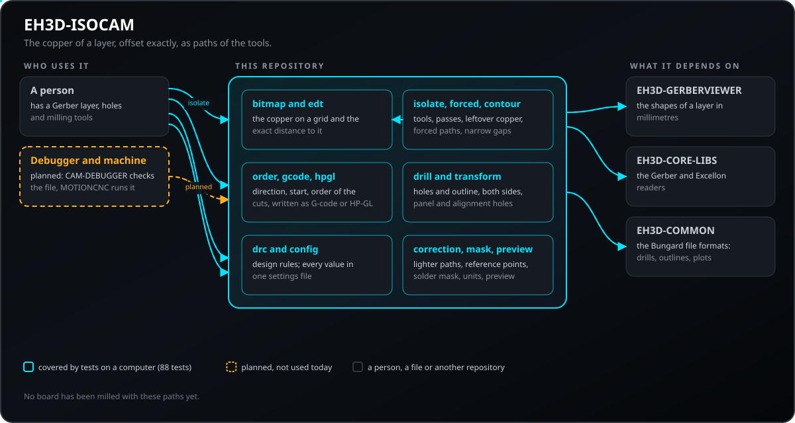
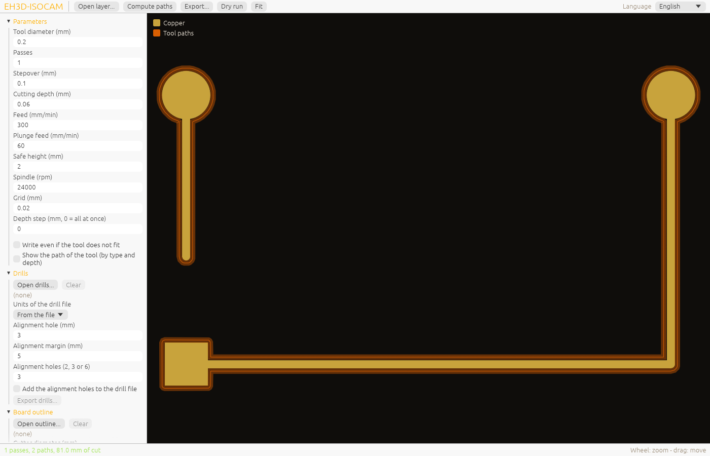
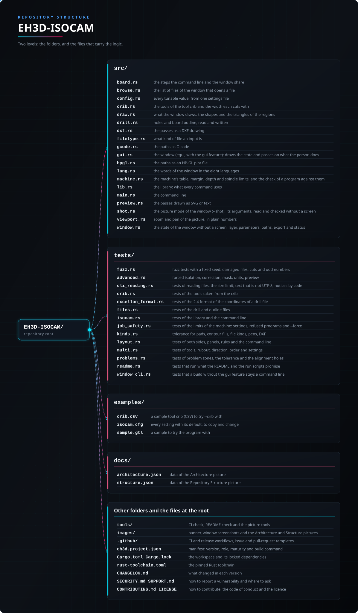

<p align="center">
  
</p>

#  EH3D-ISOCAM
<p align="center"><a href="README.md">🇺🇸 English</a> | <a href="README_spa.md">🇪🇸 Español</a> | <a href="README_fra.md">🇫🇷 Français</a> | <a href="README_ita.md">🇮🇹 Italiano</a> | <a href="README_deu.md">🇩🇪 Deutsch</a> | <a href="README_zho.md">🇨🇳 中文</a> | <a href="README_jpn.md">🇯🇵 日本語</a> | 🇵🇹 <b>Português</b></p>

### Fresagem de isolamento do cobre a partir de uma camada Gerber: deslocamentos exatos, várias passagens e verificação de espaços

<p align="center">
  
  
  
  
  
</p>

---

**Verificação de honestidade - o que funciona hoje:** uma biblioteca Rust e um programa de linha de comandos (`eh3d-isocam`) com 604 testes que correm num computador: traça os percursos de uma ou mais fresas à volta do cobre de uma camada Gerber, retira o cobre restante, escolhe o sentido, os pontos de partida e a ordem dos cortes, lê e escreve ficheiros de furação e contornos da placa, dispõe a placa para as duas faces e para um painel, verifica as regras de projeto e escreve G-code ou HP-GL. Tem uma janela (compilada com `--features gui`) que abre uma camada, um ficheiro de furação, um contorno, uma camada de máscara e uma tabela de pontos de referência, vira a placa e repete-a num painel, desenha o cobre, os furos, o contorno e as trajetórias e escreve os mesmos ficheiros que a linha de comandos, mas que ainda não foi vista num ecrã; não foi experimentado numa máquina e não foi verificado com uma coleção de ficheiros reais.

---

> **Estado de segurança:** este programa não controla nenhuma máquina e não é um sistema de segurança. O que produz deve ser verificado por uma pessoa antes de se executar algo numa máquina; nada disto correu em hardware real.


## 📋 Num relance

| | |
|---|---|
| Versão | `0.1.9` |
| Maturidade | Estrutura inicial |
| Testes | 604 |
| Tecnologias | Rust |
| Em hardware real | Não experimentado: nada disto correu numa máquina |

**Ir para:** [Visão geral](#-visão-geral) · [Arquitetura](#-arquitetura) · [Início rápido](#-início-rápido) · [Testes](#-testes) · [Estrutura](#-estrutura-do-repositório) · [Relacionados](#-projetos-relacionados)

## 🚦 Estado do projeto

Cada linha é uma parte deste repositório e a luz diz até onde chega hoje. É escrita com o que o repositório consegue demonstrar (testes, compilações, execuções), não com o que está previsto.

🟢 Feito e verificado · 🟡 Funciona, com limites conhecidos · 🟠 Feito a meio ou ainda por verificar · 🔴 Por fazer ou a não funcionar

| Área | Estado | O que significa aqui |
|---|---|---|
| Núcleo | 🟡 | traça os percursos de uma ou mais fresas à volta do cobre de uma camada Gerber, retira o cobre restante, escolhe o sentido, os pontos de partida e a ordem dos cortes, indica as folgas demasiado estreitas para a ferramenta e escreve G-code ou HP-GL; testado num computador com entradas normais e danificadas, não com uma coleção de ficheiros reais. |
| Ficheiros e disposição | 🟡 | lê e escreve ficheiros de furação e contornos da placa, dispõe a placa para as duas faces e para um painel, acrescenta furos de alinhamento e verifica as regras de projeto com a posição de cada achado; testado num computador, não com ficheiros escritos por outros programas nem numa máquina. |
| Isolamento forçado, correção, máscara | 🟡 | percursos forçados nos espaços onde a ferramenta não cabe, percursos mais leves, escala e correção com pontos de referência, aberturas da máscara de soldadura, unidades e pré-visualização das passagens; testado num computador com camadas geradas e entradas danificadas, nunca com placas reais nem numa máquina, e a correção não foi comparada com medições reais de uma câmara. |
| Linha de comandos | 🟡 | `eh3d-isocam` executa as mesmas funções da biblioteca e imprime o resultado; cada erro volta como mensagem e código de saída diferente de zero. |
| Testes | 🟡 | 604 testes passam (`cargo test`), com casos normais, casos-limite e entradas danificadas. Incluem uma simulação com semente fixa de uma máquina Bungard com o curso da sua mesa, com falhas injetadas e recuperação. |
| Segurança | 🟡 | Rust seguro e simples (`forbid(unsafe_code)`): nada entra em pânico com os ficheiros recebidos e um valor mau é um erro com o seu motivo; sem revisão independente. |
| Janela | 🟠 | Escrita (egui, `--features gui`): abrir ou largar uma camada, zoom e deslocamento, editar os parâmetros principais, exportar; a sua lógica está testada e o programa de uma versão desenha-a numa imagem (`--shot`), mas ainda ninguém a usou num ecrã. |
| Hardware real | 🔴 | Não experimentado: nada disto foi executado numa máquina. |
| Documentação | 🟡 | README em oito idiomas, o registo de alterações e as duas imagens desenhadas a partir de `docs/`. |

## 🎯 Visão geral

* **O cobre numa grelha** (`bitmap`): pads (redondos, retangulares, ovais), pistas e regiões são desenhados em células do tamanho escolhido; pistas e pads sobrepostos são uma só peça porque uma grelha não tem sobreposições, por isso não é preciso nenhum caso especial; uma grelha que não coubesse na memória é recusada.
* **A distância exata** (`eh3d-raster`): a distância de cada célula ao cobre mais próximo calcula-se exatamente (e testa-se contra força bruta), e a trajetória de uma passagem é a linha onde vale o raio da ferramenta, traçada como polilinhas fechadas e aliviada com uma tolerância de meia célula; as passagens seguintes vão cada uma um passo lateral mais longe.
* **O que a ferramenta não consegue fazer** (`isolate`): onde duas peças de cobre separadas estão mais perto do que a largura da ferramenta nenhuma trajetória passa entre elas: `check` lista esses sítios e `isolate` não escreve o G-code até serem vistos (ou `--force`). O G-code (`src/gcode.rs`) levanta a ferramenta entre trajetórias, desce à profundidade escolhida e corta a seguir a trajetória mais próxima.
* **HP-GL para as máquinas Bungard** (`src/hpgl.rs`): com um ficheiro de saída que acaba em `.plt` as passagens são escritas como ficheiro de traçado HP-GL a 40 unidades por milímetro, uma caneta por passagem, que é o que lê o programa de fresagem das máquinas Bungard.
* **Várias ferramentas e cobre restante** (`isolate`): um plano tem até quatro ferramentas e corta primeiro a mais larga; onde uma ferramenta mais larga já cortou ao longo de um percurso de outra mais fina, esse troço é omitido (o resto fica como troços abertos), e anéis de uma ferramenta mais larga, cada um sobreposto ao anterior, podem limpar o cobre que fica para além das passagens; o G-code pára para a troca de ferramenta quando a largura da ferramenta muda. Com `around_pads_min_mm` maior que 0, as ferramentas mais largas cortam apenas os anéis à volta de pads com pelo menos essa largura e a mais fina faz o resto (pistas e pads pequenos).
* **Sentido, início e ordem** (`order`): os percursos são traçados com o cobre à direita da ferramenta (fresagem em concordância com um fuso que gira no sentido horário); as definições podem invertê-lo (convencional), forçar horário ou anti-horário, começar cada percurso fechado no ponto mais próximo, no ponto mais baixo ou onde foi traçado, fixar o ponto de onde a ferramenta parte e ordenar os percursos pela ordem do traçado, o mais próximo primeiro ou encurtado ainda mais virando troços da ordem; `info` mostra quantos percursos vão em cada sentido e o deslocamento em vazio.
* **Furos e contorno da placa** (`src/drill.rs`): os ficheiros de furação são lidos (os da Bungard em milésimos de polegada com o leitor dos formatos Bungard, os métricos com o leitor da suite) e escritos em milésimos inteiros; um contorno é lido de uma camada Gerber de contorno, de um desenho DXF ou de um ficheiro de traçado HP-GL, os traços desenhados um a um são unidos, e o percurso da ferramenta à volta da placa e dentro dos seus recortes é escrito como HP-GL ou como ficheiro Excellon de fresagem. Um ficheiro de furação com ferramentas numeradas acima de 255 renumera-as com números livres, com um aviso, para que duas ferramentas nunca se tornem uma. Com `--excellon-format 2.4` (ou `excellon_format = 2.4`) as coordenadas de um ficheiro de furação são lidas e escritas com dois dígitos antes da vírgula e quatro depois (`X012340` é 1,2340 in), com os zeros como diz o cabeçalho; um ficheiro que declara o seu próprio formato mantém-no. O ficheiro Excellon de fresagem de `route` é escrito no mesmo formato.
* **Duas faces, painéis e furos de alinhamento** (`transform`): a camada, os furos e o contorno são virados, rodados em quartos de volta e repetidos num painel em conjunto; os furos de alinhamento ficam fora da placa onde a placa virada os volta a encontrar (um terceiro sobre o eixo distingue-a da mesma placa rodada meia volta).
* **Regras de projeto** (`drc`): cobre mais estreito do que a regra, peças de cobre mais próximas do que a regra ou do que a largura da ferramenta, e furos com menos cobre à volta do que a regra, cada um com a sua posição em milímetros.
* **Um ficheiro de definições** (`src/config.rs`): cada valor que se pode afinar é uma definição com um valor por omissão, lida de um ficheiro `chave = valor` (`examples/isocam.cfg`) ou dada com o mesmo nome como opção da linha de comandos.
* **Isolamento forçado** (`forced`): com `forced_isolation = yes` é traçado também um percurso a meio de cada espaço em que a ferramenta mais fina não cabe, desde que o espaço não seja mais estreito do que `forced_min_gap_mm`; cada sítio é assinalado com as suas coordenadas e o seu espaço, e os espaços mais estreitos são listados e deixados como estão. Vem desativado: nesse caso esses sítios são apenas assinalados.
* **Zonas problemáticas, tolerância e distância de alinhamento** (`problems`, `src/config.rs`): o `check` também lista, como avisos que não param nada, os cantos internos mais agudos do que `problem_corner_angle_deg` (uma ferramenta redonda deixa cobre na ponta de um entalhe; 60 graus por omissão, 0 desativa) e as pistas que passam entre dois pads mais perto delas do que `problem_track_gap_factor` vezes a ferramenta (1,5 por omissão, 0 desativa); os dois critérios são definições, não estão fixos no código. O `conflict_tolerance_mm` (0 por omissão: nenhum espaço é aceite) aceita os espaços mais estreitos do que a ferramenta no máximo nessa quantidade, no `check` e no `isolate`. A distância dos furos de alinhamento à placa é `alignment_margin_mm` (5 mm por omissão; outros programas deste tipo põem-nos a 10 mm, ou seja `alignment_margin_mm = 10`).
* **Pontes, redes, padrões de furos e limpeza de áreas** (`src/drill.rs`, `isolate`, `transform`, `problems`, `legacy`): `route` pode deixar pontes que seguram a placa na chapa (`tab_count` por cada percurso fechado, 0 por omissão; `tab_width_mm` de material que fica; `tab_min_length_mm` entre pontes): o corte pára meia largura de ponte e meio diâmetro de ferramenta antes do meio de cada ponte. `isolate --net X,Y` isola apenas a rede que contém um ponto, com a ferramenta `net_tool_mm`. `rubout-area OUT --area X0,Y0,X1,Y1` escreve linhas paralelas da ferramenta `rubout_lines_tool_mm` (direção `rubout_lines_direction`) que limpam uma área. Os furos de alinhamento podem ser 2, 3 ou 6, fora da placa ou, com `alignment_pattern = special`, num padrão em torno do seu centro (`alignment_special_a_mm` de distância no par, `alignment_special_b_mm` para os outros quatro). Com uma tolerância de conflitos, `check` e `isolate` avisam sobre as pistas e as ilhas retangulares mais finas do que o dobro da tolerância mais `tolerance_warning_margin_mm`. A estimativa do formato de uma camada Gerber antiga usa agora as unidades indicadas pelo ficheiro e o tamanho da placa, e uma lista de aberturas pode dar os dois lados numa célula (`60x40`).
* **Tolerância só para pads, preenchimento por contornos, tipo de ficheiro, DXF e canetas do plotter** (`tolerance`, `fill`, `src/filetype.rs`, `src/dxf.rs`, `src/hpgl.rs`): `conflict_tolerance_scope = pads` (por defeito `all`, como antes) reserva a tolerância de conflito para os intervalos que têm um pad ao lado, e o aviso de cobre fino olha então só para os pads. `rubout-area OUT [CAMADA.gtl] --contour FICHEIRO` (ou `--area`) preenche os caminhos fechados de um ficheiro, par-ímpar para que um caminho interior seja um furo, com linhas de ida e volta de `rubout_lines_tool_mm`; com uma camada, as linhas são recortadas ao cobre: toda a ferramenta sobre cobre mais `rubout_fill_margin_mm`. Uma camada que na verdade é um ficheiro Excellon, HP-GL ou DXF (ou um ficheiro de furação que é uma camada Gerber) é recusada pelo nome, e `kind FICHEIRO...` diz o que é cada ficheiro. `isolate` e `rubout-area` escrevem um desenho DXF para um nome em `.dxf`. `drills ENTRADA SAÍDA.plt` traça os furos com uma caneta por broca (`hpgl_pen_map = 1:2, 3:1`; as brocas não indicadas ficam com as canetas livres mais baixas), e `hpgl_pen_speed_cm_s` (0 = a da máquina, por defeito) escreve a velocidade da caneta em qualquer traçado. `hpgl_isocam_style` (ativado) escreve o traçado como o programa original: um `PA` por cada ponto e linhas de cerca de 75 colunas terminadas em CR LF; desativado, escreve a forma compacta.
* **Placas de duas faces e o ficheiro de furação simples** (`src/hpgl.rs`, `src/drill.rs`, `src/filetype.rs`): `hpgl_shift_negative = no` mantém no traçado as coordenadas da placa (também as negativas), de modo que o traçado e o ficheiro de furação partilham a mesma origem; `isolate` com `plot_outline = yes` e `--outline FICHEIRO` põe primeiro no traçado o corte à volta do contorno (com a fresa de `route_tool_mm`), na caneta `hpgl_outline_pen`, ficando o isolamento na caneta `hpgl_isolation_pen`. `--mirror vertical` vira os furos em torno do centro do contorno. `ncd_isocam_style = yes` escreve o ficheiro de furação como os programas Bungard (`M48` e `%`, ferramentas só pelo número, coordenada repetida omitida, CR LF, `M00`) e `ncd_digits` preenche as coordenadas com zeros à frente. Um ficheiro de furação sem linha `M48` é reconhecido como Excellon. Quando os traçados são deslocados, `hpgl_margin_mm` fixa o deslocamento comum do traçado de isolamento e do traçado dos furos de uma placa, para que fiquem alinhados. `spindle_wait_s` escreve uma espera (`G4`) após cada arranque do fuso no G-code.
* **Percursos mais leves, escala e correção** (`optimize`, `fiducial`): os picos são retirados e os pontos numa reta (dentro de `optimize_tolerance_mm`) passam a ser um só movimento, ativado por predefinição (0,01 mm e 0,02 mm; com 0 desativa-se); o trabalho pode ser escalado em relação ao centro da placa, e pares de pontos de referência relativos a esse centro (onde uma marca devia estar e onde foi medida) dão uma semelhança (dois pares) ou um ajuste afim (três ou mais, mínimos quadrados) aplicado a cada percurso e a cada furo; é recusado quando a escala se afasta muito de 1 ou uma marca não encaixa.
* **Máscara de soldadura** (`mask`): as aberturas são escritas como uma camada Gerber, a partir da camada de máscara do desenho ou dos pads do cobre, cada uma alargada de `mask_margin_mm`; as pistas ficam cobertas.
* **Unidades e pré-visualização** (`eh3d-raster`, `src/preview.rs`): um comprimento pode levar `mm`, `mil` ou `in`, o G-code pode ser escrito em polegadas, e `preview` desenha as passagens sobre o cobre como desenho SVG ou como texto.
* **Camadas Gerber antigas** (`legacy`): uma camada sem instrução de formato (RS-274D, como muitos programas antigos a escrevem) é lida quando se indica a sua lista de aberturas (`--apertures`, um código D e o seu tamanho por linha) juntamente com o seu formato (`--gerber-format 2.3`, `--gerber-zeros`, `--gerber-units`); é reescrita como Gerber estendido e passa pelo leitor normal. Testado com camadas escritas à mão, não com ficheiros de outros programas.
* **Leitura e avisos por código (linha de comandos):** os ficheiros são lidos com um limite de tamanho (`--max-bytes N` ou `max_input_mb`, 64 MiB por omissão) e o texto que não é UTF-8 é lido como Latin-1 com um aviso (`input-not-utf8`); os avisos do leitor de Gerber são mostrados com o seu código estável e `--hide CODE[,CODE]` omite esses códigos. A nota sobre os trajetos mais leves e a das pontes do corte só são impressas quando mudaram alguma coisa. `arc_tolerance_mm` define com que rigor se seguem os arcos de uma camada. `min_tool_mm` (0,02 por omissão) define a ferramenta mais fina que qualquer definição de ferramenta pode ter, e uma mais fina é recusada com o nome da definição; `rapid_mm_min` (0 por omissão, sem estimativa) é a velocidade dos movimentos rápidos, com a qual `info` acrescenta uma estimativa do tempo do trabalho (corte, descida, deslocações; a espera do fuso e as trocas de ferramenta à mão não são contadas). `hpgl_units_per_mm` (40 por omissão, de 10 a 1000) define as unidades de um ficheiro de traçado por milímetro; a verificação do intervalo de 32767 unidades acompanha-o (327 mm com 100).
* **Ferramentas do armazém** (`src/crib.rs`): `--crib FICHEIRO` (ou `crib_file`) lê a tabela CSV que o `eh3d-tools` exporta, e `--crib-fine N`, `--crib-coarse N` e `--crib-route N` tiram dela as ferramentas com esses números: a largura com que corta uma fresa, uma fresa em V ou um gravador a `depth_mm` passa a ser `fine_tool_mm` ou `coarse_tool_mm` (uma fresa em V corta `2 * profundidade * tan(ângulo / 2) + crib_vbit_flat_mm` de largura, no máximo o seu diâmetro, arredondada por defeito à décima de milésimo de milímetro) e o diâmetro de uma fresa passa a ser `route_tool_mm`; cada substituição é avisada na saída de erros, uma broca, um laser ou um bico é recusado, e uma ferramenta demasiado fina para `min_tool_mm` é recusada com o nome da definição. A tabela só é lida quando se escolhe uma ferramenta.
* **Limites da máquina** (`src/machine.rs`): `machine_profile` (`ccd-mtc`: 495 x 325 mm, `ccd2-mtc`: 325 x 270 mm) ou `machine_x_mm` e `machine_y_mm` dão a mesa, `machine_margin_mm` a distância guardada aos seus bordos, `machine_max_depth_mm` e `machine_max_rpm` o corte mais fundo e o fuso mais rápido. O G-code é percorrido movimento a movimento antes de ser guardado e recusado com a sua linha quando um movimento sai da mesa, desce demasiado ou faz rodar o fuso depressa demais (`--force` escreve-o na mesma e diz porquê); uma profundidade ou uma velocidade do trabalho acima dos limites é recusada ao ler as definições. Tudo está desativado por omissão.
* **O que não se pode julgar é parado:** um programa com uma parte ilegível, um comando `$`, um código que desloca a origem (`G92`, `G28`, `G53`, `G10`) ou blocos depois do fim não passa os limites; um fuso arrancado depressa demais é detetado mesmo sem movimento a essa velocidade, e a passagem em seco diz quando o programa para (`M0`, `M1`) com o fuso ligado.
* **Uma passagem em seco de um programa** (`src/simulate.rs`): `eh3d-isocam simulate PROGRAMA.nc` percorre qualquer programa de G-code movimento a movimento e imprime o seu comprimento, o percurso que abrange, o corte mais fundo e o tempo (corte ao avanço, descida ao avanço de penetração, rápidos a `rapid_mm_min`, esperas `G4`), e enumera com as suas linhas um rápido que entra no material, um corte com o fuso parado ou sem avanço, um programa que não termina e os limites da máquina que quebra; qualquer achado dá o código de saída 1. O relatório sai nas oito línguas.
* **Passadas de profundidade e mapa de alturas** (`src/heightmap.rs`): `depth_step_mm` volta a cortar cada trajeto a cada profundidade (um fechado dá outra volta, um aberto é cortado no regresso, sem levantar), e `--height-map FICHEIRO` (`heightmap_file`) lê o mapa do EH3D-AUTOLEVEL para que o Z de cada corte seja a profundidade sob a mesa nesse ponto, com os movimentos divididos em pedaços de no máximo `heightmap_max_segment_mm`; um mapa com um ponto por medir, ou uma mesa demasiado longe de plana (`heightmap_max_range_mm`), é recusado. Ambos estão desativados por omissão.
* **A profundidade para uma largura de pista** (`src/crib.rs`): `--crib-fine-width-mm W` calcula a profundidade a que a fresa em V ou o gravador do armazém corta uma pista de largura `W` e usa-a como `depth_mm`; uma largura que a ferramenta não consegue cortar, ou uma fresa cilíndrica, é recusada.
* **Um caminho curto para a broca** (`src/drill.rs`): `drill_order = nearest|optimized` (`--drill-order`) põe os furos de cada ferramenta num caminho curto a partir do ponto de partida da ferramenta, mantendo as ferramentas a sua ordem, e `drills` diz quanto mais curto é o percurso do que na ordem do ficheiro; `file` (por omissão) mantém a ordem do ficheiro.
* **O tempo do trabalho** (`src/simulate.rs`): com `rapid_mm_min` definido, `isolate` imprime também o tempo estimado do G-code escrito (o mesmo percurso do programa que `simulate` faz, sem as esperas do fuso); sem velocidade dos movimentos rápidos não imprime mais nada, e um traçado ou um desenho DXF não tem tempo.
* **A passagem em seco na janela** (`src/window.rs`): o botão «Passagem em seco» percorre o G-code em que os trajetos seriam escritos (não se escreve nada) e mostra o seu tempo, a caixa em que se move, o corte mais profundo e as suas ocorrências na língua da janela; o grupo «Máquina» reúne a velocidade em rápido e os limites da máquina (`machine_profile`, a mesa, a margem, o corte mais profundo e o fuso mais rápido), e um limite que se ultrapassa é uma ocorrência.
* **O percurso da ferramenta na imagem** (`src/toolpath.rs`): a caixa «Mostrar o percurso da ferramenta» percorre o G-code em que os trajetos seriam escritos e desenha o que a máquina faria em vez das bandas das passagens: os movimentos rápidos a cinzento, as descidas a vermelho e cada troço de corte numa cor do azul (logo abaixo da superfície) ao âmbar (o corte mais profundo), com os arcos desenhados como arcos; o zoom, o deslocamento e «Ajustar» da imagem atuam sobre ele, e a definição `depth_step_mm` é agora um parâmetro da janela.
* **Pontes afastadas dos cantos** (`src/drill.rs`): `tab_corner_clearance_mm` (0 por omissão, o que reparte as pontes por igual ao longo de cada trajeto como antes) desloca uma ponte que cairia num canto do corte ao longo do trajeto, em passos de um quarto da distância, até ao lugar mais próximo onde o trajeto vira no máximo 20 graus dentro do espaço e da distância de cada lado; uma ponte que não encontra esse lugar fica onde estava e é contada e assinalada (`route` avisa, a janela acrescenta uma nota). O número de pontes (`tab_count`), a sua largura (`tab_width_mm`) e o troço mais curto entre duas (`tab_min_length_mm`) são parâmetros da janela.
* **Um programa nunca fica escrito a meio:** cada ficheiro que o programa escreve (G-code, HP-GL, ficheiros de furação, desenhos, pela linha de comandos e pela janela) vai para um ficheiro novo ao lado do verdadeiro e é renomeado sobre ele, pelo que um corte ou um disco cheio deixam inteiro o ficheiro antigo; um ficheiro só de leitura não é substituído.
* **A forma do corte à volta da placa** (`src/corners.rs`): `outline_corner_radius_mm` (0 por omissão, que mantém os cantos vivos como estão desenhados) arredonda cada canto dos percursos fechados do contorno com um arco desse raio antes de a ferramenta o percorrer; um canto cujos lados são demasiado curtos para o raio (um arco ocupa no máximo metade de cada lado) recebe o maior raio que cabe e é contado e avisado. `outline_min_cutout_mm` (0 por omissão) omite os recortes do contorno (percursos fechados dentro da placa) cuja caixa não tem nenhum lado maior do que esse valor. Ambos aplicam-se a `route` e ao corte de `plot_outline` e são parâmetros da janela, que diz nas suas notas quantos cantos receberam um raio menor e quantos recortes foram omitidos.
* **O corte verificado contra a mesa da máquina:** quando as definições descrevem uma mesa (`machine_profile`, ou `machine_x_mm` e `machine_y_mm`, com `machine_margin_mm`), `route` e a janela recusam um corte que saia dela, com o percurso e o sítio para onde vai; `--force` escreve-o com um aviso na linha de comandos. Sem mesa descrita não se verifica nada, como antes. Os furos de um ficheiro de furação ou de um plot de furos e um plot do isolamento são verificados contra a mesma mesa e recusados da mesma forma.
* **Desbaste de uma zona com anéis** (`src/clearing.rs`): com `rubout_style = rings`, `rubout-area` preenche um retângulo (`--area`) ou os trajetos fechados de um ficheiro (`--contour`, preenchimento par-ímpar: um trajeto dentro de outro é um furo) com anéis fechados que seguem o bordo para dentro em vez de linhas de ida e volta; o primeiro anel fica a meia ferramenta do bordo, os seguintes a um passo de `tool * (1 - rubout_overlap)` mais para dentro, e acrescenta-se um anel pelo meio quando ficaria uma faixa. `rubout_ring_order` (`outside-in`, o normal, ou `inside-out`) mantém-se no G-code diga o que disser `ordering`. Antes de escrever o que quer que seja, os trajetos são verificados contra a mesa da máquina e um trajeto que sai dela é recusado com o seu número e a sua passagem (`--force` escreve-o na mesma); a verificação serve também para as linhas.
* **Arcos ajustados aos trajetos** (`src/arcs.rs`): `arc_fit_tolerance_mm` (0 por omissão, o que mantém todos os troços retos como antes; de 0.001 a 0.5 mm) substitui cada série de movimentos curtos que está sobre uma circunferência por um único `G2` ou `G3`, no máximo a essa distância do polígono de onde saiu (o ponto mais afastado da circunferência e a flecha do troço mais comprido cabem juntos nela). O `isolate` diz quantos movimentos poupou e quanto mede o corte com arcos e com troços retos; o intérprete da suite percorre o programa, pelo que os limites da máquina veem para onde um arco se abaúla. Só G-code, não em conjunto com um mapa de alturas, e é um parâmetro da janela.
* **A serigrafia gravada** (`src/silk.rs`): `eh3d-isocam silk CAMADA.gto SAIDA.nc` junta os traços que se tocam pelas pontas, corta uma região ao longo do seu bordo e grava-os a `silk_depth_mm` com uma ferramenta de `silk_tool_mm`; avisa que a linha é tão larga como a ferramenta e fica cortada na placa, diz que traços têm outra largura (`silk_width_tolerance_mm`) e conta as pastilhas carimbadas que deixa de fora. Escreve G-code ou um desenho DXF, nunca um traçado de plotter.
* **O relatório antes do trabalho** (`src/report.rs`): `eh3d-isocam report CAMADA.gtl` diz as passagens, os trajetos, o comprimento do corte, as ferramentas pela ordem em que são usadas, os arcos, o tempo e os avisos do ensaio em seco, confronta cada ferramenta com a tabela CSV do armazém de ferramentas (`crib_file`: uma fresa pelo seu diâmetro, uma ponta em V ou um gravador pela largura que corta à profundidade do trabalho) e junta as verificações da camada (sítios onde a ferramenta não cabe, zonas problemáticas, regras de projeto). Termina com 2, o código de saída de uma verificação não superada, quando há algo a ver. A janela faz o mesmo relatório e as mesmas verificações sem ecrã (`Window::report_text`, `Window::checks_text`); os botões que as chamam ainda não estão escritos.
* **Onde vai o trabalho na mesa** (`src/config.rs`): `offset_x_mm` e `offset_y_mm` (0 por omissão, de -10000 a 10000) deslocam todas as saídas da mesma quantidade, depois da escala e dos pontos de referência: os trajetos do cobre, os furos de um ficheiro de furação e o corte em redor da placa, de modo que um trabalho pode ser colocado em qualquer ponto da mesa da máquina; os limites da máquina (`machine_profile`) continuam a recusar um programa que o deslocamento tire da mesa.

## 🧩 Papel no EH3D

EH3D-ISOCAM é um programa da EH3D Fabrication Suite. Funciona como biblioteca e linha de comandos e, compilado com `--features gui`, como janela com o aspeto que os outros programas da suíte partilham. Lê e escreve ficheiros simples, por isso pode ser usado sozinho ou entre os outros programas.

## 🏛️ Arquitetura

<p align="center">
  
</p>


Como as partes deste repositório se encaixam: quem o usa, o que contém e de que depende. A imagem é desenhada a partir de `docs/architecture.json` e verificada com o código.

## 🖼️ Capturas de ecrã

<p align="center">
  
</p>

<p align="center"><em>A janela com a camada de exemplo de `examples/`, depois de calcular os percursos: o cobre a dourado, os percursos da ferramenta à volta a laranja, as definições e os furos à esquerda. A imagem foi escrita pelo modo de imagem (`--shot`) do programa publicado, com as definições por omissão; ainda ninguém usou a janela num ecrã.</em></p>

## ✨ Funcionalidades

* **Biblioteca e linha de comandos:** cada comando de `eh3d-isocam` é uma função da biblioteca, por isso outro programa da suíte pode chamá-la sem lançar um processo.
* **Testes com entradas danificadas:** os testes também dão ficheiros vazios, lixo, números enormes e ficheiros cortados, e nenhum pode entrar em pânico.
* **Sem adivinhar:** um valor sem sentido é um erro que diz qual e porquê, nunca um resultado que apenas parece certo.
* **Sem código unsafe:** `#![forbid(unsafe_code)]` na biblioteca e no programa.
* **Cada valor afinado é uma definição:** nada do que uma pessoa possa querer mudar está escondido no código; um valor mau é um erro com a sua linha.
* **Unidades à escolha:** os comprimentos de um ficheiro de definições ou da linha de comandos podem ser escritos em milímetros, mils ou polegadas; o G-code pode ser escrito em polegadas e o ecrã pode mostrar mils.
* **Ficheiros mais seguros:** o G-code começa com o cabeçalho padrão (gerador, unidades, ficheiro de origem com o seu SHA-256), recusa-se uma saída que também é uma entrada da execução, recusa-se um traçado com uma coordenada além de 32767 unidades, `--units mm|inch` dá as unidades de um ficheiro de furação que não as diz (um ficheiro com furos minúsculos e sem unidades é recusado sem isso) e o contorno de traços soltos junta-se com um índice, de modo que cinquenta mil segmentos levam um instante.
* **Saída verificada e documentada:** o ficheiro de furação diz num comentário que as suas coordenadas são milésimas de polegada inteiras sem ponto decimal e quanto o arredondamento pode errar; os testes voltam a ler o G-code das passagens e o da linha de comandos com o leitor da suite, que não encontra nenhum aviso, nenhum movimento rápido para dentro do material nem nenhum corte com o fuso parado.
* **Marcas a partir de uma tabela:** `--fiducials-csv FICHEIRO` lê os pares de marcas (x de projeto, y de projeto, x medido, y medido; uma linha de cabeçalho e as linhas que começam por `#` são omitidas), de modo que a saída de `eh3d-vision align --isocam-args` se usa tal como está.

## 🔒 Segurança e proteção

| Ameaça | Defesa |
|---|---|
| Um ficheiro danificado, cortado ou vazio | sem pânico: os testes cortam uma entrada válida em cada posição e dão lixo |
| Um número sem sentido (negativo, não finito, absurdamente grande) | recusado com um erro que nomeia o valor; nada é arredondado para algo plausível |
| Uso inseguro de memória | Rust seguro e simples com `forbid(unsafe_code)` |

**O que não é defendido:** um resultado produzido sem erros não é um resultado verificado. Enquanto não for definido um perfil de máquina ou limites, nada aqui conhece os limites de uma máquina e o programa não teve revisão independente. Comunique uma vulnerabilidade em privado (ver [SECURITY.md](SECURITY.md)).

## 🔌 Interfaces

A biblioteca é `eh3d_isocam` (`use eh3d_isocam::...`); a linha de comandos é `eh3d-isocam`. Cada comando escreve o resultado na saída padrão e comunica um erro na saída de erros com um código de saída diferente de zero. Não há acesso à rede. O texto da ajuda (`eh3d-isocam help`) está em inglês:

O código de saída segue a convenção da suite: 0 se a execução correu bem, 1 se o trabalho falhou (por exemplo um ficheiro que não se consegue ler) e 64 se a linha de comandos foi mal utilizada (um comando ou uma opção desconhecidos, ou algo de que um comando precisa e que falta).

```text
eh3d-isocam isolate LAYER.gtl OUT.nc|OUT.plt|OUT.dxf  paths round the copper (G-code, HP-GL for a .plt, DXF for a .dxf)
eh3d-isocam check LAYER.gtl                      places where the tool does not fit between pieces of copper
eh3d-isocam info LAYER.gtl                       passes, paths each way round, travel through the air
eh3d-isocam preview LAYER.gtl [OUT.svg|OUT.txt]    the passes drawn over the copper, as SVG or text
eh3d-isocam drc LAYER.gtl [--drills F.ncd]       design rules, with the place of every finding
eh3d-isocam drills IN.ncd OUT.ncd|OUT.plt [--align]  read, turn over, panel and add alignment holes; .plt = a pen per drill
eh3d-isocam route OUTLINE OUT.plt|OUT.ncd        path of the tool round the board
eh3d-isocam rubout-area OUT.nc|OUT.plt|OUT.dxf [LAYER.gtl] --area X0,Y0,X1,Y1|--contour FILE  parallel lines of a tool that clear an area or fill closed paths, cut to the copper of LAYER
eh3d-isocam kind FILE...                        say what kind of file each one is (Gerber, old-style Gerber, Excellon, HP-GL, DXF)
eh3d-isocam mask COPPER.gtl OUT.gts [--mask-layer F] openings of the solder mask, from the mask layer or the pads
eh3d-isocam config                               every setting with its default, as a file
eh3d-isocam [gui] [LAYER.gtl]                    the window (a build with --features gui); with no arguments it opens
eh3d-isocam gui [LAYER.gtl] --shot OUT.png [--size WxH] [--theme forge|dark|light] [--wait N] [--lang CODE] [--replace]   a picture of the window
options: --config FILE  --outline FILE  --drills FILE  --force  and every setting by its name (--fine-tool-mm 0.15, --fine-tool-mm 8mil, --forced-isolation yes, --fiducial "0,0,0.1,0.05")
old-style Gerber (no format statement): --apertures FILE  --gerber-format 2.3  --gerber-zeros leading|trailing  --gerber-units inch|mm  --aperture-units mil|mm|inch
drill and routing files: --excellon-format auto|2.4   (2.4 = two digits before the point, four after)
tools from the crib: --crib FILE  --crib-fine N  --crib-coarse N  --crib-route N  --crib-fine-width-mm W   (N = the number of the tool in the table of eh3d-tools; 0 = keep the setting; W = the width the V-bit is to cut, the depth follows)
machine limits: --machine-profile none|ccd-mtc|ccd2-mtc  --machine-x-mm N  --machine-y-mm N  --machine-margin-mm N  --machine-max-depth-mm N  --machine-max-rpm N   (0 = not checked)
dry run of a program: eh3d-isocam simulate PROGRAM.nc [--rapid-mm-min N]   (time, box, deepest cut, findings with their lines; exit code 1 on any finding)
depth and surface: --depth-step-mm N  --height-map FILE  --heightmap-ref-x-mm N  --heightmap-ref-y-mm N  --heightmap-max-segment-mm N  --heightmap-max-range-mm N   (the map is the text file of EH3D-AUTOLEVEL)
drill order: --drill-order file|nearest|optimized   (the holes of each tool in a short path from --start-x-mm and --start-y-mm; file keeps the order of the file)
clearing an area: --rubout-style lines|rings  --rubout-ring-order outside-in|inside-out  --rubout-overlap N  --rubout-lines-tool-mm N   (rings follow the edge inwards, never cut to a layer; the paths are checked against the machine table first)
work on the table: --offset-x-mm N  --offset-y-mm N   (every output is moved by this much, after the scale and the reference points; the machine limits still apply)
```

```text
EH3D-ISOCAM/
├── src/
│   ├── board.rs                                 os passos que a linha de comandos e a janela partilham
│   ├── browse.rs                                a lista de ficheiros da janela que abre um ficheiro
│   ├── clearing.rs                              o desbaste de uma zona com anéis, na ordem pedida e dentro da zona
│   ├── config.rs                                todos os valores ajustáveis, a partir de um ficheiro de definições
│   ├── corners.rs                               os cantos do contorno arredondados e os seus recortes pequenos omitidos
│   ├── crib.rs                                  as ferramentas do armazém e a largura com que cada uma corta
│   ├── draw.rs                                  o que a janela desenha: as formas e os triângulos das regiões
│   ├── drill.rs                                 furos e contorno da placa, lidos e escritos
│   ├── dxf.rs                                   as passagens como desenho DXF
│   ├── eh3dfile.rs                              o projeto .eh3d: entra o cobre do trabalho, os programas ficam no seu ramo
│   ├── filetype.rs                              de que tipo é um ficheiro de entrada
│   ├── gcode.rs                                 os percursos como G-code
│   ├── gui.rs                                   a janela (egui, com a funcionalidade gui): desenha o estado e transmite o que a pessoa faz
│   ├── heightmap.rs                             o mapa de alturas da mesa, lido do ficheiro do EH3D-AUTOLEVEL
│   ├── hpgl.rs                                  os percursos como ficheiro de traçado HP-GL
│   ├── lang.rs                                  as palavras da janela nos oito idiomas
│   ├── machine.rs                               a mesa, a margem e os limites de profundidade e de fuso da máquina, e a verificação de um programa contra eles
│   ├── lib.rs                                   a biblioteca: o que cada comando usa
│   ├── main.rs                                  a linha de comandos
│   ├── preview.rs                               as passagens desenhadas em SVG ou texto
│   ├── shot.rs                                  o modo de captura da janela (--shot): os seus argumentos, lidos e verificados sem ecrã
│   ├── simulate.rs                              a passagem em seco de um programa G-code: tempo, percurso, corte mais fundo e achados em oito línguas
│   ├── toolpath.rs                              o percurso da ferramenta de um programa para a imagem: rápido, descida e corte por profundidade
│   ├── viewport.rs                              zoom e deslocamento da imagem, em números simples
│   └── window.rs                                o estado da janela sem ecrã: camada, parâmetros, trajetórias, exportação e estado
├── tests/
│   ├── fuzz.rs                                  testes com semente fixa: ficheiros danificados, cortes e números estranhos
│   ├── advanced.rs                              isolamento forçado, correção, máscara, unidades, pré-visualização
│   ├── cli_reading.rs                           testes de leitura de ficheiros: o limite de tamanho, texto que não é UTF-8, avisos por código
│   ├── crib.rs                                  testes das ferramentas tiradas do armazém
│   ├── depth_and_levelling.rs                   testes das passadas de profundidade e do corte segundo um mapa de alturas
│   ├── excellon_format.rs                       testes do formato 2.4 das coordenadas de um ficheiro de furação
│   ├── files.rs                                 testes dos ficheiros de furação e contorno
│   ├── isocam.rs                                testes da biblioteca e da linha de comandos
│   ├── job_safety.rs                            testes dos limites da máquina e da passagem em seco
│   ├── kinds.rs                                 tolerância para pads, preenchimentos, tipos de ficheiro, canetas, DXF
│   ├── layout.rs                                testes de dupla face, painéis, regras e linha de comandos
│   ├── multi.rs                                 testes de ferramentas, cobre restante, sentido, ordem e definições
│   ├── problems.rs                              testes das zonas problemáticas, da tolerância e dos furos de alinhamento
│   ├── readme.rs                                testes que executam o que o README e os scripts run prometem
│   └── window_cli.rs                            testes de que uma compilação sem a funcionalidade gui continua a ser só linha de comandos
├── examples/
│   ├── crib.csv                                 um armazém de exemplo (CSV) para experimentar --crib
│   ├── isocam.cfg                               todas as definições com o valor por omissão, para copiar e alterar
│   └── sample.gtl                               um exemplo para experimentar o programa
├── docs/
│   ├── architecture.json                        dados da imagem de Arquitetura
│   └── structure.json                           dados da imagem de Estrutura
├── tools/                                       verificação da CI e do README e ferramentas de imagens
├── images/                                      banner, capturas de ecrã da janela e as imagens de Arquitetura e Estrutura
├── .github/                                     fluxos de CI e de publicação, modelos de issues e pull requests
├── eh3d.project.json                            manifesto: versão, papel, maturidade e comando de compilação
├── Cargo.toml Cargo.lock                        o workspace e as suas dependências fixadas
├── rust-toolchain.toml                          a toolchain de Rust fixada
├── CHANGELOG.md                                 o que mudou em cada versão
├── SECURITY.md SUPPORT.md                       como comunicar uma vulnerabilidade e onde perguntar
└── CONTRIBUTING.md CODE_OF_CONDUCT.md LICENSE   como contribuir, o código de conduta e a licença
```

**O projeto da suite.** Um ficheiro `.eh3d` tem um ramo por programa. `project info FICHEIRO.eh3d` mostra as camadas do trabalho (o ramo `manufacturing/`, um pacote `.eh3dproj`) e os programas guardados no projeto; `project isolate FICHEIRO.eh3d [--layer NOME] [--plt]` isola cada camada de cobre do trabalho (ou a indicada), com as mesmas opções e as mesmas recusas de `isolate`, e guarda o programa apenas no ramo `isocam/`, com uma cópia da camada e o conteúdo do ramo de onde vem. Se o trabalho mudar depois, `project info` avisa que os programas estão desatualizados e termina com 2. Na janela, um `.eh3d` largado abre as camadas de cobre do seu trabalho (escolhidas numa lista) e o programa é guardado no projeto. Quando guardar removeria uma assinatura do projeto ou do seu ramo, a janela pergunta primeiro e sem acordo não escreve nada. A janela não escreve por cima de um projeto que outro programa guardou desde que foi aberto ou guardado nela, nem quando foi guardado enquanto uma pergunta esperava: di-lo e propõe ler o projeto de novo (com a mesma camada se o trabalho ainda a tiver), guardar uma cópia com outro nome com o programa lá dentro, ou fechar. O comando `project isolate` também o verifica: se outro programa guardar o projeto enquanto os programas são feitos, nada é escrito por cima.

## ⚙️ Configuração

Cada valor que se pode afinar é uma definição com um valor por omissão: os diâmetros, as passagens e o avanço lateral da ferramenta fina e da grossa, a retirada do cobre restante, a profundidade, o avanço e a velocidade, o sentido, o ponto de partida, o início de cada percurso e a ordem, a ferramenta que corta a placa, os furos de alinhamento, o espelho, a rotação e o painel, e as regras de projeto. `eh3d-isocam config` imprime-as todas como um ficheiro (`examples/isocam.cfg` é esse ficheiro); `--config FICHEIRO` lê um, e qualquer definição pode ser dada na linha de comandos como opção com o mesmo nome (`--fine-tool-mm 0.15`), que prevalece sobre o ficheiro. Um valor sem sentido é um erro que indica a linha. Os limites fixos vivem no código como constantes com nome e estão cobertos por testes. O isolamento forçado, os percursos mais leves, a escala e os pontos de referência, a margem da máscara de soldadura, as unidades e a largura da pré-visualização em texto também são definições. O formato das coordenadas de um ficheiro de furação (`excellon_format`: `auto` ou `2.4`) também é uma definição.

**Modo servidor.** `--to-server` guarda no servidor EH3D, como artefacto, o ficheiro que `isolate`, `drills`, `route`, `mask` ou `rubout-area` escrevem (G-code, HP-GL, DXF ou um ficheiro de furos) e o relatório de `simulate`, com o comando e os valores principais com que foi feito, para que os outros programas da suite o encontrem lá. A ligação é o cliente único da suite (`eh3d-serverclient` do EH3D-COMMON) e as suas chaves ficam no ficheiro de definições: `server_address` (`host:port`; vazio significa desligado), `server_token` (só de escrita, nunca é mostrado), `server_machine`, `server_timeout_s` (1 a 120, 15 por omissão), `server_retries` (0 a 5, 2 por omissão), `server_mdns` (`off` por omissão) e `server_max_answer_mib` (1 a 256, 8 por omissão). As recusas do servidor são explicadas pelo seu código no idioma do sistema. `eh3d-isocam server status --config FILE` mostra as definições (o token como `***`) e o que o servidor responde. Não se envia nada sem endereço e o trabalho local nunca depende do servidor.

## 🚀 Início rápido

Precisa de uma cadeia de ferramentas Rust estável (1.89 ou mais recente).

```bash
cargo build --release
cargo test
cargo run --release -- isolate examples/sample.gtl examples/sample.nc --passes 2
cargo run --release --features gui   # the window
cargo run --release --features gui -- --shot screen.png examples/sample.gtl   # a picture of the window
```

Para tirar uma captura da janela sem a abrir à mão, execute-o com `--shot FICHEIRO.png` (também `--size WxH`, `--theme forge|dark|light`, `--wait N`, `--lang CODE`, `--open FILE`, `--replace`): abre-se com esse tamanho, guarda o PNG, não guarda definições e fecha-se sozinho (código de saída 0 se o ficheiro foi escrito, 1 se não, 2 se os argumentos estiverem errados).

## 🧪 Testes

O conjunto tem 604 testes (`cargo test`, executados em Windows e Linux no CI). Verificam os casos normais, os casos-limite e as entradas danificadas: ficheiros vazios, lixo e ficheiros cortados nunca provocam pânico. O CI executa ainda `cargo fmt --check`, `cargo clippy` com avisos como erros e `python -I tools/ci_validate.py`.

## 🏗️ Compilação e publicação

A versão está em `Cargo.toml` e em `eh3d.project.json`; cada versão tem a sua entrada em [CHANGELOG.md](CHANGELOG.md). `build.bat` / `build.sh` compilam o programa, `test.bat` / `test.sh` executam os testes e `run.bat` / `run.sh` executam-no com um exemplo. As versões são publicadas no GitHub.

### Transferências

Cada versão traz o programa com a sua janela para Windows (64 e 32 bits), Linux (64 bits) e macOS (Apple silicon e Intel), como `<nome>-<versão>-<sistema>.zip` (Windows) ou `.tar.gz` com o programa, a licença, o leia-me, o ícone e os exemplos. Os ficheiros são construídos pelo GitHub Actions, constam de `SHA256SUMS` e estão assinados com a chave da EH3D. Para verificar uma transferência, compare o seu hash com o ficheiro `.sha256` que a acompanha (`sha256sum -c`) e verifique a assinatura com o ficheiro `.sig` que a acompanha (`ssh-keygen -Y verify`).

## 📂 Estrutura do repositório

<p align="center">
  
</p>

<details>
<summary>Versão em texto da árvore</summary>

```text
EH3D-ISOCAM/
├── src/
│   ├── arcs.rs                                  arcos ajustados a séries de movimentos curtos, com tolerância
│   ├── board.rs                                 os passos que a linha de comandos e a janela partilham
│   ├── browse.rs                                a lista de ficheiros da janela que abre um ficheiro
│   ├── clearing.rs                              o desbaste de uma zona com anéis, na ordem pedida e dentro da zona
│   ├── config.rs                                todos os valores ajustáveis, a partir de um ficheiro de definições
│   ├── corners.rs                               os cantos do contorno arredondados e os seus recortes pequenos omitidos
│   ├── crib.rs                                  as ferramentas do armazém e a largura com que cada uma corta
│   ├── draw.rs                                  o que a janela desenha: as formas e os triângulos das regiões
│   ├── drill.rs                                 furos e contorno da placa, lidos e escritos
│   ├── dxf.rs                                   as passagens como desenho DXF
│   ├── eh3dfile.rs                              o projeto .eh3d: entra o cobre do trabalho, os programas ficam no seu ramo
│   ├── filetype.rs                              de que tipo é um ficheiro de entrada
│   ├── gcode.rs                                 os percursos como G-code
│   ├── gui.rs                                   a janela (egui, com a funcionalidade gui): desenha o estado e transmite o que a pessoa faz
│   ├── heightmap.rs                             o mapa de alturas da mesa, lido do ficheiro do EH3D-AUTOLEVEL
│   ├── hpgl.rs                                  os percursos como ficheiro de traçado HP-GL
│   ├── lang.rs                                  as palavras da janela nos oito idiomas
│   ├── machine.rs                               a mesa, a margem e os limites de profundidade e de fuso da máquina, e a verificação de um programa contra eles
│   ├── lib.rs                                   a biblioteca: o que cada comando usa
│   ├── main.rs                                  a linha de comandos
│   ├── preview.rs                               as passagens desenhadas em SVG ou texto
│   ├── report.rs                                o relatório antes do trabalho, as ferramentas contra o armazém e as verificações
│   ├── shot.rs                                  o modo de captura da janela (--shot): os seus argumentos, lidos e verificados sem ecrã
│   ├── silk.rs                                  a serigrafia gravada: traços juntos, regiões cortadas ao longo do bordo
│   ├── simulate.rs                              a passagem em seco de um programa G-code: tempo, percurso, corte mais fundo e achados em oito línguas
│   ├── toolpath.rs                              o percurso da ferramenta de um programa para a imagem: rápido, descida e corte por profundidade
│   ├── viewport.rs                              zoom e deslocamento da imagem, em números simples
│   └── window.rs                                o estado da janela sem ecrã: camada, parâmetros, trajetórias, exportação e estado
├── tests/
│   ├── fuzz.rs                                  testes com semente fixa: ficheiros danificados, cortes e números estranhos
│   ├── advanced.rs                              isolamento forçado, correção, máscara, unidades, pré-visualização
│   ├── cli_reading.rs                           testes de leitura de ficheiros: o limite de tamanho, texto que não é UTF-8, avisos por código
│   ├── crib.rs                                  testes das ferramentas tiradas do armazém
│   ├── curve_paths.rs                           testes dos arcos ajustados aos trajetos
│   ├── depth_and_levelling.rs                   testes das passadas de profundidade e do corte segundo um mapa de alturas
│   ├── excellon_format.rs                       testes do formato 2.4 das coordenadas de um ficheiro de furação
│   ├── files.rs                                 testes dos ficheiros de furação e contorno
│   ├── isocam.rs                                testes da biblioteca e da linha de comandos
│   ├── job_report.rs                            testes do relatório antes do trabalho e da verificação do armazém
│   ├── job_safety.rs                            testes dos limites da máquina e da passagem em seco
│   ├── kinds.rs                                 tolerância para pads, preenchimentos, tipos de ficheiro, canetas, DXF
│   ├── layout.rs                                testes de dupla face, painéis, regras e linha de comandos
│   ├── multi.rs                                 testes de ferramentas, cobre restante, sentido, ordem e definições
│   ├── problems.rs                              testes das zonas problemáticas, da tolerância e dos furos de alinhamento
│   ├── silkscreen.rs                            testes da serigrafia gravada
│   ├── readme.rs                                testes que executam o que o README e os scripts run prometem
│   ├── window_checks.rs                         testes das verificações e do relatório na janela
│   ├── window_cli.rs                            testes de que uma compilação sem a funcionalidade gui continua a ser só linha de comandos
│   ├── reqs.rs                                  testes do registo de requisitos
│   └── project.rs                               testes do projeto: ramos, desatualizado, linha de comandos e janela
├── examples/
│   ├── crib.csv                                 um armazém de exemplo (CSV) para experimentar --crib
│   ├── isocam.cfg                               todas as definições com o valor por omissão, para copiar e alterar
│   └── sample.gtl                               um exemplo para experimentar o programa
├── docs/
│   ├── architecture.json                        dados da imagem de Arquitetura
│   ├── NOT_YET.md                               boas ideias fora desta versão, com o porquê e o quando
│   ├── REQUIREMENTS.md                          o registo de requisitos: estado, evidência e teste de cada um
│   ├── SCOPE.md                                 para que serve, o que não fará e o que nunca decide
│   ├── STATUS.md                                o que existe, o que falta e o que continua em aberto
│   └── structure.json                           dados da imagem de Estrutura
├── tools/                                       verificação da CI e do README e ferramentas de imagens
├── images/                                      banner, capturas de ecrã da janela e as imagens de Arquitetura e Estrutura
├── .github/                                     fluxos de CI e de publicação, modelos de issues e pull requests
├── eh3d.project.json                            manifesto: versão, papel, maturidade e comando de compilação
├── Cargo.toml Cargo.lock                        o workspace e as suas dependências fixadas
├── rust-toolchain.toml                          a toolchain de Rust fixada
├── CHANGELOG.md                                 o que mudou em cada versão
├── AGENTS.md                                    as regras para quem altera o repositório
├── SECURITY.md SUPPORT.md                       como comunicar uma vulnerabilidade e onde perguntar
└── CONTRIBUTING.md CODE_OF_CONDUCT.md LICENSE   como contribuir, o código de conduta e a licença
```

</details>

## 🗺️ Roteiro e limites conhecidos

**Limites conhecidos hoje**

* A janela não foi vista num ecrã; usa as definições por defeito além dos parâmetros que mostra e não cobre os comandos `check`, `drc`, `info`, `preview` e `rubout-area`: esses ficam na linha de comandos.
* Não foi experimentado numa máquina nem com uma coleção de ficheiros reais, e não teve revisão independente.
* Os percursos são exatos a meia célula, não à própria curva; não há estratégia Voronoi, os arcos não são ajustados, por decisão (uma curva são muitos movimentos curtos), um percurso forçado deixa uma ferramenta mais larga do que o espaço tocar no cobre dos dois lados, a correção com pontos de referência move os percursos mas mantém o tamanho do desvio da ferramenta, a escala é em relação ao centro da placa, não há camada de serigrafia e nenhuma placa foi fresada com estes percursos.
* A máscara de soldadura segue os pads tal como estão desenhados (círculos, retângulos e ovais); as pistas ficam cobertas e uma margem negativa não encolhe uma região.
* A retirada do cobre restante faz-se com anéis de uma ferramenta mais larga a uma distância do cobre: os sítios mais estreitos do que essa ferramenta mantêm o seu cobre, e não segue a borda da placa.
* Os troços omitidos para uma ferramenta mais fina são decididos numa grelha com duas células de margem; prefere-se cortar um troço duas vezes a deixá-lo por cortar.
* Os ficheiros de furação são escritos em milésimos de polegada inteiros (convenção dos programas Bungard): um diâmetro `T1C0.8` sem unidade é lido como milímetros a partir de 0,2 e como polegadas abaixo disso; os ficheiros com ranhuras ou percursos de fresagem deixam-nos de fora com uma nota. Os ficheiros escritos só foram relidos pelos leitores desta suite, não por outros programas nem máquinas.
* As regras de projeto não arredondam os cantos de uma pastilha quadrada e não verificam o cobre em relação à borda da placa nem à máscara de soldadura; a verificação dos anéis toma a pastilha como desenhada na camada Gerber.
* As ferramentas do armazém são lidas da sua tabela CSV, não do ficheiro JSON, e a janela não usa o armazém; a largura de uma fresa em V calcula-se a partir do ângulo, da profundidade e de uma ponta plana definida à mão, não é medida.

**A seguir**

* Ver a janela num ecrã e levar para ela as verificações da linha de comandos (`check`, `drc`, a pré-visualização).
* A estratégia Voronoi; comparar a correção com pontos de referência com medições de uma câmara.
* Camadas de serigrafia.
* Comparar os percursos com placas realmente fresadas e experimentá-lo com ficheiros reais e com os outros programas da suite.

## 🌍 Idiomas

O README e os textos existem em inglês, espanhol, francês, italiano, alemão, chinês, japonês e português europeu.

## 🔗 Projetos relacionados

* [EH3D-CORE-LIBS](https://github.com/JuanenRac/EH3D-CORE-LIBS): os leitores de Gerber, Excellon e G-code
* [EH3D-COMMON](https://github.com/JuanenRac/EH3D-COMMON): os formatos de ficheiros das máquinas Bungard: furação, traçado e contornos
* [EH3D-GERBERVIEWER](https://github.com/JuanenRac/EH3D-GERBERVIEWER): o visualizador de camadas Gerber
* [EH3D-TOOL-MANAGER](https://github.com/JuanenRac/EH3D-TOOL-MANAGER): o armazém de ferramentas partilhado pelos programas CAM
* [EH3D-CAM-DEBUGGER](https://github.com/JuanenRac/EH3D-CAM-DEBUGGER): a verificação do G-code antes de chegar a uma máquina
* [EH3D-AUTOLEVEL](https://github.com/JuanenRac/EH3D-AUTOLEVEL): o mapa de alturas e a correção do G-code
* [EH3D-VISION-STUDIO](https://github.com/JuanenRac/EH3D-VISION-STUDIO): as câmaras, os fiduciais e a inspeção

## 📚 Documentação

* [Registo de alterações](CHANGELOG.md)
* [Âmbito](docs/SCOPE.md): para que serve o programa, o que não fará e o que nunca decide.
* [Requisitos](docs/REQUIREMENTS.md): o registo das capacidades, o estado de cada uma e o teste que a mostra.
* [Estado](docs/STATUS.md): o que existe, o que falta e o que continua em aberto.
* [Ainda não](docs/NOT_YET.md): boas ideias que ficam fora desta versão.
* [Regras para alterar o repositório](AGENTS.md): as regras para quem altera o repositório.
* [Dados de arquitetura e estrutura](docs/architecture.json): os dados a partir dos quais as duas imagens são desenhadas.

## 🤝 Contribuir e comunidade

* Antes de um pull request execute `cargo fmt --check`, `cargo clippy --all-targets -- -D warnings`, `cargo test` e `python -I tools/ci_validate.py`: tudo tem de passar. Veja [CONTRIBUTING.md](CONTRIBUTING.md) e o [código de conduta](CODE_OF_CONDUCT.md).
* O README existe em oito idiomas: uma alteração ao texto faz-se nos oito ficheiros, e as duas imagens são desenhadas a partir de `docs/architecture.json` e `docs/structure.json` por `tools/make_architecture.py` e `tools/make_structure.py`.
* Comunique uma vulnerabilidade em privado: [SECURITY.md](SECURITY.md). Perguntas, ideias e relatos: electrohobby3d@gmail.com ([SUPPORT.md](SUPPORT.md)).

## 👤 AUTOR

**JuanenRac (Electro Hobby 3D)** · electrohobby3d@gmail.com

## 📜 LICENÇA

Software: GPL-3.0-or-later. Ver [LICENSE](LICENSE). Os projetos de hardware da suite usam a CERN OHL-S.
