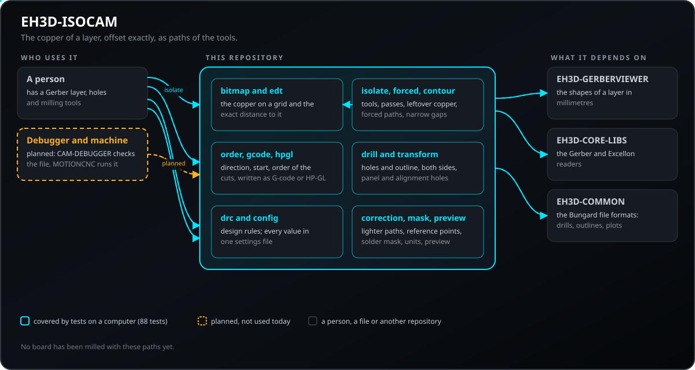
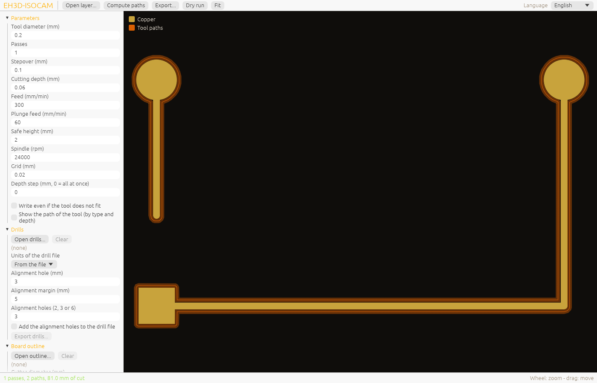
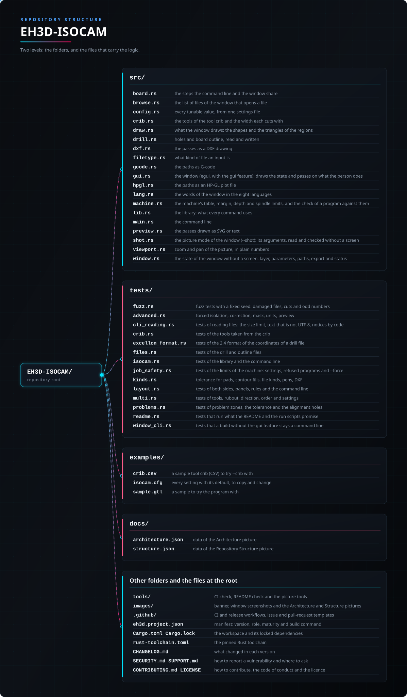

<p align="center">
  
</p>

#  EH3D-ISOCAM
<p align="center"><a href="README.md">🇺🇸 English</a> | 🇪🇸 <b>Español</b> | <a href="README_fra.md">🇫🇷 Français</a> | <a href="README_ita.md">🇮🇹 Italiano</a> | <a href="README_deu.md">🇩🇪 Deutsch</a> | <a href="README_zho.md">🇨🇳 中文</a> | <a href="README_jpn.md">🇯🇵 日本語</a> | <a href="README_por.md">🇵🇹 Português</a></p>

### Fresado de aislamiento del cobre desde una capa Gerber: desplazamientos exactos, varias pasadas y comprobación de huecos

<p align="center">
  
  
  
  
  
</p>

---

**Comprobación de honestidad - lo que funciona hoy:** una biblioteca Rust y un programa de línea de comandos (`eh3d-isocam`) con 597 pruebas que se ejecutan en un ordenador: traza las trayectorias de una o varias fresas alrededor del cobre de una capa Gerber, retira el cobre sobrante, elige el sentido, los puntos de inicio y el orden de los cortes, lee y escribe ficheros de taladros y contornos de placa, coloca la placa para las dos caras y para un panel, comprueba las reglas de diseño y escribe G-code o HP-GL. Tiene una ventana (se compila con `--features gui`) que abre una capa, un fichero de taladros, un contorno, una capa de máscara y una tabla de puntos de referencia, da la vuelta a la placa y la repite en un panel, dibuja el cobre, los taladros, el contorno y las trayectorias y escribe los mismos ficheros que la línea de comandos, pero esa ventana todavía no se ha visto en una pantalla; no se ha probado en una máquina y no se ha comprobado con una colección de ficheros reales.

---

> **Estado de seguridad:** este programa no controla ninguna máquina y no es un sistema de seguridad. Lo que produce debe revisarlo una persona antes de ejecutar nada en una máquina; nada de esto se ha ejecutado en hardware real.


## 📋 De un vistazo

| | |
|---|---|
| Versión | `0.1.8` |
| Madurez | Andamiaje |
| Pruebas | 597 |
| Pila tecnológica | Rust |
| En hardware real | No probado: nada de esto se ha ejecutado en una máquina |

**Ir a:** [Resumen](#-resumen) · [Arquitectura](#-arquitectura) · [Inicio rápido](#-inicio-rápido) · [Pruebas](#-pruebas) · [Estructura](#-estructura-del-repositorio) · [Relacionados](#-proyectos-relacionados)

## 🚦 Estado del proyecto

Cada línea es una parte de este repositorio y la luz dice hasta dónde llega hoy. Se escribe con lo que el repositorio puede demostrar (pruebas, compilaciones, ejecuciones), no con lo previsto.

🟢 Hecho y verificado · 🟡 Funciona, con límites conocidos · 🟠 Hecho a medias o sin verificar · 🔴 Sin hacer o sin funcionar

| Área | Estado | Qué significa aquí |
|---|---|---|
| Núcleo | 🟡 | traza las trayectorias de una o varias fresas alrededor del cobre de una capa Gerber, retira el cobre sobrante, elige el sentido, los puntos de inicio y el orden de los cortes, indica los huecos demasiado estrechos para la herramienta y escribe G-code o HP-GL; probado en un ordenador con entradas normales y dañadas, no con una colección de ficheros reales. |
| Ficheros y disposición | 🟡 | lee y escribe ficheros de taladros y contornos de placa, coloca la placa para las dos caras y para un panel, añade agujeros de alineación y comprueba las reglas de diseño con la posición de cada hallazgo; probado en un ordenador, no con ficheros escritos por otros programas ni en una máquina. |
| Aislamiento forzado, corrección, máscara | 🟡 | caminos forzados por los huecos donde no cabe la herramienta, trayectorias más ligeras, escala y corrección con puntos de referencia, las aberturas de la máscara de soldadura, unidades y vista previa de las pasadas; probado en un ordenador con capas generadas y entradas dañadas, nunca con placas reales ni en una máquina, y la corrección no se ha comparado con mediciones reales de una cámara. |
| Línea de comandos | 🟡 | `eh3d-isocam` ejecuta las mismas funciones que la biblioteca e imprime el resultado; cada error vuelve como mensaje y un código de salida distinto de cero. |
| Pruebas | 🟡 | 597 pruebas pasan (`cargo test`), con casos normales, casos límite y entradas dañadas. Incluyen una simulación con semilla fija de una máquina Bungard con el recorrido de su mesa, con fallos inyectados y recuperación. |
| Seguridad | 🟡 | Rust seguro y simple (`forbid(unsafe_code)`): nada entra en pánico con los ficheros recibidos y un valor malo es un error con su motivo; sin revisión independiente. |
| Ventana | 🟠 | Escrita (egui, `--features gui`): abrir o soltar una capa, zoom y desplazamiento, editar los parámetros principales, exportar; su lógica está probada y el programa de una versión la dibuja en una imagen (`--shot`), pero nadie la ha usado todavía en una pantalla. |
| Hardware real | 🔴 | No probado: nada de esto se ha ejecutado en una máquina. |
| Documentación | 🟡 | README en ocho idiomas, el registro de cambios y las dos imágenes dibujadas desde `docs/`. |

## 🎯 Resumen

* **El cobre en una rejilla** (`bitmap`): pads (redondos, rectangulares, ovalados), pistas y regiones se dibujan en celdas del tamaño elegido; las pistas y pads solapados son una sola pieza porque una rejilla no tiene solapes, así que no hace falta ningún caso especial; una rejilla que no cupiera en memoria se rechaza.
* **La distancia exacta** (`eh3d-raster`): la distancia de cada celda al cobre más cercano se calcula exactamente (y se prueba contra fuerza bruta), y la trayectoria de una pasada es la línea donde vale el radio de la herramienta, trazada como polilíneas cerradas y aligerada con una tolerancia de media celda; las pasadas siguientes van un paso lateral más lejos cada una.
* **Lo que la herramienta no puede hacer** (`isolate`): donde dos piezas de cobre separadas están más cerca que el ancho de la herramienta ninguna trayectoria puede pasar entre ellas: `check` lista esos sitios y `isolate` no escribe el G-code hasta que se miren (o `--force`). El G-code (`src/gcode.rs`) levanta la herramienta entre trayectorias, baja a la profundidad elegida y corta después la trayectoria más cercana.
* **HP-GL para las máquinas Bungard** (`src/hpgl.rs`): con un fichero de salida que acaba en `.plt` las pasadas se escriben como fichero de trazado HP-GL a 40 unidades por milímetro, una plumilla por pasada, que es lo que lee el programa de fresado de las máquinas Bungard.
* **Varias herramientas y cobre sobrante** (`isolate`): un plan tiene hasta cuatro herramientas y corta primero la más ancha; donde una herramienta más ancha ya ha cortado a lo largo de una trayectoria de otra más fina, ese tramo se omite (el resto queda como tramos abiertos), y anillos de una herramienta más ancha, cada uno solapado con el anterior, pueden limpiar el cobre que queda más allá de las pasadas; el G-code se detiene para cambiar de herramienta cuando cambia su ancho. Con `around_pads_min_mm` mayor que 0, las herramientas más anchas cortan solo los anillos alrededor de pads de al menos esa anchura y la más fina hace el resto (pistas y pads pequeños).
* **Sentido, inicio y orden** (`order`): las trayectorias se trazan con el cobre a la derecha de la herramienta (fresado en concordancia con un husillo que gira en sentido horario); los ajustes pueden invertirlo (convencional), forzar horario o antihorario, empezar cada trayectoria cerrada en su punto más cercano, en su punto más bajo o donde se trazó, fijar el punto desde el que sale la herramienta y ordenar las trayectorias como se trazaron, la más cercana primero o acortando aún más el recorrido dando la vuelta a tramos del orden; `info` muestra cuántas trayectorias van en cada sentido y el recorrido en vacío.
* **Taladros y contorno de la placa** (`src/drill.rs`): los ficheros de taladros se leen (los de Bungard en milésimas de pulgada con el lector de los formatos Bungard, los métricos con el lector de la suite) y se escriben en milésimas enteras; el contorno se lee de una capa Gerber de contorno, un dibujo DXF o un fichero de trazado HP-GL, los trazos dibujados uno a uno se unen, y la trayectoria de la herramienta alrededor de la placa y dentro de sus recortes se escribe como HP-GL o como fichero Excellon de fresado. Un archivo de taladros con herramientas numeradas por encima de 255 las renumera con números libres, con un aviso, para que dos herramientas nunca se conviertan en una. Con `--excellon-format 2.4` (o `excellon_format = 2.4`) las coordenadas de un fichero de taladros se leen y se escriben con dos dígitos antes del punto y cuatro después (`X012340` es 1,2340 in), con los ceros como diga la cabecera; un fichero que declara su propio formato lo conserva. El fichero Excellon de fresado de `route` se escribe en el mismo formato.
* **Dos caras, paneles y agujeros de alineación** (`transform`): la capa, los taladros y el contorno se dan la vuelta, se giran en cuartos de vuelta y se repiten en un panel a la vez; los agujeros de alineación se ponen fuera de la placa donde ésta los vuelve a encontrar una vez dada la vuelta (un tercero sobre la línea la distingue de la misma placa girada media vuelta).
* **Reglas de diseño** (`drc`): cobre más estrecho que la regla, piezas de cobre más cerca que la regla o que el ancho de la herramienta, y taladros con menos cobre alrededor que la regla, cada uno con su posición en milímetros.
* **Un fichero de ajustes** (`src/config.rs`): cada valor que se puede afinar es un ajuste con un valor por defecto, que se lee de un fichero `clave = valor` (`examples/isocam.cfg`) o se da con el mismo nombre como opción de la línea de comandos.
* **Aislamiento forzado** (`forced`): con `forced_isolation = yes` se traza además un camino por el medio de cada hueco en el que no cabe la herramienta más fina, siempre que el hueco no sea más estrecho que `forced_min_gap_mm`; cada sitio se avisa con sus coordenadas y su hueco, y los huecos más estrechos se listan y se dejan como están. Viene desactivado: entonces esos sitios solo se avisan.
* **Zonas problema, tolerancia y distancia de alineación** (`problems`, `src/config.rs`): `check` también lista, como avisos que no detienen nada, las esquinas internas más agudas que `problem_corner_angle_deg` (una herramienta redonda deja cobre en la punta de una muesca; 60 grados por defecto, 0 lo desactiva) y las pistas que pasan entre dos pads más cerca de ellas que `problem_track_gap_factor` veces la herramienta (1,5 por defecto, 0 lo desactiva); ambos criterios son ajustes, no están fijos en el código. `conflict_tolerance_mm` (0 por defecto: no se acepta ningún hueco) acepta los huecos más estrechos que la herramienta como mucho en esa cantidad, en `check` y en `isolate`. La distancia de los agujeros de alineación a la placa es `alignment_margin_mm` (5 mm por defecto; otros programas de este tipo los ponen a 10 mm, que es `alignment_margin_mm = 10`).
* **Puentes, redes, patrones de agujeros y vaciado de áreas** (`src/drill.rs`, `isolate`, `transform`, `problems`, `legacy`): `route` puede dejar puentes que sujetan la placa en la plancha (`tab_count` por cada trazado cerrado, 0 por defecto; `tab_width_mm` de material que queda; `tab_min_length_mm` entre puentes): el corte se detiene media anchura de puente y medio diámetro de herramienta antes del centro de cada puente. `isolate --net X,Y` aísla solo la red que contiene un punto, con la herramienta `net_tool_mm`. `rubout-area OUT --area X0,Y0,X1,Y1` escribe líneas paralelas de la herramienta `rubout_lines_tool_mm` (dirección `rubout_lines_direction`) que vacían un área. Los agujeros de alineación pueden ser 2, 3 o 6, fuera de la placa o, con `alignment_pattern = special`, en un patrón en torno a su centro (`alignment_special_a_mm` de separación en la pareja, `alignment_special_b_mm` para los cuatro más). Con una tolerancia de conflictos, `check` e `isolate` avisan de las pistas y pads rectangulares más finos que el doble de la tolerancia más `tolerance_warning_margin_mm`. La estimación del formato de una capa Gerber antigua usa ahora las unidades que indica el archivo y el tamaño de la placa, y una lista de aperturas puede dar los dos lados en una celda (`60x40`).
* **Tolerancia para pads, relleno por contornos, tipo de fichero, DXF y plumas del trazador** (`tolerance`, `fill`, `src/filetype.rs`, `src/dxf.rs`, `src/hpgl.rs`): `conflict_tolerance_scope = pads` (por defecto `all`, como antes) reserva la tolerancia de conflicto para los huecos que tienen un pad al lado, y el aviso de cobre fino mira entonces solo los pads. `rubout-area OUT [CAPA.gtl] --contour FICHERO` (o `--area`) rellena los trazados cerrados de un fichero, par-impar para que un trazado interior sea un agujero, con líneas de ida y vuelta de `rubout_lines_tool_mm`; con una capa, las líneas se recortan al cobre: toda la herramienta sobre cobre más `rubout_fill_margin_mm`. Una capa que en realidad es un fichero Excellon, HP-GL o DXF (o un fichero de taladros que es una capa Gerber) se rechaza por su nombre, y `kind FICHERO...` dice qué es cada fichero. `isolate` y `rubout-area` escriben un dibujo DXF si el nombre acaba en `.dxf`. `drills ENTRADA SALIDA.plt` traza los agujeros con una pluma por broca (`hpgl_pen_map = 1:2, 3:1`; las brocas que no aparecen toman las plumas libres más bajas), y `hpgl_pen_speed_cm_s` (0 = la de la máquina, por defecto) escribe la velocidad de pluma en cualquier trazado. `hpgl_isocam_style` (activado) escribe el trazado como el programa original: un `PA` por cada punto y líneas de unas 75 columnas terminadas en CR LF; desactivado escribe la forma compacta.
* **Placas de dos caras y el fichero de taladros sencillo** (`src/hpgl.rs`, `src/drill.rs`, `src/filetype.rs`): `hpgl_shift_negative = no` mantiene en el trazado las coordenadas de la placa (también las negativas), de modo que el trazado y el fichero de taladros comparten origen; `isolate` con `plot_outline = yes` y `--outline FICHERO` pone primero en el trazado el corte alrededor del contorno (con la fresa de `route_tool_mm`), con la pluma `hpgl_outline_pen`, y el aislamiento con la pluma `hpgl_isolation_pen`. `--mirror vertical` da la vuelta a los taladros respecto al centro del contorno. `ncd_isocam_style = yes` escribe el fichero de taladros como los programas de Bungard (`M48` y `%`, herramientas solo por número, coordenada repetida omitida, CR LF, `M00`) y `ncd_digits` rellena las coordenadas con ceros por delante. Un fichero de taladros sin línea `M48` se reconoce como Excellon. Cuando los trazados se desplazan, `hpgl_margin_mm` fija el desplazamiento común del trazado de aislamiento y del de taladros de una placa, para que sigan alineados. `spindle_wait_s` escribe una espera (`G4`) tras cada arranque del husillo en el G-code.
* **Trayectorias más ligeras, escala y corrección** (`optimize`, `fiducial`): se quitan los picos y los puntos sobre una recta (dentro de `optimize_tolerance_mm`) pasan a ser un solo movimiento, activado por defecto (0,01 mm y 0,02 mm; con 0 se desactiva); el trabajo se puede escalar respecto al centro de la placa, y pares de puntos de referencia relativos a ese centro (dónde debería estar una marca y dónde se midió) dan una semejanza (dos pares) o un ajuste afín (tres o más, mínimos cuadrados) que se aplica a cada trayectoria y a cada taladro; se rechaza si la escala se aleja mucho de 1 o una marca no encaja.
* **Máscara de soldadura** (`mask`): las aberturas se escriben como una capa Gerber, a partir de la capa de máscara del diseño o de los pads del cobre, cada una ensanchada en `mask_margin_mm`; las pistas quedan cubiertas.
* **Unidades y vista previa** (`eh3d-raster`, `src/preview.rs`): una longitud puede llevar `mm`, `mil` o `in`, el G-code puede escribirse en pulgadas, y `preview` dibuja las pasadas sobre el cobre como dibujo SVG o como texto.
* **Capas Gerber antiguas** (`legacy`): una capa sin sentencia de formato (RS-274D, como la escriben muchos programas antiguos) se lee cuando se da su lista de aperturas (`--apertures`, un código D y su tamaño por línea) junto con su formato (`--gerber-format 2.3`, `--gerber-zeros`, `--gerber-units`); se reescribe como Gerber extendido y pasa por el lector normal. Probado con capas escritas a mano, no con ficheros de otros programas.
* **Lectura y avisos por código (línea de comandos):** los ficheros se leen con un límite de tamaño (`--max-bytes N` o `max_input_mb`, 64 MiB por defecto) y el texto que no es UTF-8 se lee como Latin-1 con un aviso (`input-not-utf8`); los avisos del lector de Gerber se muestran con su código estable y `--hide CODE[,CODE]` omite esos códigos. La nota sobre los trazados más ligeros y la de los puentes del corte solo se imprimen cuando cambiaron algo. `arc_tolerance_mm` fija con qué precisión se siguen los arcos de una capa. `min_tool_mm` (0,02 por defecto) fija la herramienta más fina que puede tener cualquier ajuste de herramienta, y una por debajo se rechaza con el nombre del ajuste; `rapid_mm_min` (0 por defecto, sin estimación) es la velocidad de los movimientos rápidos, con la que `info` añade una estimación del tiempo del trabajo (corte, bajada, desplazamientos; la espera del husillo y los cambios de herramienta a mano no se cuentan). `hpgl_units_per_mm` (40 por defecto, de 10 a 1000) fija las unidades de un fichero de trazado por milímetro; la comprobación del rango de 32767 unidades lo sigue (327 mm con 100).
* **Herramientas del almacén** (`src/crib.rs`): `--crib FICHERO` (o `crib_file`) lee la tabla CSV que exporta `eh3d-tools`, y `--crib-fine N`, `--crib-coarse N` y `--crib-route N` toman de ella las herramientas con esos números: el ancho con el que corta una fresa, una fresa en V o un grabador a `depth_mm` pasa a ser `fine_tool_mm` o `coarse_tool_mm` (una fresa en V corta `2 * profundidad * tan(ángulo / 2) + crib_vbit_flat_mm` de ancho, como mucho su diámetro, recortado a una diezmilésima de milímetro) y el diámetro de una fresa pasa a ser `route_tool_mm`; cada sustitución se avisa por la salida de errores, se rechaza un taladro, un láser o una boquilla, y una herramienta demasiado fina para `min_tool_mm` se rechaza con el nombre del ajuste. La tabla solo se lee cuando se elige una herramienta.
* **Límites de la máquina** (`src/machine.rs`): `machine_profile` (`ccd-mtc`: 495 x 325 mm, `ccd2-mtc`: 325 x 270 mm) o `machine_x_mm` y `machine_y_mm` dan la mesa, `machine_margin_mm` la distancia que se guarda a sus bordes, `machine_max_depth_mm` y `machine_max_rpm` el corte más profundo y el husillo más rápido. El G-code se recorre movimiento a movimiento antes de guardarlo y se rechaza con su línea cuando un movimiento sale de la mesa, baja demasiado o hace girar el husillo demasiado deprisa (`--force` lo escribe igualmente y dice por qué); una profundidad o una velocidad del trabajo por encima de los límites se rechaza al leer los ajustes. Todo está desactivado por defecto.
* **Una pasada en seco de un programa** (`src/simulate.rs`): `eh3d-isocam simulate PROGRAMA.nc` recorre cualquier programa de G-code movimiento a movimiento e imprime su longitud, el recorrido que abarca, el corte más profundo y el tiempo (corte al avance, bajada al avance de penetración, rápidos a `rapid_mm_min`, esperas `G4`), y enumera con sus líneas un rápido que entra en el material, un corte con el husillo parado o sin avance, un programa que no termina y los límites de la máquina que rompe; cualquier hallazgo da el código de salida 1. El informe sale en los ocho idiomas.
* **Pasadas de profundidad y mapa de alturas** (`src/heightmap.rs`): `depth_step_mm` vuelve a cortar cada trayectoria a cada profundidad (una cerrada vuelve a dar la vuelta, una abierta se corta de vuelta por donde vino, sin levantar), y `--height-map FICHERO` (`heightmap_file`) lee el mapa de EH3D-AUTOLEVEL para que la Z de cada corte sea la profundidad bajo la mesa en ese punto, con los movimientos partidos en trozos de a lo sumo `heightmap_max_segment_mm`; se rechaza un mapa con un punto sin medir o una mesa demasiado lejos de plana (`heightmap_max_range_mm`). Ambas cosas están desactivadas por defecto.
* **La profundidad para un ancho de pista** (`src/crib.rs`): `--crib-fine-width-mm W` calcula la profundidad a la que la fresa en V o el grabador del almacén corta una pista de ancho `W` y la usa como `depth_mm`; se rechaza un ancho que la herramienta no puede cortar, o una fresa cilíndrica.
* **Un camino corto para el taladro** (`src/drill.rs`): `drill_order = nearest|optimized` (`--drill-order`) pone los agujeros de cada herramienta en un camino corto desde el punto de partida de la herramienta, manteniendo el orden de las herramientas, y `drills` dice cuánto más corto es el recorrido que en el orden del fichero; `file` (por defecto) conserva el orden del fichero.
* **El tiempo del trabajo** (`src/simulate.rs`): con `rapid_mm_min` puesto, `isolate` imprime además el tiempo estimado del G-code que ha escrito (el mismo recorrido del programa que hace `simulate`, sin las esperas del husillo); sin velocidad de movimientos rápidos no imprime nada más, y un trazado o un dibujo DXF no tiene tiempo.
* **La pasada en seco en la ventana** (`src/window.rs`): el botón «Pasada en seco» recorre el G-code con el que se escribirían las trayectorias (no se escribe nada) y muestra su tiempo, la caja en la que se mueve, el corte más profundo y sus hallazgos en el idioma de la ventana; el grupo «Máquina» reúne la velocidad en rápido y los límites de la máquina (`machine_profile`, la mesa, el margen, el corte más profundo y el husillo más rápido), y un límite que se rompe es un hallazgo.
* **El recorrido de la herramienta en la imagen** (`src/toolpath.rs`): la casilla «Mostrar el recorrido de la herramienta» recorre el G-code con el que se escribirían las trayectorias y dibuja lo que haría la máquina en lugar de las bandas de las pasadas: los movimientos rápidos en gris, las bajadas en rojo y cada tramo de corte en un color de azul (justo bajo la superficie) a ámbar (el corte más profundo), con los arcos dibujados como arcos; el zoom, el desplazamiento y «Ajustar» de la imagen actúan sobre él, y el ajuste `depth_step_mm` es ahora un parámetro de la ventana.
* **Puentes apartados de las esquinas** (`src/drill.rs`): `tab_corner_clearance_mm` (0 por defecto, que reparte los puentes por igual a lo largo de cada trayectoria como antes) desplaza un puente que caería en una esquina del corte a lo largo de la trayectoria, en pasos de un cuarto de la distancia, hasta el lugar más cercano donde la trayectoria gira como mucho 20 grados dentro del hueco y de la distancia a cada lado; un puente que no encuentra ese lugar se queda donde estaba y se cuenta y se avisa (`route` advierte, la ventana añade una nota). El número de puentes (`tab_count`), su ancho (`tab_width_mm`) y el tramo más corto entre dos (`tab_min_length_mm`) son parámetros de la ventana.
* **Un programa nunca queda a medio escribir:** cada fichero que escribe el programa (G-code, HP-GL, ficheros de taladrado, dibujos, desde la línea de comandos y la ventana) va a un fichero nuevo junto al real y se renombra sobre él, así un corte o un disco lleno dejan el fichero antiguo entero; un fichero de solo lectura no se sustituye.
* **La forma del corte alrededor de la placa** (`src/corners.rs`): `outline_corner_radius_mm` (0 por defecto, que deja las esquinas vivas como están dibujadas) redondea cada esquina de los trazados cerrados del contorno con un arco de ese radio antes de que la herramienta lo recorra; una esquina cuyos lados son demasiado cortos para el radio (un arco ocupa como mucho la mitad de cada lado) recibe el mayor radio que cabe y se cuenta y se avisa. `outline_min_cutout_mm` (0 por defecto) omite los huecos del contorno (trazados cerrados dentro de la placa) cuya caja no tiene ningún lado mayor que ese valor. Ambos se aplican a `route` y al corte de `plot_outline`, y son parámetros de la ventana, que dice en sus notas cuántas esquinas recibieron un radio menor y cuántos huecos se omitieron.
* **El corte comprobado contra la mesa de la máquina:** cuando los ajustes describen una mesa (`machine_profile`, o `machine_x_mm` y `machine_y_mm`, con `machine_margin_mm`), `route` y la ventana rechazan un corte que se sale de ella, con el trazado y el lugar al que va; `--force` lo escribe con un aviso en la línea de comandos. Sin mesa descrita no se comprueba nada, como antes. Los taladros de un fichero o de un plot de taladros y un plot del aislamiento se comprueban contra la misma mesa y se rechazan igual.
* **Relleno de una zona con anillos** (`src/clearing.rs`): `rubout_style = rings` hace que `rubout-area` rellene un rectángulo (`--area`) o las trayectorias cerradas de un fichero (`--contour`, relleno par-impar, así que una trayectoria dentro de otra es un agujero) con anillos cerrados que siguen el borde hacia dentro en lugar de líneas de ida y vuelta; el primer anillo queda a media herramienta del borde, los siguientes a un paso de `tool * (1 - rubout_overlap)` más adentro, y se añade un anillo por el centro cuando quedaría una franja. `rubout_ring_order` (`outside-in`, lo normal, o `inside-out`) se respeta en el G-code diga lo que diga `ordering`. Antes de escribir nada se comprueban las trayectorias contra la mesa de la máquina y la que se sale se rechaza con su número y su pasada (`--force` la escribe igualmente); la comprobación sirve también para las líneas.
* **Arcos ajustados a las trayectorias** (`src/arcs.rs`): `arc_fit_tolerance_mm` (0 por defecto, que mantiene todos los tramos rectos como antes; de 0.001 a 0.5 mm) sustituye cada serie de movimientos cortos que está sobre una circunferencia por un solo `G2` o `G3`, a esa distancia como máximo del polígono del que salió (el punto más alejado de la circunferencia y la flecha del tramo más largo caben juntos en ella). `isolate` dice cuántos movimientos ahorra y cuánto mide el corte con arcos y con tramos rectos, y el intérprete de la suite recorre el programa, así que los límites de la máquina ven por dónde se abomba un arco. Solo G-code, no junto con un mapa de alturas, y es un parámetro de la ventana.
* **El serigrafiado grabado** (`src/silk.rs`): `eh3d-isocam silk CAPA.gto SALIDA.nc` une los trazos que se tocan por los extremos, corta una región por su borde y los graba a `silk_depth_mm` con una herramienta de `silk_tool_mm`; avisa de que la línea es tan ancha como la herramienta y queda cortada en la placa, dice qué trazos tienen otro ancho (`silk_width_tolerance_mm`) y cuenta las almohadillas estampadas que deja fuera. Escribe G-code o un dibujo DXF, nunca un trazado de plotter.
* **El informe antes del trabajo** (`src/report.rs`): `eh3d-isocam report CAPA.gtl` dice las pasadas, las trayectorias, lo que mide el corte, las herramientas en el orden en que se usan, los arcos, el tiempo y los avisos de la prueba en seco, compara cada herramienta con la tabla CSV del almacén de herramientas (`crib_file`: una fresa por su diámetro, una punta en V o un grabador por el ancho que corta a la profundidad del trabajo) y añade las comprobaciones de la capa (sitios donde la herramienta no cabe, zonas problemáticas, reglas de diseño). Termina con 2, el código de salida de una verificación no superada, cuando hay algo que mirar. La ventana hace el mismo informe y las mismas comprobaciones sin pantalla (`Window::report_text`, `Window::checks_text`); los botones que las llaman aún no están escritos.
* **Dónde va el trabajo en la mesa** (`src/config.rs`): `offset_x_mm` y `offset_y_mm` (0 por defecto, de -10000 a 10000) desplazan todas las salidas la misma cantidad, después de la escala y de los puntos de referencia: las trayectorias del cobre, los taladros de un fichero de taladros y el corte alrededor de la placa, de modo que un trabajo puede colocarse en cualquier lugar de la mesa de la máquina; los límites de la máquina (`machine_profile`) siguen rechazando un programa que el desplazamiento saque de la mesa.

## 🧩 Papel en EH3D

EH3D-ISOCAM es un programa de la EH3D Fabrication Suite. Funciona como biblioteca y línea de comandos y, compilado con `--features gui`, como ventana con el aspecto que comparten los demás programas de la suite. Lee y escribe ficheros simples, así que puede usarse solo o entre los demás programas.

## 🏛️ Arquitectura

<p align="center">
  
</p>


Cómo encajan las partes de este repositorio: quién lo usa, qué contiene y de qué depende. La imagen se dibuja desde `docs/architecture.json` y se comprueba con el código.

## 🖼️ Capturas de pantalla

<p align="center">
  
</p>

<p align="center"><em>La ventana con la capa de muestra de `examples/`, tras calcular las trayectorias: el cobre en dorado, las trayectorias de la herramienta a su alrededor en naranja, los parámetros y los taladros a la izquierda. La imagen la escribió el modo de imagen (`--shot`) del programa publicado, con los parámetros por defecto; nadie ha usado todavía la ventana en una pantalla.</em></p>

## ✨ Funciones

* **Biblioteca y línea de comandos:** cada orden de `eh3d-isocam` es una función de la biblioteca, así que otro programa de la suite puede llamarla sin lanzar un proceso.
* **Pruebas con entradas dañadas:** las pruebas también dan ficheros vacíos, basura, números enormes y ficheros cortados, y ninguna puede provocar un pánico.
* **Sin adivinar:** un valor que no tiene sentido es un error que dice cuál y por qué, nunca un resultado que solo lo parece.
* **Sin código unsafe:** `#![forbid(unsafe_code)]` en la biblioteca y el programa.
* **Cada valor afinado es un ajuste:** nada de lo que una persona pueda querer cambiar está escondido en el código; un valor malo es un error con su línea.
* **Unidades a elegir:** las longitudes de un fichero de ajustes o de la línea de comandos pueden escribirse en milímetros, mils o pulgadas; el G-code puede escribirse en pulgadas y la pantalla puede mostrar mils.
* **Ficheros más seguros:** el G-code empieza con la cabecera estándar (generador, unidades, fichero de origen con su SHA-256), se rechaza una salida que también es una entrada de la ejecución, se rechaza un trazado con una coordenada de más de 32767 unidades, `--units mm|inch` da las unidades de un fichero de taladros que no las dice (uno con agujeros diminutos y sin unidades se rechaza sin ello) y el contorno de trazos sueltos se une con un índice, de modo que cincuenta mil segmentos tardan un momento.
* **Salida comprobada y documentada:** el fichero de taladros dice en un comentario que sus coordenadas son milésimas de pulgada enteras sin punto decimal y cuánto puede errar el redondeo, y las pruebas vuelven a leer el G-code de las pasadas y el de la línea de órdenes con el lector de la suite, que no encuentra ningún aviso, ningún movimiento rápido dentro del material ni ningún corte con el husillo parado.
* **Marcas desde una tabla:** `--fiducials-csv FICHERO` lee los pares de marcas (x de diseño, y de diseño, x medida, y medida; una fila de cabecera y las líneas que empiezan por `#` se omiten), de modo que la salida de `eh3d-vision align --isocam-args` se puede usar tal cual.

## 🔒 Seguridad y protección

| Amenaza | Defensa |
|---|---|
| Un fichero dañado, cortado o vacío | sin pánico: las pruebas cortan una entrada válida en cada posición y dan basura |
| Un número sin sentido (negativo, no finito, absurdamente grande) | se rechaza con un error que nombra el valor; nada se redondea hasta parecer plausible |
| Uso inseguro de memoria | Rust seguro y simple con `forbid(unsafe_code)` |

**Lo que no se defiende:** un resultado producido sin errores no es un resultado verificado. Mientras no se indique un perfil de máquina o límites, nada de esto conoce los límites de una máquina y el programa no ha tenido revisión independiente. Informe de una vulnerabilidad en privado (véase [SECURITY.md](SECURITY.md)).

## 🔌 Interfaces

La biblioteca es `eh3d_isocam` (`use eh3d_isocam::...`); la línea de comandos es `eh3d-isocam`. Cada orden imprime su resultado en la salida estándar y comunica un error en la salida de errores con un código de salida distinto de cero. No hay acceso a la red. El texto de la ayuda (`eh3d-isocam help`) está en inglés:

El código de salida sigue la convención de la suite: 0 si la ejecución fue bien, 1 si falló el trabajo (por ejemplo un fichero que no se puede leer) y 64 si la línea de comandos se usó mal (un comando u opción desconocidos, o algo que un comando necesita y falta).

```text
eh3d-isocam isolate LAYER.gtl OUT.nc|OUT.plt|OUT.dxf  paths round the copper (G-code, HP-GL for a .plt, DXF for a .dxf)
eh3d-isocam check LAYER.gtl                      places where the tool does not fit between pieces of copper
eh3d-isocam info LAYER.gtl                       passes, paths each way round, travel through the air
eh3d-isocam preview LAYER.gtl [OUT.svg|OUT.txt]    the passes drawn over the copper, as SVG or text
eh3d-isocam drc LAYER.gtl [--drills F.ncd]       design rules, with the place of every finding
eh3d-isocam drills IN.ncd OUT.ncd|OUT.plt [--align]  read, turn over, panel and add alignment holes; .plt = a pen per drill
eh3d-isocam route OUTLINE OUT.plt|OUT.ncd        path of the tool round the board
eh3d-isocam rubout-area OUT.nc|OUT.plt|OUT.dxf [LAYER.gtl] --area X0,Y0,X1,Y1|--contour FILE  parallel lines of a tool that clear an area or fill closed paths, cut to the copper of LAYER
eh3d-isocam kind FILE...                        say what kind of file each one is (Gerber, old-style Gerber, Excellon, HP-GL, DXF)
eh3d-isocam mask COPPER.gtl OUT.gts [--mask-layer F] openings of the solder mask, from the mask layer or the pads
eh3d-isocam config                               every setting with its default, as a file
eh3d-isocam [gui] [LAYER.gtl]                    the window (a build with --features gui); with no arguments it opens
eh3d-isocam gui [LAYER.gtl] --shot OUT.png [--size WxH] [--theme forge|dark|light] [--wait N] [--lang CODE] [--replace]   a picture of the window
options: --config FILE  --outline FILE  --drills FILE  --force  and every setting by its name (--fine-tool-mm 0.15, --fine-tool-mm 8mil, --forced-isolation yes, --fiducial "0,0,0.1,0.05")
old-style Gerber (no format statement): --apertures FILE  --gerber-format 2.3  --gerber-zeros leading|trailing  --gerber-units inch|mm  --aperture-units mil|mm|inch
drill and routing files: --excellon-format auto|2.4   (2.4 = two digits before the point, four after)
tools from the crib: --crib FILE  --crib-fine N  --crib-coarse N  --crib-route N  --crib-fine-width-mm W   (N = the number of the tool in the table of eh3d-tools; 0 = keep the setting; W = the width the V-bit is to cut, the depth follows)
machine limits: --machine-profile none|ccd-mtc|ccd2-mtc  --machine-x-mm N  --machine-y-mm N  --machine-margin-mm N  --machine-max-depth-mm N  --machine-max-rpm N   (0 = not checked)
dry run of a program: eh3d-isocam simulate PROGRAM.nc [--rapid-mm-min N]   (time, box, deepest cut, findings with their lines; exit code 1 on any finding)
depth and surface: --depth-step-mm N  --height-map FILE  --heightmap-ref-x-mm N  --heightmap-ref-y-mm N  --heightmap-max-segment-mm N  --heightmap-max-range-mm N   (the map is the text file of EH3D-AUTOLEVEL)
drill order: --drill-order file|nearest|optimized   (the holes of each tool in a short path from --start-x-mm and --start-y-mm; file keeps the order of the file)
clearing an area: --rubout-style lines|rings  --rubout-ring-order outside-in|inside-out  --rubout-overlap N  --rubout-lines-tool-mm N   (rings follow the edge inwards, never cut to a layer; the paths are checked against the machine table first)
work on the table: --offset-x-mm N  --offset-y-mm N   (every output is moved by this much, after the scale and the reference points; the machine limits still apply)
```

```text
EH3D-ISOCAM/
├── src/
│   ├── board.rs                                 los pasos que comparten la línea de comandos y la ventana
│   ├── browse.rs                                la lista de ficheros de la ventana que abre un fichero
│   ├── clearing.rs                              el relleno de una zona con anillos, en el orden pedido y dentro de la zona
│   ├── config.rs                                todos los valores ajustables, desde un fichero de ajustes
│   ├── corners.rs                               las esquinas del contorno redondeadas y sus huecos pequeños omitidos
│   ├── crib.rs                                  las herramientas del almacén y el ancho con que corta cada una
│   ├── draw.rs                                  lo que dibuja la ventana: las formas y los triángulos de las regiones
│   ├── drill.rs                                 taladros y contorno de la placa, leídos y escritos
│   ├── dxf.rs                                   las pasadas como dibujo DXF
│   ├── eh3dfile.rs                              el proyecto .eh3d: entra el cobre del trabajo, los programas quedan en su rama
│   ├── filetype.rs                              de qué tipo es un fichero de entrada
│   ├── gcode.rs                                 los recorridos como G-code
│   ├── gui.rs                                   la ventana (egui, con la característica gui): dibuja el estado y transmite lo que hace la persona
│   ├── heightmap.rs                             el mapa de alturas de la mesa, leído del fichero de EH3D-AUTOLEVEL
│   ├── hpgl.rs                                  los recorridos como fichero de trazado HP-GL
│   ├── lang.rs                                  las palabras de la ventana en los ocho idiomas
│   ├── machine.rs                               la mesa, el margen y los límites de profundidad y husillo de la máquina, y la comprobación de un programa contra ellos
│   ├── lib.rs                                   la biblioteca: lo que usa cada orden
│   ├── main.rs                                  la línea de comandos
│   ├── preview.rs                               las pasadas dibujadas en SVG o texto
│   ├── shot.rs                                  el modo de captura de la ventana (--shot): sus argumentos, leídos y comprobados sin pantalla
│   ├── simulate.rs                              la pasada en seco de un programa de G-code: tiempo, recorrido, corte más profundo y hallazgos en ocho idiomas
│   ├── toolpath.rs                              el recorrido de la herramienta de un programa para la imagen: rápido, bajada y corte por profundidad
│   ├── viewport.rs                              zoom y desplazamiento de la imagen, en números simples
│   └── window.rs                                el estado de la ventana sin pantalla: capa, parámetros, trayectorias, exportación y estado
├── tests/
│   ├── fuzz.rs                                  pruebas con semilla fija: ficheros dañados, cortes y números raros
│   ├── advanced.rs                              aislamiento forzado, corrección, máscara, unidades, vista previa
│   ├── cli_reading.rs                           pruebas de lectura de ficheros: el límite de tamaño, texto que no es UTF-8, avisos por código
│   ├── crib.rs                                  tests de las herramientas tomadas del almacén
│   ├── depth_and_levelling.rs                   tests de las pasadas de profundidad y del corte según un mapa de alturas
│   ├── excellon_format.rs                       tests del formato 2.4 de las coordenadas de un fichero de taladros
│   ├── files.rs                                 pruebas de los ficheros de taladros y contorno
│   ├── isocam.rs                                pruebas de la biblioteca y la línea de comandos
│   ├── job_safety.rs                            tests de los límites de la máquina y de la pasada en seco
│   ├── kinds.rs                                 tolerancia para pads, rellenos, tipos de fichero, plumas, DXF
│   ├── layout.rs                                pruebas de doble cara, paneles, reglas y la línea de comandos
│   ├── multi.rs                                 pruebas de herramientas, cobre sobrante, sentido, orden y ajustes
│   ├── problems.rs                              pruebas de zonas problema, la tolerancia y los agujeros de alineación
│   ├── readme.rs                                pruebas que ejecutan lo que prometen el README y los scripts run
│   └── window_cli.rs                            pruebas de que una compilación sin la característica gui sigue siendo solo línea de comandos
├── examples/
│   ├── crib.csv                                 un almacén de muestra (CSV) para probar --crib
│   ├── isocam.cfg                               todos los ajustes con su valor por defecto, para copiar y cambiar
│   └── sample.gtl                               una muestra para probar el programa
├── docs/
│   ├── architecture.json                        datos de la imagen de Arquitectura
│   └── structure.json                           datos de la imagen de Estructura
├── tools/                                       comprobación del CI y del README y herramientas de imágenes
├── images/                                      banner, capturas de la ventana y las imágenes de Arquitectura y Estructura
├── .github/                                     flujos de CI y de publicación, plantillas de issues y pull requests
├── eh3d.project.json                            manifiesto: versión, rol, madurez y comando de compilación
├── Cargo.toml Cargo.lock                        el workspace y sus dependencias fijadas
├── rust-toolchain.toml                          la toolchain de Rust fijada
├── CHANGELOG.md                                 qué cambió en cada versión
├── SECURITY.md SUPPORT.md                       cómo informar de una vulnerabilidad y dónde preguntar
└── CONTRIBUTING.md CODE_OF_CONDUCT.md LICENSE   cómo contribuir, el código de conducta y la licencia
```

**El proyecto de la suite.** Un fichero `.eh3d` tiene una rama por programa. `project info FICHERO.eh3d` muestra las capas del trabajo (la rama `manufacturing/`, un paquete `.eh3dproj`) y los programas guardados en el proyecto; `project isolate FICHERO.eh3d [--layer NOMBRE] [--plt]` aísla cada capa de cobre del trabajo (o la nombrada), con las mismas opciones y los mismos rechazos que `isolate`, y guarda el programa solo en la rama `isocam/`, con una copia de la capa y el contenido de la rama de la que viene. Si el trabajo cambia después, `project info` avisa de que los programas están desactualizados y termina con 2. En la ventana, un `.eh3d` soltado abre las capas de cobre de su trabajo (se eligen de una lista) y el programa se guarda en el proyecto. Cuando guardar quitaría una firma del proyecto o de su rama, la ventana pregunta antes y no escribe nada si no se acepta. La ventana no escribe sobre un proyecto que otro programa ha guardado desde que se abrió o se guardó en ella, tampoco si se guardó mientras una pregunta esperaba: lo dice y ofrece volver a leer el proyecto (con la misma capa si el trabajo aún la tiene), guardar una copia con otro nombre con el programa dentro, o cerrar.

## ⚙️ Configuración

Cada valor que se puede afinar es un ajuste con un valor por defecto: los diámetros, las pasadas y el paso lateral de la herramienta fina y de la gruesa, la retirada del cobre sobrante, la profundidad, el avance y la velocidad, el sentido, el punto de salida, el inicio de cada trayectoria y el orden, la herramienta que corta la placa, los agujeros de alineación, el espejo, el giro y el panel, y las reglas de diseño. `eh3d-isocam config` los imprime todos como un fichero (`examples/isocam.cfg` es ese fichero); `--config FICHERO` lee uno, y cualquier ajuste puede darse en la línea de comandos como opción con el mismo nombre (`--fine-tool-mm 0.15`), que prevalece sobre el fichero. Un valor sin sentido es un error que indica la línea. Los límites fijos viven en el código como constantes con nombre y están cubiertos por pruebas. El aislamiento forzado, las trayectorias más ligeras, la escala y los puntos de referencia, el margen de la máscara de soldadura, las unidades y el ancho de la vista previa en texto también son ajustes. El formato de las coordenadas de un fichero de taladros (`excellon_format`: `auto` o `2.4`) también es un ajuste.

**Modo servidor.** `--to-server` guarda en el servidor EH3D, como artefacto, el archivo que escriben `isolate`, `drills`, `route`, `mask` o `rubout-area` (G-code, HP-GL, DXF o un archivo de taladros) y el informe de `simulate`, con la orden y los valores principales con que se hizo, para que los demás programas de la suite lo encuentren allí. El enlace es el cliente único de la suite (`eh3d-serverclient` de EH3D-COMMON) y sus claves van en el archivo de ajustes: `server_address` (`host:port`; vacío significa apagado), `server_token` (solo escritura, nunca se muestra), `server_machine`, `server_timeout_s` (1 a 120, 15 por defecto), `server_retries` (0 a 5, 2 por defecto), `server_mdns` (`off` por defecto) y `server_max_answer_mib` (1 a 256, 8 por defecto). Las negativas del servidor se explican por su código en el idioma del sistema. `eh3d-isocam server status --config FILE` muestra los ajustes (el token como `***`) y lo que responde el servidor. No se envía nada sin dirección y el trabajo local nunca depende del servidor.

## 🚀 Inicio rápido

Necesita una cadena de herramientas Rust estable (1.89 o más reciente).

```bash
cargo build --release
cargo test
cargo run --release -- isolate examples/sample.gtl examples/sample.nc --passes 2
cargo run --release --features gui   # the window
cargo run --release --features gui -- --shot screen.png examples/sample.gtl   # a picture of the window
```

Para sacar una captura de la ventana sin abrirla a mano, ejecútelo con `--shot FICHERO.png` (también `--size WxH`, `--theme forge|dark|light`, `--wait N`, `--lang CODE`, `--open FILE`, `--replace`): se abre con ese tamaño, guarda el PNG, no guarda ajustes y se cierra solo (código de salida 0 si se escribió el fichero, 1 si no, 2 si los argumentos están mal).

## 🧪 Pruebas

El conjunto tiene 597 pruebas (`cargo test`, ejecutadas en Windows y Linux en el CI). Comprueban los casos normales, los casos límite y las entradas dañadas: ficheros vacíos, basura y ficheros cortados nunca provocan un pánico. El CI ejecuta además `cargo fmt --check`, `cargo clippy` con las advertencias como errores y `python -I tools/ci_validate.py`.

## 🏗️ Compilación y publicación

La versión está en `Cargo.toml` y en `eh3d.project.json`; cada versión tiene su entrada en [CHANGELOG.md](CHANGELOG.md). `build.bat` / `build.sh` compilan el programa, `test.bat` / `test.sh` ejecutan las pruebas y `run.bat` / `run.sh` lo ejecutan con un ejemplo. Las versiones se publican en GitHub.

### Descargas

Cada versión trae el programa con su ventana para Windows (64 y 32 bits), Linux (64 bits) y macOS (Apple silicon e Intel), como `<nombre>-<versión>-<sistema>.zip` (Windows) o `.tar.gz` con el programa, la licencia, el léame, el icono y los ejemplos. Los ficheros los construye GitHub Actions, van en `SHA256SUMS` y están firmados con la clave de EH3D. Para comprobar una descarga, compara su hash con el fichero `.sha256` que la acompaña (`sha256sum -c`) y comprueba su firma con el fichero `.sig` que la acompaña (`ssh-keygen -Y verify`).

## 📂 Estructura del repositorio

<p align="center">
  
</p>

<details>
<summary>Versión en texto del árbol</summary>

```text
EH3D-ISOCAM/
├── src/
│   ├── arcs.rs                                  arcos ajustados a series de movimientos cortos, con tolerancia
│   ├── board.rs                                 los pasos que comparten la línea de comandos y la ventana
│   ├── browse.rs                                la lista de ficheros de la ventana que abre un fichero
│   ├── clearing.rs                              el relleno de una zona con anillos, en el orden pedido y dentro de la zona
│   ├── config.rs                                todos los valores ajustables, desde un fichero de ajustes
│   ├── corners.rs                               las esquinas del contorno redondeadas y sus huecos pequeños omitidos
│   ├── crib.rs                                  las herramientas del almacén y el ancho con que corta cada una
│   ├── draw.rs                                  lo que dibuja la ventana: las formas y los triángulos de las regiones
│   ├── drill.rs                                 taladros y contorno de la placa, leídos y escritos
│   ├── dxf.rs                                   las pasadas como dibujo DXF
│   ├── eh3dfile.rs                              el proyecto .eh3d: entra el cobre del trabajo, los programas quedan en su rama
│   ├── filetype.rs                              de qué tipo es un fichero de entrada
│   ├── gcode.rs                                 los recorridos como G-code
│   ├── gui.rs                                   la ventana (egui, con la característica gui): dibuja el estado y transmite lo que hace la persona
│   ├── heightmap.rs                             el mapa de alturas de la mesa, leído del fichero de EH3D-AUTOLEVEL
│   ├── hpgl.rs                                  los recorridos como fichero de trazado HP-GL
│   ├── lang.rs                                  las palabras de la ventana en los ocho idiomas
│   ├── machine.rs                               la mesa, el margen y los límites de profundidad y husillo de la máquina, y la comprobación de un programa contra ellos
│   ├── lib.rs                                   la biblioteca: lo que usa cada orden
│   ├── main.rs                                  la línea de comandos
│   ├── preview.rs                               las pasadas dibujadas en SVG o texto
│   ├── report.rs                                el informe antes del trabajo, las herramientas frente al almacén y las comprobaciones
│   ├── shot.rs                                  el modo de captura de la ventana (--shot): sus argumentos, leídos y comprobados sin pantalla
│   ├── silk.rs                                  el serigrafiado grabado: trazos unidos, regiones cortadas por el borde
│   ├── simulate.rs                              la pasada en seco de un programa de G-code: tiempo, recorrido, corte más profundo y hallazgos en ocho idiomas
│   ├── toolpath.rs                              el recorrido de la herramienta de un programa para la imagen: rápido, bajada y corte por profundidad
│   ├── viewport.rs                              zoom y desplazamiento de la imagen, en números simples
│   └── window.rs                                el estado de la ventana sin pantalla: capa, parámetros, trayectorias, exportación y estado
├── tests/
│   ├── fuzz.rs                                  pruebas con semilla fija: ficheros dañados, cortes y números raros
│   ├── advanced.rs                              aislamiento forzado, corrección, máscara, unidades, vista previa
│   ├── cli_reading.rs                           pruebas de lectura de ficheros: el límite de tamaño, texto que no es UTF-8, avisos por código
│   ├── crib.rs                                  tests de las herramientas tomadas del almacén
│   ├── curve_paths.rs                           pruebas de los arcos ajustados a las trayectorias
│   ├── depth_and_levelling.rs                   tests de las pasadas de profundidad y del corte según un mapa de alturas
│   ├── excellon_format.rs                       tests del formato 2.4 de las coordenadas de un fichero de taladros
│   ├── files.rs                                 pruebas de los ficheros de taladros y contorno
│   ├── isocam.rs                                pruebas de la biblioteca y la línea de comandos
│   ├── job_report.rs                            pruebas del informe antes del trabajo y de la comprobación del almacén
│   ├── job_safety.rs                            tests de los límites de la máquina y de la pasada en seco
│   ├── kinds.rs                                 tolerancia para pads, rellenos, tipos de fichero, plumas, DXF
│   ├── layout.rs                                pruebas de doble cara, paneles, reglas y la línea de comandos
│   ├── multi.rs                                 pruebas de herramientas, cobre sobrante, sentido, orden y ajustes
│   ├── problems.rs                              pruebas de zonas problema, la tolerancia y los agujeros de alineación
│   ├── silkscreen.rs                            pruebas del serigrafiado grabado
│   ├── readme.rs                                pruebas que ejecutan lo que prometen el README y los scripts run
│   ├── window_checks.rs                         pruebas de las comprobaciones y del informe en la ventana
│   ├── window_cli.rs                            pruebas de que una compilación sin la característica gui sigue siendo solo línea de comandos
│   ├── reqs.rs                                  pruebas del registro de requisitos
│   └── project.rs                               pruebas del proyecto: ramas, desactualizado, línea de comandos y ventana
├── examples/
│   ├── crib.csv                                 un almacén de muestra (CSV) para probar --crib
│   ├── isocam.cfg                               todos los ajustes con su valor por defecto, para copiar y cambiar
│   └── sample.gtl                               una muestra para probar el programa
├── docs/
│   ├── architecture.json                        datos de la imagen de Arquitectura
│   ├── NOT_YET.md                               buenas ideas fuera de esta versión, con el porqué y el cuándo
│   ├── REQUIREMENTS.md                          el registro de requisitos: estado, evidencia y la prueba de cada uno
│   ├── SCOPE.md                                 para qué sirve, qué no hará y qué no decide nunca
│   ├── STATUS.md                                qué existe, qué falta y qué sigue abierto
│   └── structure.json                           datos de la imagen de Estructura
├── tools/                                       comprobación del CI y del README y herramientas de imágenes
├── images/                                      banner, capturas de la ventana y las imágenes de Arquitectura y Estructura
├── .github/                                     flujos de CI y de publicación, plantillas de issues y pull requests
├── eh3d.project.json                            manifiesto: versión, rol, madurez y comando de compilación
├── Cargo.toml Cargo.lock                        el workspace y sus dependencias fijadas
├── rust-toolchain.toml                          la toolchain de Rust fijada
├── CHANGELOG.md                                 qué cambió en cada versión
├── AGENTS.md                                    las reglas para quien cambie el repositorio
├── SECURITY.md SUPPORT.md                       cómo informar de una vulnerabilidad y dónde preguntar
└── CONTRIBUTING.md CODE_OF_CONDUCT.md LICENSE   cómo contribuir, el código de conducta y la licencia
```

</details>

## 🗺️ Hoja de ruta y límites conocidos

**Límites conocidos hoy**

* La ventana no se ha visto en una pantalla; usa los ajustes por defecto además de los parámetros que muestra y no cubre los comandos `check`, `drc`, `info`, `preview` y `rubout-area`: eso sigue en la línea de comandos.
* No se ha probado en una máquina ni con una colección de ficheros reales, y no ha tenido revisión independiente.
* Las trayectorias son exactas a media celda, no a la curva misma; no hay estrategia Voronoi, no se ajustan arcos, por decisión (una curva son muchos movimientos cortos), un camino forzado deja que una herramienta más ancha que el hueco toque el cobre por los dos lados, la corrección con puntos de referencia mueve las trayectorias pero conserva el tamaño del desfase de la herramienta, la escala es respecto al centro de la placa, no hay capa de serigrafía y no se ha fresado ninguna placa con estas trayectorias.
* La máscara de soldadura sigue los pads tal como están dibujados (círculos, rectángulos y óvalos); las pistas quedan cubiertas y un margen negativo no encoge una región.
* La retirada del cobre sobrante son anillos de una herramienta más ancha a cierta distancia del cobre: los sitios más estrechos que esa herramienta conservan su cobre, y no sigue el borde de la placa.
* Los tramos omitidos para una herramienta más fina se deciden en una rejilla con dos celdas de margen; prefiere cortar un tramo dos veces a dejarlo sin cortar.
* Los ficheros de taladros se escriben en milésimas de pulgada enteras (la convención de los programas Bungard): un diámetro `T1C0.8` sin unidad se lee como milímetros desde 0,2 y como pulgadas por debajo; los ficheros con ranuras o trayectorias de fresado las dejan fuera, con una nota. Los ficheros escritos solo los han releído los lectores de esta suite, no otros programas ni máquinas.
* Las reglas de diseño no redondean las esquinas de un pad cuadrado y no comprueban el cobre frente al borde de la placa ni a la máscara de soldadura; la comprobación de los anillos toma el pad tal como está dibujado en la capa Gerber.
* Las herramientas del almacén se leen de su tabla CSV, no de su fichero JSON, y la ventana no usa el almacén; el ancho de una fresa en V se calcula a partir de su ángulo, la profundidad y una punta plana fijada a mano, no se mide.

**Siguiente**

* Ver la ventana en una pantalla y llevar a ella las comprobaciones de la línea de comandos (`check`, `drc`, la vista previa).
* La estrategia Voronoi; comparar la corrección con puntos de referencia con mediciones de una cámara.
* Capas de serigrafía.
* Comparar las trayectorias con placas fresadas de verdad y probarlo con ficheros reales y con los demás programas de la suite.

## 🌍 Idiomas

El README y los textos existen en inglés, español, francés, italiano, alemán, chino, japonés y portugués de Portugal.

## 🔗 Proyectos relacionados

* [EH3D-CORE-LIBS](https://github.com/JuanenRac/EH3D-CORE-LIBS): los lectores de Gerber, Excellon y G-code
* [EH3D-COMMON](https://github.com/JuanenRac/EH3D-COMMON): los formatos de ficheros de las máquinas Bungard: taladros, trazado y contornos
* [EH3D-GERBERVIEWER](https://github.com/JuanenRac/EH3D-GERBERVIEWER): el visor de capas Gerber
* [EH3D-TOOL-MANAGER](https://github.com/JuanenRac/EH3D-TOOL-MANAGER): el almacén de herramientas que comparten los programas CAM
* [EH3D-CAM-DEBUGGER](https://github.com/JuanenRac/EH3D-CAM-DEBUGGER): la revisión del G-code antes de llegar a una máquina
* [EH3D-AUTOLEVEL](https://github.com/JuanenRac/EH3D-AUTOLEVEL): el mapa de alturas y la corrección del G-code
* [EH3D-VISION-STUDIO](https://github.com/JuanenRac/EH3D-VISION-STUDIO): las cámaras, los fiduciales y la inspección

## 📚 Documentación

* [Registro de cambios](CHANGELOG.md)
* [Alcance](docs/SCOPE.md): para qué sirve el programa, qué no hará y qué no decide nunca.
* [Requisitos](docs/REQUIREMENTS.md): el registro de capacidades, el estado de cada una y la prueba que la muestra.
* [Estado](docs/STATUS.md): qué existe, qué falta y qué sigue abierto.
* [Todavía no](docs/NOT_YET.md): buenas ideas que quedan fuera de esta versión.
* [Reglas para cambiar el repositorio](AGENTS.md): las reglas para quien cambie el repositorio.
* [Datos de arquitectura y estructura](docs/architecture.json): los datos con los que se dibujan las dos imágenes.

## 🤝 Contribuir y comunidad

* Antes de una pull request ejecute `cargo fmt --check`, `cargo clippy --all-targets -- -D warnings`, `cargo test` y `python -I tools/ci_validate.py`: todo debe pasar. Véanse [CONTRIBUTING.md](CONTRIBUTING.md) y el [código de conducta](CODE_OF_CONDUCT.md).
* El README existe en ocho idiomas: un cambio de texto se hace en los ocho ficheros, y las dos imágenes se dibujan desde `docs/architecture.json` y `docs/structure.json` con `tools/make_architecture.py` y `tools/make_structure.py`.
* Informe de una vulnerabilidad en privado: [SECURITY.md](SECURITY.md). Preguntas, ideas e informes: electrohobby3d@gmail.com ([SUPPORT.md](SUPPORT.md)).

## 👤 AUTOR

**JuanenRac (Electro Hobby 3D)** · electrohobby3d@gmail.com

## 📜 LICENCIA

Software: GPL-3.0-or-later. Véase [LICENSE](LICENSE). Los diseños de hardware de la suite usan CERN OHL-S.
