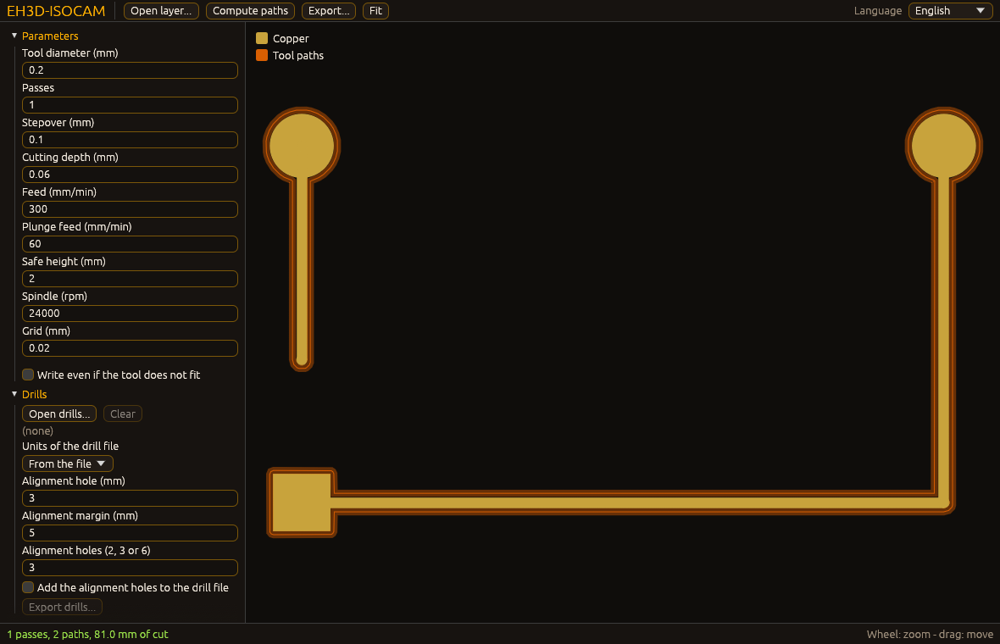

<p align="center">
  
</p>

#  EH3D-ISOCAM
<p align="center"><a href="README.md">🇺🇸 English</a> | <a href="README_spa.md">🇪🇸 Español</a> | <a href="README_fra.md">🇫🇷 Français</a> | <a href="README_ita.md">🇮🇹 Italiano</a> | <a href="README_deu.md">🇩🇪 Deutsch</a> | 🇨🇳 <b>中文</b> | <a href="README_jpn.md">🇯🇵 日本語</a> | <a href="README_por.md">🇵🇹 Português</a></p>

### 由 Gerber 层生成铜箔隔离铣削：精确偏移、多道走刀和间隙检查

<p align="center">
  
  
  
  
  
</p>

---

**诚实检查 - 当前真正能运行的内容：** 一个Rust库和一个命令行程序（`eh3d-isocam`），有361个在电脑上运行的测试：围绕Gerber层的铜箔追踪一把或多把铣刀的路径，清除残余铜箔，选择切削的方向、起点和顺序，读写钻孔文件和板框，为双面和拼板布置电路板，检查设计规则，并写出G代码或HP-GL。它有一个窗口（用 `--features gui` 构建），可打开层、钻孔文件、板框、阻焊层和基准点表，翻转电路板并在拼板上重复，绘制铜箔、孔、板框和路径，并写出与命令行相同的文件，但窗口尚未在屏幕上看过，没有在机器上试过，也没有用一批真实文件检验过。

---

> **安全状态：** 本程序不控制任何机器，也不是安全系统。它的输出在机器上运行之前必须由人检查；这里的任何内容都没有在真实硬件上运行过。


## 📋 速览

| | |
|---|---|
| 版本 | `0.0.9` |
| 成熟度 | 脚手架 |
| 测试 | 361 |
| 技术栈 | Rust |
| 真实硬件 | 未试过：这里的任何内容都没有在机器上运行过 |

**跳转到：** [概述](#-概述) · [架构](#-架构) · [快速开始](#-快速开始) · [测试](#-测试) · [结构](#-仓库结构) · [相关项目](#-相关项目)

## 🚦 项目状态

每一行是本仓库的一个部分，灯号表示它今天做到了哪一步。内容依据仓库能够展示的证据（测试、构建、运行），而不是计划。

🟢 已完成并验证 · 🟡 可用，有已知限制 · 🟠 部分完成或尚未验证 · 🔴 未完成或不可用

| 领域 | 状态 | 在这里的含义 |
|---|---|---|
| 核心 | 🟡 | 围绕Gerber层的铜箔追踪一把或多把铣刀的路径，清除残余铜箔，选择切削的方向、起点和顺序，报告刀具放不进去的过窄间隙，并写出G代码或HP-GL；已在电脑上用正常和损坏的输入测试，未用一批真实文件测试。 |
| 文件与布置 | 🟡 | 读写钻孔文件和板框，为双面和拼板布置电路板，添加对位孔，并按位置检查设计规则；已在电脑上测试，未用其他程序写出的文件测试，也未在机器上试过。 |
| 强制隔离、补偿、阻焊 | 🟡 | 沿刀具放不进去的间隙铺设强制路径、更轻的路径、用参考点做缩放与补偿、阻焊开窗、单位以及各遍路径的预览；已在电脑上用生成的层和损坏的输入测试，从未用真实电路板或在机器上试过，补偿也没有与相机的真实测量值比较过。 |
| 命令行 | 🟡 | `eh3d-isocam` 运行与库相同的函数并打印结果；每个错误都以消息和非零退出码返回。 |
| 测试 | 🟡 | 361 个测试通过（`cargo test`），包含正常情况、边界情况和损坏的输入。 |
| 安全 | 🟡 | 纯安全 Rust（`forbid(unsafe_code)`）：处理收到的文件时不会 panic，错误的值会返回带原因的错误；没有独立审查。 |
| 窗口 | 🟠 | 已编写（egui，`--features gui`）：打开或拖入层、缩放和平移、编辑主要参数、导出；其逻辑已测试，发布版程序可将其绘制为图片（`--shot`），但还没有人在屏幕上实际使用过。 |
| 真实硬件 | 🔴 | 未试过：这里的任何内容都没有在机器上运行过。 |
| 文档 | 🟡 | 八种语言的 README、更新日志，以及由 `docs/` 绘制的两张图。 |

## 🎯 概述

* **网格上的铜箔**（`bitmap`）：焊盘（圆形、矩形、长圆形）、走线和区域被画在所选大小的单元格上；重叠的走线和焊盘是同一块，因为网格没有重叠，所以不需要特殊处理；放不进内存的网格会被拒绝。
* **精确距离**（`eh3d-raster`）：精确计算每个单元格到最近铜箔的距离（并与暴力算法对照测试），一道走刀的路径就是距离等于刀具半径的线，以闭合折线追踪并以半个单元格的容差精简；后续各道依次再向外一个步距。
* **刀具做不到的事**（`isolate`）：两块分离的铜箔间距小于刀具宽度时，任何路径都无法从中穿过：`check` 列出这些位置，在查看之前（或使用 `--force`）`isolate` 不会写出 G 代码。G 代码（`src/gcode.rs`）在路径之间抬刀，下到所选深度，然后切最近的一条路径。
* **面向 Bungard 机器的 HP-GL**（`src/hpgl.rs`）：输出文件以 `.plt` 结尾时，各道走刀被写成每毫米 40 单位的 HP-GL 绘图文件，每道使用一支笔，这正是 Bungard 机器的铣削程序所读取的格式。
* **多把刀具与残余铜箔**（`isolate`）：一个方案最多有四把刀具，最宽的先切；较宽的刀具已沿较细刀具的路径切过的地方，该段被省去（其余成为开放段），较宽刀具的环（每个与前一个重叠）可以清除走刀之外剩下的铜箔；刀具宽度变化时，G代码会停下来换刀。 将 `around_pads_min_mm` 设为大于 0 时,较宽的刀具只切削不小于该宽度的焊盘周围的环,其余部分(走线和小焊盘)由最细的刀具完成。
* **方向、起点和顺序**（`order`）：路径按铜箔在刀具右侧来追踪（主轴顺时针旋转时为顺铣）；设置可以将其反过来（逆铣）、强制顺时针或逆时针、让每条闭合路径从最近点、最低点或追踪时的位置开始、设定刀具出发的点，并让路径按追踪顺序、最近优先，或通过反转部分顺序进一步缩短；`info`显示各方向的路径数和空行程。
* **钻孔与板框**（`src/drill.rs`）：读取钻孔文件（Bungard的密耳文件用Bungard格式读取器，公制文件用套件的读取器），并以整数密耳写出；板框从Gerber外形层、DXF图纸或HP-GL绘图文件读取，逐条绘制的线段会被连接起来，刀具绕板和在其挖空内的路径写成HP-GL或铣削用的Excellon文件。钻孔文件中编号超过 255 的刀具会被重新编号为空闲编号并给出提示，因此两把刀具不会被合并成一把。 使用 `--excellon-format 2.4`（或 `excellon_format = 2.4`）时，钻孔文件的坐标按小数点前两位、后四位读写（`X012340` 即 1.2340 in），零的处理按文件头所述；自行声明格式的文件保持其格式。 `route` 的铣削 Excellon 文件也按同一格式写出。
* **双面、拼板与对位孔**（`transform`）：图层、钻孔和板框一起翻面、按四分之一圈旋转并在拼板上重复；对位孔放在板外，翻面后的板能在原位找到它们（轴线上的第三个孔可区分同一块板旋转半圈的情况）。
* **设计规则**（`drc`）：窄于规则的铜箔、间距小于规则或刀具宽度的铜块，以及周围铜箔少于规则的孔，均给出以毫米为单位的位置。
* **一个设置文件**（`src/config.rs`）：每个可调的值都是有默认值的设置，可从`键 = 值`文件（`examples/isocam.cfg`）读取，或用同名的命令行选项给出。
* **强制隔离**（`forced`）：设置 `forced_isolation = yes` 后，在最细刀具放不进去的间隙中间也会铺一条路径，只要间隙不窄于 `forced_min_gap_mm`；每处都会连同坐标和间隙宽度一起报告，更窄的间隙只列出而不处理。默认关闭：此时这些位置只会被报告。
* **问题区域、容差和对位孔距离**（`problems`、`src/config.rs`）：`check` 还会把不会中止任何操作的警告列出来：比 `problem_corner_angle_deg` 更尖的内角（圆形刀具会在缺口尖端留下铜；默认 60 度，0 表示关闭），以及穿过两个焊盘之间、且焊盘与走线的距离小于 `problem_track_gap_factor` 倍刀具直径的走线（默认 1.5，0 表示关闭）；这两个判据都是设置，没有写死在代码里。`conflict_tolerance_mm`（默认 0：不接受任何间隙）接受比刀具最多窄这么多的间隙，对 `check` 和 `isolate` 都有效。对位孔与板子的距离是 `alignment_margin_mm`（默认 5 mm；同类的其他程序把它们放在 10 mm 处，即 `alignment_margin_mm = 10`）。
* **连接桥、网络、孔图案与区域清除** （`src/drill.rs`、`isolate`、`transform`、`problems`、`legacy`）：`route` 可以保留把板固定在板材上的连接桥（每条闭合路径的数量为 `tab_count`，默认0；保留的材料宽度为 `tab_width_mm`；桥之间的最小长度为 `tab_min_length_mm`）：切削在每座桥中心之前停下，距离为半个桥宽加半个刀具直径。`isolate --net X,Y` 只用刀具 `net_tool_mm` 隔离包含该点的网络。`rubout-area OUT --area X0,Y0,X1,Y1` 写出刀具 `rubout_lines_tool_mm` 的平行线（方向为 `rubout_lines_direction`）来清除一块区域。对位孔可以是2、3或6个，位于板外，或用 `alignment_pattern = special` 排成围绕板中心的图案（一对孔相距 `alignment_special_a_mm`，另外四个相距 `alignment_special_b_mm`）。设置冲突容差后，`check` 和 `isolate` 会对比两倍容差加 `tolerance_warning_margin_mm` 更细的走线和矩形焊盘发出警告。旧式Gerber层的格式推测现在使用文件声明的单位和板的大小，孔径列表也可以在一个单元格里给出两边（`60x40`）。
* **仅用于焊盘的容差、按轮廓填充、文件类型、DXF 与绘图笔** （`tolerance`、`fill`、`src/filetype.rs`、`src/dxf.rs`、`src/hpgl.rs`）：`conflict_tolerance_scope = pads`（默认仍为 `all`，与以前相同）把冲突容差只留给旁边有焊盘的间隙，细铜箔警告此时也只看焊盘。`rubout-area OUT [LAYER.gtl] --contour FILE`（或 `--area`）用奇偶规则填充文件中的闭合路径（内部路径是孔），线条为 `rubout_lines_tool_mm` 的往返线；给出层时线条按铜箔裁剪：整把刀都在铜上，再加 `rubout_fill_margin_mm`。实为 Excellon、HP-GL 或 DXF 的“层”（或实为 Gerber 层的钻孔文件）会按名称被拒绝，`kind FILE...` 会说明每个文件是什么。`isolate` 和 `rubout-area` 遇到 `.dxf` 会写 DXF 图纸。`drills IN OUT.plt` 为每种钻头用一支笔绘制孔位（`hpgl_pen_map = 1:2, 3:1`；未列出的钻头取最小的空闲笔号），`hpgl_pen_speed_cm_s`（0 = 机器自带速度，默认）把笔速写入任何绘图文件。 `hpgl_isocam_style`(开启)按原程序的方式写出绘图文件:每个点一条 `PA`,每行约 75 列并以 CR LF 结束;关闭则写出紧凑形式。
* **双面板与简式钻孔文件** (`src/hpgl.rs`, `src/drill.rs`, `src/filetype.rs`)：`hpgl_shift_negative = no` 在绘图中保留电路板的坐标（包括负值），使绘图与钻孔文件共用同一原点；`isolate` 配合 `plot_outline = yes` 和 `--outline 文件`，会把围绕外形的切割（使用 `route_tool_mm` 的刀具）放在绘图最前面，使用笔号 `hpgl_outline_pen`，隔离路径使用笔号 `hpgl_isolation_pen`。`--mirror vertical` 以外形中线为轴翻转钻孔。`ncd_isocam_style = yes` 按 Bungard 程序的方式写出钻孔文件（`M48` 与 `%`、刀具仅用编号、省略重复的坐标、CR LF、`M00`），`ncd_digits` 在坐标前补零。没有 `M48` 行的钻孔文件会被识别为 Excellon。 平移绘图时，`hpgl_margin_mm` 为同一块板的隔离绘图和钻孔绘图设定共同的平移量，使两者保持对齐。`spindle_wait_s` 在 G 代码中每次启动主轴后写入等待（`G4`）。
* **更轻的路径、缩放与补偿**（`optimize`、`fiducial`）：去掉尖刺，并把落在直线上的点（在 `optimize_tolerance_mm` 之内）合并为一次移动（两者默认开启：0.01 mm 和 0.02 mm，设为 0 即关闭）；整个作业可以以电路板中心为基准缩放，成对的参考点（相对于该中心，标记应在的位置和实测位置）给出相似变换（两对）或仿射拟合（三对及以上，最小二乘），并应用到每条路径和每个孔；缩放远离 1 或某个标记对不上时会被拒绝。
* **阻焊层**（`mask`）：开窗写成 Gerber 层，来自设计的阻焊层或铜箔的焊盘，每个按 `mask_margin_mm` 外扩；走线保持被覆盖。
* **单位与预览**（`eh3d-raster`、`src/preview.rs`）：长度可以带 `mm`、`mil` 或 `in`，G 代码可以按英寸写出，`preview` 把各遍加工路径画在铜箔上，输出为 SVG 图或文本。
* **旧式Gerber层**（`legacy`）：没有格式语句的层（许多旧程序写出的RS-274D），在给出光圈列表（`--apertures`，每行一个D码及其尺寸）和格式（`--gerber-format 2.3`、`--gerber-zeros`、`--gerber-units`）后即可读取；它会被改写为扩展Gerber，再交给普通读取器。已用手写的层测试，未用其他程序生成的文件测试。
* **读取与按代码的提示（命令行）：** 文件带大小限制读取（`--max-bytes N` 或 `max_input_mb`，默认 64 MiB），非 UTF-8 文本按 Latin-1 读取并给出警告（`input-not-utf8`）；Gerber 读取器的提示连同稳定代码一起显示，`--hide CODE[,CODE]` 可省略这些代码。关于简化路径的说明和关于切割桥的说明，只在确实改变了内容时才输出。 `arc_tolerance_mm` 设定图层圆弧的跟随精度。 `min_tool_mm`（默认 0.02）设定任何刀具设置所能使用的最细刀具，更细的刀具会连同设置名称一起被拒绝；`rapid_mm_min`（默认 0，不估算）是快速移动的速度，`info` 据此追加作业时间的估算（切削、下刀、移动；主轴等待和手动换刀不计入）。 `hpgl_units_per_mm`（默认 40，范围 10 到 1000）设定绘图文件每毫米的单位数，32767 单位的范围检查随之变化（100 时为 327 毫米）。
* **来自刀具库的刀具**（`src/crib.rs`）：`--crib 文件`（或 `crib_file`）读取 `eh3d-tools` 导出的 CSV 表，`--crib-fine N`、`--crib-coarse N` 和 `--crib-route N` 从中取出对应编号的刀具：立铣刀、V 形刀或雕刻刀在 `depth_mm` 深度的切削宽度成为 `fine_tool_mm` 或 `coarse_tool_mm`（V 形刀宽度为 `2 * 深度 * tan(角度 / 2) + crib_vbit_flat_mm`，最大为其直径，向下取整到万分之一毫米），立铣刀的直径成为 `route_tool_mm`；每次替换都会在标准错误输出中说明，钻头、激光和喷嘴会被拒绝，比 `min_tool_mm` 更细的刀具会连同设置名一起被拒绝。只有选择了刀具时才会读取该表。

## 🧩 在 EH3D 中的角色

EH3D-ISOCAM 是 EH3D Fabrication Suite 的一个程序。它以库和命令行的形式工作，用 `--features gui` 构建时还是一个与套件其他程序外观一致的窗口。它读写简单的文件，因此可以单独使用，也可以用在其他程序之间。

## 🏛️ 架构

<p align="center">
  
</p>


本仓库各部分如何配合：谁使用它、它包含什么、它依赖什么。图由 `docs/architecture.json` 绘制并与代码核对。

## 🖼️ 屏幕截图

<p align="center">
  
</p>

<p align="center"><em>打开 `examples/` 中的示例层并计算路径后的窗口：铜为金色，其周围的刀具路径为橙色，左侧是参数和钻孔。该图片由已发布程序的图片模式（`--shot`）以默认参数写出；还没有人在屏幕上实际使用过这个窗口。</em></p>

## ✨ 功能

* **库加命令行：** `eh3d-isocam` 的每个命令都是库中的函数，套件中的其他程序无需启动进程即可调用。
* **损坏输入的测试：** 测试还会输入空文件、乱码、巨大数字和被截断的文件，任何情况都不允许 panic。
* **不猜测：** 没有意义的值是一个说明哪个值、为什么的错误，绝不是只是看起来正确的结果。
* **没有 unsafe 代码：** 库和程序中都有 `#![forbid(unsafe_code)]`。
* **每个调好的值都是设置：** 人可能想改的东西都不会藏在代码里；错误的值会报错并给出行号。
* **可选单位：** 设置文件或命令行里的长度可以用毫米、密耳或英寸书写；G 代码可以按英寸写出，屏幕也可以显示密耳。
* **更安全的文件：** G 代码以标准文件头（生成器、单位、源文件及其 SHA-256）开头，同时也是本次运行输入的输出会被拒绝，坐标超过 32767 单位的绘图会被拒绝，`--units mm|inch` 为未声明单位的钻孔文件提供单位（孔极小且没有单位的文件没有它会被拒绝），由分散线段组成的外形用索引连接，因此五万条线段只需片刻。
* **输出经过检查并有说明:** 钻孔文件在注释中说明其坐标是不带小数点的整数密耳(0.001英寸)以及舍入最多会偏差多少;测试用套件的读取器重新读取各道次的G-code和命令行写出的G-code,找不到任何警告、进入材料的快速移动或主轴停转时的切削。
* **从表格读取标记：** `--fiducials-csv FILE` 读取标记对（设计 x、设计 y、测量 x、测量 y；标题行和以 `#` 开头的行会被忽略），因此 `eh3d-vision align --isocam-args` 的输出可以直接使用。

## 🔒 安全与防护

| 威胁 | 防御 |
|---|---|
| 损坏、被截断或为空的文件 | 不会 panic：测试在每个位置截断有效输入并输入乱码 |
| 没有意义的数字（负数、非有限值、过大的数） | 以指出该值的错误拒绝；不会被舍入成看似合理的值 |
| 不安全的内存使用 | 带 `forbid(unsafe_code)` 的纯安全 Rust |

**没有防御的内容：** 无错误产生的结果不等于经过验证的结果。这里没有任何内容了解机器的极限，程序也没有经过独立审查。请私下报告漏洞（见 [SECURITY.md](SECURITY.md)）。

## 🔌 接口

库是`eh3d_isocam`（`use eh3d_isocam::...`），命令行是`eh3d-isocam`。每条命令把结果输出到标准输出，错误则输出到标准错误并返回非零退出码。没有网络访问。帮助文字（`eh3d-isocam help`）是英文的：

退出码遵循套件的约定：运行顺利为 0，工作失败（例如文件无法读取）为 1，命令行用法错误（未知的命令或选项，或命令所需内容缺失）为 64。

```text
eh3d-isocam isolate LAYER.gtl OUT.nc|OUT.plt|OUT.dxf  paths round the copper (G-code, HP-GL for a .plt, DXF for a .dxf)
eh3d-isocam check LAYER.gtl                      places where the tool does not fit between pieces of copper
eh3d-isocam info LAYER.gtl                       passes, paths each way round, travel through the air
eh3d-isocam preview LAYER.gtl [OUT.svg|OUT.txt]    the passes drawn over the copper, as SVG or text
eh3d-isocam drc LAYER.gtl [--drills F.ncd]       design rules, with the place of every finding
eh3d-isocam drills IN.ncd OUT.ncd|OUT.plt [--align]  read, turn over, panel and add alignment holes; .plt = a pen per drill
eh3d-isocam route OUTLINE OUT.plt|OUT.ncd        path of the tool round the board
eh3d-isocam rubout-area OUT.nc|OUT.plt|OUT.dxf [LAYER.gtl] --area X0,Y0,X1,Y1|--contour FILE  parallel lines of a tool that clear an area or fill closed paths, cut to the copper of LAYER
eh3d-isocam kind FILE...                        say what kind of file each one is (Gerber, old-style Gerber, Excellon, HP-GL, DXF)
eh3d-isocam mask COPPER.gtl OUT.gts [--mask-layer F] openings of the solder mask, from the mask layer or the pads
eh3d-isocam config                               every setting with its default, as a file
eh3d-isocam [gui] [LAYER.gtl]                    the window (a build with --features gui); with no arguments it opens
eh3d-isocam gui [LAYER.gtl] --shot OUT.png [--size WxH] [--theme forge|dark|light] [--wait N] [--lang CODE] [--replace]   a picture of the window
options: --config FILE  --outline FILE  --drills FILE  --force  and every setting by its name (--fine-tool-mm 0.15, --fine-tool-mm 8mil, --forced-isolation yes, --fiducial "0,0,0.1,0.05")
old-style Gerber (no format statement): --apertures FILE  --gerber-format 2.3  --gerber-zeros leading|trailing  --gerber-units inch|mm  --aperture-units mil|mm|inch
drill and routing files: --excellon-format auto|2.4   (2.4 = two digits before the point, four after)
tools from the crib: --crib FILE  --crib-fine N  --crib-coarse N  --crib-route N   (N = the number of the tool in the table of eh3d-tools; 0 = keep the setting)
```

```text
EH3D-ISOCAM/
├── src/
│   ├── board.rs                                 命令行与窗口共用的步骤
│   ├── browse.rs                                打开文件窗口的文件列表
│   ├── config.rs                                所有可调值都来自一个设置文件
│   ├── crib.rs                                  刀具库中的刀具及每把刀的切削宽度
│   ├── draw.rs                                  窗口绘制的内容：图形和区域的三角形
│   ├── drill.rs                                 钻孔和板框的读取与写入
│   ├── dxf.rs                                   将路径输出为 DXF 图纸
│   ├── filetype.rs                              判断输入文件的类型
│   ├── gcode.rs                                 把路径写成G代码
│   ├── gui.rs                                   窗口（egui，gui 特性）：绘制状态并传递用户的操作
│   ├── hpgl.rs                                  把路径写成HP-GL绘图文件
│   ├── lang.rs                                  窗口的文字（八种语言）
│   ├── lib.rs                                   库：每个命令所使用的部分
│   ├── main.rs                                  命令行
│   ├── preview.rs                               以 SVG 或文本绘制各遍路径
│   ├── shot.rs                                  窗口的截图模式（--shot）：无需屏幕即可读取和检查其参数
│   ├── viewport.rs                              图像的缩放和平移（纯数值）
│   └── window.rs                                无需屏幕的窗口状态：层、参数、路径、导出和状态
├── tests/
│   ├── fuzz.rs                                  固定种子的测试：损坏的文件、截断和异常数字
│   ├── advanced.rs                              强制隔离、补偿、阻焊、单位、预览
│   ├── cli_reading.rs                           文件读取测试：大小限制、非 UTF-8 文本、按代码的提示
│   ├── crib.rs                                  取自刀具库的刀具测试
│   ├── excellon_format.rs                       钻孔文件坐标 2.4 格式的测试
│   ├── files.rs                                 钻孔与板框文件的测试
│   ├── isocam.rs                                库和命令行的测试
│   ├── kinds.rs                                 焊盘容差、轮廓填充、文件类型、笔、DXF
│   ├── layout.rs                                双面、拼板、规则和命令行的测试
│   ├── multi.rs                                 刀具、残余铜箔、方向、顺序和设置的测试
│   ├── problems.rs                              问题区域、容差和对位孔的测试
│   ├── readme.rs                                运行 README 和 run 脚本所承诺内容的测试
│   └── window_cli.rs                            测试没有 gui 特性的构建仍然只是命令行
├── examples/
│   ├── crib.csv                                 试用 --crib 的示例刀具库（CSV）
│   ├── isocam.cfg                               所有设置及其默认值，可复制后修改
│   └── sample.gtl                               试用的示例
├── docs/
│   ├── architecture.json                        架构图数据
│   └── structure.json                           结构图数据
├── tools/                                       CI 和 README 检查及绘图工具
├── images/                                      横幅图、窗口截图以及架构和结构图片
├── .github/                                     CI 与发布工作流、Issue 和 PR 模板
├── eh3d.project.json                            清单：版本、角色、成熟度和构建命令
├── Cargo.toml Cargo.lock                        工作区及其锁定的依赖
├── rust-toolchain.toml                          固定的 Rust 工具链
├── CHANGELOG.md                                 每个版本的变更
├── SECURITY.md SUPPORT.md                       如何报告漏洞及在哪里提问
└── CONTRIBUTING.md CODE_OF_CONDUCT.md LICENSE   参与贡献、行为准则和许可证
```

## ⚙️ 配置

每个可调的值都是有默认值的设置：细刀和粗刀的直径、走刀次数和步距，残余铜箔的清除，深度、进给和转速，方向，出发点，每条路径的起点和顺序，切割板边的刀具，对位孔，镜像、旋转和拼板，以及设计规则。`eh3d-isocam config`把它们全部作为文件输出（`examples/isocam.cfg`就是这个文件）；`--config 文件`读取一个文件，任何设置都可以在命令行用同名选项给出（`--fine-tool-mm 0.15`），并优先于文件。无意义的值会报错并指出行号。固定的上限在代码中是有名字的常量，并有测试覆盖。强制隔离、更轻的路径、缩放与参考点、阻焊的外扩量、单位以及文本预览的宽度也都是设置项。 钻孔文件的坐标格式（`excellon_format`：`auto` 或 `2.4`）也是一项设置。

## 🚀 快速开始

需要稳定版 Rust 工具链（1.88 或更新）。

```bash
cargo build --release
cargo test
cargo run --release -- isolate examples/sample.gtl examples/sample.nc --passes 2
cargo run --release --features gui   # the window
cargo run --release --features gui -- --shot screen.png examples/sample.gtl   # a picture of the window
```

要在不手动打开窗口的情况下截取窗口图像，请使用 `--shot FILE.png` 运行（还可用 `--size WxH`, `--theme forge|dark|light`, `--wait N`, `--lang CODE`, `--open FILE`, `--replace`）：它按该尺寸打开，保存 PNG，不保留任何设置并自动关闭（写入文件成功时退出码为 0，否则为 1，参数错误时为 2）。

## 🧪 测试

测试套件有 361 个测试（`cargo test`，CI 在 Windows 和 Linux 上运行）。它们检查正常情况、边界情况和损坏的输入：空文件、乱码和被截断的文件绝不会 panic。CI 还运行 `cargo fmt --check`、把警告当作错误的 `cargo clippy` 以及 `python -I tools/ci_validate.py`。

## 🏗️ 构建与发布

版本号位于 `Cargo.toml` 和 `eh3d.project.json`；每个版本在 [CHANGELOG.md](CHANGELOG.md) 中都有条目。`build.bat` / `build.sh` 构建程序，`test.bat` / `test.sh` 运行测试，`run.bat` / `run.sh` 用示例运行。版本发布在 GitHub 上。

### 下载

每个版本都提供带窗口的程序，适用于 Windows（64 位和 32 位）、Linux（64 位）和 macOS（Apple silicon 和 Intel），文件名为 `<名称>-<版本>-<系统>.zip`（Windows）或 `.tar.gz`，内含程序、许可证、自述文件、图标和示例。这些文件由 GitHub Actions 构建，列在 `SHA256SUMS` 中，并使用 EH3D 的密钥签名。要检查下载的文件，请将其哈希与旁边的 `.sha256` 文件比较（`sha256sum -c`），并用旁边的 `.sig` 文件检查签名（`ssh-keygen -Y verify`）。

## 📂 仓库结构

<p align="center">
  
</p>

<details>
<summary>目录树的文本版</summary>

```text
EH3D-ISOCAM/
├── src/
│   ├── board.rs                                 命令行与窗口共用的步骤
│   ├── browse.rs                                打开文件窗口的文件列表
│   ├── config.rs                                所有可调值都来自一个设置文件
│   ├── crib.rs                                  刀具库中的刀具及每把刀的切削宽度
│   ├── draw.rs                                  窗口绘制的内容：图形和区域的三角形
│   ├── drill.rs                                 钻孔和板框的读取与写入
│   ├── dxf.rs                                   将路径输出为 DXF 图纸
│   ├── filetype.rs                              判断输入文件的类型
│   ├── gcode.rs                                 把路径写成G代码
│   ├── gui.rs                                   窗口（egui，gui 特性）：绘制状态并传递用户的操作
│   ├── hpgl.rs                                  把路径写成HP-GL绘图文件
│   ├── lang.rs                                  窗口的文字（八种语言）
│   ├── lib.rs                                   库：每个命令所使用的部分
│   ├── main.rs                                  命令行
│   ├── preview.rs                               以 SVG 或文本绘制各遍路径
│   ├── shot.rs                                  窗口的截图模式（--shot）：无需屏幕即可读取和检查其参数
│   ├── viewport.rs                              图像的缩放和平移（纯数值）
│   └── window.rs                                无需屏幕的窗口状态：层、参数、路径、导出和状态
├── tests/
│   ├── advanced.rs                              强制隔离、补偿、阻焊、单位、预览
│   ├── cli_reading.rs                           文件读取测试：大小限制、非 UTF-8 文本、按代码的提示
│   ├── crib.rs                                  取自刀具库的刀具测试
│   ├── excellon_format.rs                       钻孔文件坐标 2.4 格式的测试
│   ├── files.rs                                 钻孔与板框文件的测试
│   ├── isocam.rs                                库和命令行的测试
│   ├── kinds.rs                                 焊盘容差、轮廓填充、文件类型、笔、DXF
│   ├── layout.rs                                双面、拼板、规则和命令行的测试
│   ├── multi.rs                                 刀具、残余铜箔、方向、顺序和设置的测试
│   ├── problems.rs                              问题区域、容差和对位孔的测试
│   ├── readme.rs                                运行 README 和 run 脚本所承诺内容的测试
│   └── window_cli.rs                            测试没有 gui 特性的构建仍然只是命令行
├── examples/
│   ├── crib.csv                                 试用 --crib 的示例刀具库（CSV）
│   ├── isocam.cfg                               所有设置及其默认值，可复制后修改
│   └── sample.gtl                               试用的示例
├── docs/
│   ├── architecture.json                        架构图数据
│   └── structure.json                           结构图数据
├── tools/                                       CI 和 README 检查及绘图工具
├── images/                                      横幅图、窗口截图以及架构和结构图片
├── .github/                                     CI 与发布工作流、Issue 和 PR 模板
├── eh3d.project.json                            清单：版本、角色、成熟度和构建命令
├── Cargo.toml Cargo.lock                        工作区及其锁定的依赖
├── rust-toolchain.toml                          固定的 Rust 工具链
├── CHANGELOG.md                                 每个版本的变更
├── SECURITY.md SUPPORT.md                       如何报告漏洞及在哪里提问
└── CONTRIBUTING.md CODE_OF_CONDUCT.md LICENSE   参与贡献、行为准则和许可证
```

</details>

## 🗺️ 路线图与已知限制

**目前已知的限制**

* 窗口尚未在屏幕上看过；除显示的参数外它使用默认设置，也不支持 `check`、`drc`、`info`、`preview` 和 `rubout-area` 命令：这些仍在命令行中完成。
* 没有在机器上试过，也没有用一批真实文件试过，且没有经过独立审查。
* 路径精确到半个单元，而不是曲线本身；没有沃罗诺伊策略，按设计不拟合圆弧（曲线由许多短移动组成），强制路径会让比间隙更宽的刀具在两侧碰到铜箔，用参考点做的补偿会移动路径但保持刀具偏移量的大小，缩放以电路板中心为基准，没有丝印层，也没有用这些路径铣过任何电路板。
* 阻焊按绘制的焊盘（圆形、矩形和长圆形）生成；走线保持被覆盖，负的外扩量不会缩小区域。
* 残余铜箔的清除是一把较宽刀具在离铜箔一定距离处的环：比该刀具更窄的地方会保留铜箔，而且不沿板边。
* 为较细刀具省去的段由带两个单元余量的网格决定；宁可把一段切两次，也不留下不切的部分。
* 钻孔文件以整数密耳写出（Bungard程序的惯例）：没有单位的直径`T1C0.8`，从0.2起按毫米读取，低于0.2按英寸读取；含有长孔或铣削路径的文件会略去它们并给出说明。写出的文件只由本套件的读取器读回过，没有用其他程序或机器检验。
* 设计规则不会把方形焊盘的角圆化，也不检查铜箔与板边或阻焊的关系；焊环检查按Gerber层中绘制的焊盘进行。
* 刀具库中的刀具从其 CSV 表读取，而不是 JSON 文件，窗口也不使用刀具库；V 形刀的宽度由角度、深度和手动设定的平头宽度计算得出，并非实测。

**下一步**

* 在屏幕上查看窗口，并在其中提供命令行的检查（`check`、`drc`、预览）。
* 沃罗诺伊策略；把用参考点做的补偿与相机的测量值比较。
* 丝印层。
* 把路径与真正铣过的板比较，并用真实文件和套件的其他程序试用。

## 🌍 语言

README 和文本提供英语、西班牙语、法语、意大利语、德语、汉语、日语和欧洲葡萄牙语版本。

## 🔗 相关项目

* [EH3D-CORE-LIBS](https://github.com/JuanenRac/EH3D-CORE-LIBS): Gerber、Excellon 和 G 代码的读取器
* [EH3D-COMMON](https://github.com/JuanenRac/EH3D-COMMON): Bungard机器的文件格式：钻孔、绘图和板框文件
* [EH3D-GERBERVIEWER](https://github.com/JuanenRac/EH3D-GERBERVIEWER): Gerber 层查看器
* [EH3D-TOOL-MANAGER](https://github.com/JuanenRac/EH3D-TOOL-MANAGER): CAM 程序共用的刀具库
* [EH3D-CAM-DEBUGGER](https://github.com/JuanenRac/EH3D-CAM-DEBUGGER): G 代码到达机器之前的检查
* [EH3D-AUTOLEVEL](https://github.com/JuanenRac/EH3D-AUTOLEVEL): 高度图和 G 代码修正
* [EH3D-VISION-STUDIO](https://github.com/JuanenRac/EH3D-VISION-STUDIO): 摄像头、基准点和检测

## 📚 文档

* [更新日志](CHANGELOG.md)
* [架构与结构数据](docs/architecture.json)：绘制两张图所用的数据。

## 🤝 参与贡献与社区

* 提交拉取请求前请运行 `cargo fmt --check`、`cargo clippy --all-targets -- -D warnings`、`cargo test` 和 `python -I tools/ci_validate.py`：必须全部通过。见 [CONTRIBUTING.md](CONTRIBUTING.md) 和[行为准则](CODE_OF_CONDUCT.md)。
* README 有八种语言：修改文字要在八个文件中同时进行，两张图由 `tools/make_architecture.py` 和 `tools/make_structure.py` 根据 `docs/architecture.json` 和 `docs/structure.json` 绘制。
* 请私下报告漏洞：[SECURITY.md](SECURITY.md)。问题、想法和报告：electrohobby3d@gmail.com（[SUPPORT.md](SUPPORT.md)）。

## 👤 作者

**JuanenRac (Electro Hobby 3D)** · electrohobby3d@gmail.com

## 📜 许可证

软件：GPL-3.0-or-later。见 [LICENSE](LICENSE)。套件的硬件设计使用 CERN OHL-S。
